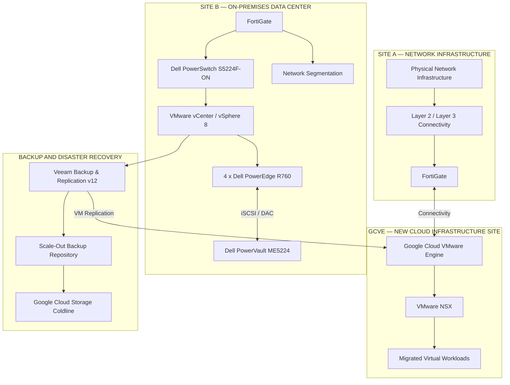

# Enterprise Data Center Modernization & Private Cloud Migration

**Infrastructure Architecture | Data Center Modernization | Hybrid Cloud | Cybersecurity | Business Continuity**

**English** | [Português](https://github.com/CarloshZeferino/datacenter-modernization-private-cloud-migration/blob/main/README.pt-BR.md)
---

## 1. Executive Summary

This project presents an enterprise infrastructure modernization initiative involving the transformation of two data center environments and the establishment of a new cloud infrastructure site, with a focus on technology evolution, security, operational resilience, business continuity, and IT governance.

The initiative involved three main components:

- **Site A — Network Infrastructure:** following the migration, the physical site remained operational exclusively to support network infrastructure and Layer 2 / Layer 3 connectivity services.
- **GCVE — New Cloud Infrastructure Site:** the entire virtualized infrastructure previously hosted at Site A was migrated to Google Cloud VMware Engine (GCVE), establishing a new workload hosting environment.
- **Site B — On-Premises Data Center:** remained operational on-premises and underwent modernization of its virtualization, compute, storage, and network infrastructure.

The project also involved improvements to security, connectivity, backup, disaster recovery, automation, monitoring, and operational governance processes.

This repository documents the architecture, technical decisions, implementation strategies, operational procedures, and outcomes of the transformation.

## 2. Transformation Overview

### 2.1 Site A — Transformation into a Network Infrastructure Site

Site A underwent a significant transformation. All virtualized infrastructure previously hosted at this location was migrated to Google Cloud VMware Engine (GCVE).

Following the migration, Site A ceased operating as a virtualized workload hosting environment and remained physically active exclusively to support network infrastructure and Layer 2 / Layer 3 connectivity services.

Key characteristics:

- Complete migration of virtualized infrastructure to GCVE.
- Retention of physical network infrastructure.
- Continuity of Layer 2 and Layer 3 connectivity services.
- FortiGate for perimeter security and connectivity.
- Connectivity to the GCVE environment.
- Removal of local virtualized workload hosting responsibilities.

The migration strategy included VMware Export/Import, RackWare, and Lift and Shift approaches, according to workload characteristics and requirements.

The transformation also included operating system vulnerability remediation and application upgrades to newer versions.

### 2.2 GCVE — New Cloud Infrastructure Site

Google Cloud VMware Engine became the new hosting environment for the virtualized infrastructure migrated from Site A.

The new environment was established to host enterprise workloads while maintaining VMware-based virtualization technologies within Google Cloud Platform.

Key components:

- Google Cloud VMware Engine (GCVE).
- VMware NSX for network microsegmentation.
- VMware HA and DRS.
- FortiGate within the perimeter security and cloud connectivity architecture.
- Workloads migrated from Site A.
- Integration with the Site B Disaster Recovery strategy.

### 2.3 Site B — On-Premises Infrastructure Modernization

Site B remained on-premises and underwent modernization of its virtualization, compute, storage, and network infrastructure.

Key components:

- VMware vSphere 8 cluster with four compute nodes.
- Dell PowerEdge R760 servers.
- VMware vCenter, HA, and DRS.
- Dell PowerVault ME5224 block storage using iSCSI connectivity.
- Direct Attached Copper (DAC) interconnections.
- Dell PowerSwitch S5224F-ON switches.
- FortiGate for VLAN-based segmentation and Layer 3 routing.
- Illumio/Guardicore solutions within the security and segmentation architecture.
- Integration with the Veeam-based Disaster Recovery strategy targeting GCVE.

## 3. High-Level Architecture

The following diagram conceptually represents the resulting architecture, highlighting the separation between the remaining network infrastructure at Site A, the new cloud hosting environment at GCVE, and the modernized on-premises data center at Site B.

*Conceptual architecture representation. It does not depict every physical component, network path, connectivity configuration, or implementation detail.*

## 4. Key Technologies

| Category | Technologies |
|---|---|
| Virtualization | VMware vSphere 8, vCenter, HA, DRS |
| Cloud | Google Cloud Platform, GCVE |
| Migration | RackWare, VMware Export/Import |
| Security | FortiGate, VMware NSX, Illumio/Guardicore |
| Compute | Dell PowerEdge R760 |
| Storage | Dell PowerVault ME5224, iSCSI |
| Networking | Dell PowerSwitch S5224F-ON, DAC, SD-WAN, BGP |
| Cloud Connectivity | Equinix Enterprise Connectivity, Google Cloud Partner Interconnect |
| Backup and DR | Veeam Backup & Replication v12 |
| Cloud Storage | Google Cloud Storage Coldline |
| Automation | Terraform, Ansible, Packer |
| Monitoring | Zabbix, Grafana |
| Security and Vulnerability Management | Tenable, ManageEngine, BeyondTrust |
| Governance | ITSM, Change Management, Azure DevOps |

## 5. Transformation Workstreams

The initiative was organized into multiple technical and operational workstreams.

### 5.1 Data Center and Cloud Modernization

Migration of workloads to GCVE, transformation of Site A into a network infrastructure site, and modernization of the on-premises environment at Site B.

### 5.2 Network Architecture and Connectivity

Implementation of redundant connectivity, SD-WAN, BGP, Equinix Enterprise Connectivity, and Google Cloud Partner Interconnect.

The architecture incorporated independent circuits, physically diverse paths, and redundant network equipment and connectivity.

### 5.3 Security and Vulnerability Management

Strengthening security controls through hardening, vulnerability management, privileged access management, microsegmentation, and change governance.

Technologies and controls included identity management, BeyondTrust, Tenable, ManageEngine, VMware NSX, and FortiGate, alongside Illumio/Guardicore solutions.

### 5.4 Backup and Disaster Recovery

Veeam architecture incorporating SOBR, Capacity Tier, Google Cloud Storage Coldline, and virtual machine replication from Site B to GCVE.

The strategy also included periodic restore tests, functional validation, and disaster recovery exercises.

### 5.5 Automation and Infrastructure as Code

Use of Terraform, Ansible, and Packer for infrastructure provisioning, configuration management, and standardization.

These tools were integrated into corporate Azure DevOps pipelines to automate infrastructure activities.

### 5.6 Operational Governance

Establishment and improvement of monitoring, incident management, change management, technical documentation, and capacity planning processes.

### 5.7 Business Continuity

Definition of recovery strategies, workload criticality classification, RPO and RTO requirements, and periodic backup restoration and disaster recovery tests.

### 5.8 Monitoring and IT Service Management

Integration of monitoring alerts with ITSM and Microsoft Teams, automatic incident creation, severity classification, and escalation according to business impact.

## 6. Project Documentation

The documentation is organized by technical domain to provide structured navigation and demonstrate the architectural decisions and operational practices used throughout the transformation.

| Area | Documentation |
|---|---|
| Architecture | [Architecture](architecture/) |
| Executive Overview | [Architecture Overview](architecture-overview/) |
| Technical Decisions | [Architecture Decisions](architecture-decisions/) |
| Governance | [Governance](governance/) |
| Security | [Security](security/) |
| Network and Connectivity | [Network](network/) |
| Backup and Recovery | [Backup](backup/) |
| Automation | [Automation](automation/) |
| Operational Procedures | [Operational Runbooks](operational-runbooks/) |
| Troubleshooting and Case Studies | [Troubleshooting](troubleshooting/) |
| Diagrams | [Diagrams](diagrams/) |
| Additional Documentation | [Docs](docs/) |

## 7. Project Leadership and Responsibilities

The initiative involved infrastructure architecture, planning, technical execution, and operational governance activities.

Key responsibilities included:

- Infrastructure architecture planning and evolution.
- Technical coordination of infrastructure modernization.
- Cloud workload migration strategy.
- Transformation of Site A into a network infrastructure site.
- Establishment of GCVE as the new workload hosting environment.
- Modernization of Site B's on-premises infrastructure.
- Definition of security and connectivity standards.
- Backup, disaster recovery, and business continuity planning.
- Infrastructure automation and Infrastructure as Code initiatives.
- Implementation of governance and change management controls.
- Risk, vulnerability, and capacity management.
- Alignment of technical solutions with business requirements.

## 8. Strategic Outcomes

The transformation established a hybrid infrastructure architecture combining a new cloud infrastructure site, a modernized on-premises data center, and the remaining physical network infrastructure at Site A.

Key outcomes:

- Complete migration of Site A's virtualized infrastructure to GCVE.
- Transformation of Site A into a network infrastructure and connectivity site.
- Establishment of GCVE as the new hosting site for migrated workloads.
- Modernization of Site B's virtualization and compute platform.
- Evolution of connectivity architecture across environments.
- Strengthening of security and network segmentation controls.
- Improvement of vulnerability management processes.
- Establishment of a Veeam-based backup and recovery strategy.
- Replication of Site B workloads to GCVE.
- Adoption of cloud storage for the Capacity Tier.
- Evolution of infrastructure automation practices.
- Strengthening of operational governance and business continuity.

## 9. About This Portfolio

This repository presents technical and architectural documentation of a real-world enterprise infrastructure modernization initiative.

The content demonstrates practical experience in infrastructure architecture, hybrid cloud, cybersecurity, virtualization, automation, business continuity, and IT governance.

Sensitive organizational information, including IP addresses, server names, credentials, internal identifiers, proprietary configurations, and confidential implementation details, has been intentionally omitted.

The objective is to demonstrate technical approaches, architectural decisions, and the ability to lead technology transformation initiatives in complex enterprise environments.
