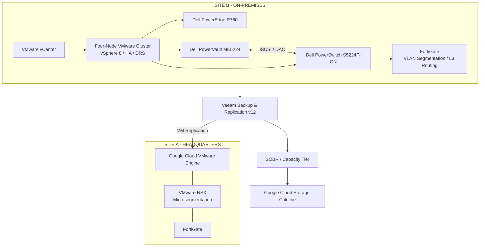

# Enterprise Data Center Modernization & Private Cloud Migration

### Infrastructure Architecture | VMware | Google Cloud VMware Engine | Cybersecurity | Business Continuity | IT Governance

**Enterprise Infrastructure Transformation | Architecture & Technical Leadership**

[English](README.md) | [Português](README.pt-BR.md)

---

## Executive Summary

This portfolio documents an enterprise infrastructure modernization and transformation initiative involving two critical data center environments.

The program combined private cloud migration, on-premises infrastructure modernization, cybersecurity improvements, business continuity, infrastructure automation, and IT governance.

The transformation addressed legacy infrastructure, virtualization modernization, hardware lifecycle, security vulnerabilities, operational standardization, and disaster recovery readiness.

The project adopted two complementary infrastructure strategies:

| Environment | Transformation Strategy | Resulting Architecture |
|---|---|---|
| **Site A – Headquarters** | Data center migration | Google Cloud VMware Engine (GCVE) |
| **Site B – Secondary Site** | On-premises infrastructure modernization | VMware vSphere 8 cluster |

The resulting architecture combined cloud-based VMware infrastructure with a modernized on-premises environment, integrated through enterprise networking, data protection, and disaster recovery processes.

## Transformation Overview

### Site A — Cloud Migration to GCVE

Site A underwent a full migration of its virtualized infrastructure to Google Cloud VMware Engine.

The migration strategy included:

- VMware Export/Import.
- RackWare migration tooling.
- Lift-and-Shift migration approaches.
- Operating system vulnerability remediation.
- Application upgrades and modernization.
- VMware NSX microsegmentation.
- FortiGate security and connectivity integration.

After migration, only the Layer 2 and Layer 3 network infrastructure remained at the physical site.

### Site B — On-Premises Infrastructure Modernization

Site B retained its on-premises infrastructure and received a modernization of its compute, storage, virtualization, and network layers.

Key components included:

- VMware vSphere 8 and vCenter.
- Four-node VMware compute cluster.
- VMware HA and DRS.
- Dell PowerEdge R760 servers.
- Dell PowerVault ME5224 block storage.
- iSCSI connectivity over DAC cabling.
- Dell PowerSwitch S5224F-ON.
- FortiGate network segmentation and Layer 3 routing.

Site B was integrated with the disaster recovery strategy through Veeam virtual machine replication to GCVE.

## High-Level Architecture

The following diagram illustrates the logical relationship between the two sites, their infrastructure models, and the disaster recovery architecture.

*Conceptual architecture diagram. It represents the documented logical architecture and does not specify physical connectivity, IP addressing, VLAN IDs, or undocumented implementation details.*

## Key Technologies

| Domain | Technologies |
|---|---|
| Virtualization | VMware vSphere 8, vCenter, HA, DRS |
| Cloud Infrastructure | Google Cloud VMware Engine, Google Cloud Platform |
| Compute | Dell PowerEdge R760 |
| Storage | Dell PowerVault ME5224 |
| Network | Dell PowerSwitch S5224F-ON, iSCSI, DAC, SD-WAN |
| Network Security | FortiGate, VMware NSX |
| Workload Security | Illumio / Guardicore |
| Migration | RackWare, VMware Export/Import, Lift and Shift |
| Backup & Recovery | Veeam Backup & Replication v12, SOBR, Capacity Tier |
| Cloud Storage | Google Cloud Storage Coldline |
| Vulnerability Management | Tenable, ManageEngine |
| Privileged Access Management | BeyondTrust |
| Monitoring | Zabbix, Grafana |
| Automation & IaC | Terraform, Ansible, Packer |
| Scripting | PowerShell, Bash |
| CI/CD | Azure DevOps |

## Transformation Workstreams

### 1. Infrastructure Assessment & Architecture

- Infrastructure inventory and technical assessment.
- Identification of hardware lifecycle risks and security vulnerabilities.
- Virtualization environment assessment.
- Architecture design and technology evaluation.
- Infrastructure dependency mapping.
- Technical documentation and modernization planning.

### 2. Cloud Migration & Private Cloud

- Migration of Site A's virtualized infrastructure to GCVE.
- VMware Export/Import and RackWare migration approaches.
- Lift-and-Shift migration strategy.
- Operating system remediation and modernization.
- Application upgrades and compatibility considerations.
- Network and security integration.

### 3. On-Premises Infrastructure Modernization

- Deployment of a four-node VMware vSphere 8 cluster.
- Dell PowerEdge R760 compute infrastructure.
- Dell PowerVault ME5224 block storage.
- iSCSI storage connectivity using DAC cabling.
- Dell PowerSwitch S5224F-ON switching infrastructure.
- FortiGate network segmentation and Layer 3 routing.
- VMware HA and DRS configuration.

### 4. Cybersecurity & Vulnerability Remediation

- VMware NSX microsegmentation at Site A.
- FortiGate VLAN segmentation at Site B.
- Illumio / Guardicore workload segmentation.
- Active Directory and role-based access controls.
- BeyondTrust Privileged Access Management.
- Multi-factor authentication and privileged account separation.
- CIS-based hardening and vendor security recommendations.
- Vulnerability assessment and remediation workflows.
- Tenable validation scans.

### 5. Backup, Recovery & Business Continuity

- Veeam Backup & Replication v12.
- Centralized backup management.
- SOBR with Capacity Tier.
- Google Cloud Storage Coldline integration.
- Site B virtual machine replication to GCVE.
- Application-based RPO and RTO objectives.
- Semiannual restore testing.
- Annual full Site B unavailability simulation.
- Technical validation and business acceptance.

### 6. Network & Connectivity

- Enterprise SD-WAN architecture.
- Equinix Enterprise Connectivity.
- Google Cloud Partner Interconnect.
- Redundant connectivity through independent circuits and physically distinct locations.
- BGP routing.
- FortiGate security and traffic control.
- Site-specific network segmentation architecture.

### 7. Infrastructure Automation & Infrastructure as Code

- Terraform for infrastructure provisioning across GCP, VMware, and on-premises environments.
- Ansible for server configuration and software installation.
- Packer for server image generation.
- Azure DevOps pipelines for infrastructure automation.
- PowerShell and Bash operational automation.

### 8. IT Governance, Monitoring & Operations

- Infrastructure monitoring with Zabbix and Grafana.
- Native vendor monitoring integrations.
- ITSM incident management integration with Microsoft Teams.
- Incident severity and priority classification.
- SLA management and incident escalation.
- Change Management and approval workflows.
- Annual infrastructure capacity planning.
- Technical documentation and operational runbooks.

---

## Project Documentation

The repository is organized by technical domain. Each documentation area is intended to provide architecture context, technical decisions, implementation practices, and operational considerations.

| Documentation Area | Scope |
|---|---|
| [Architecture Overview](architecture-overview/) | Executive architecture and transformation overview |
| [Architecture Decisions](architecture-decisions/) | Technical decisions, rationale, and outcomes |
| [Architecture](architecture/) | Infrastructure architecture documentation |
| [Network](network/) | Network connectivity and architecture |
| [Backup](backup/) | Veeam backup and infrastructure topology |
| [Security](security/) | Infrastructure security and hardening |
| [Automation](automation/) | Infrastructure automation and IaC |
| [Governance](governance/) | Operational governance and controls |
| [Operational Runbooks](operational-runbooks/) | Technical procedures and operational runbooks |
| [Troubleshooting](troubleshooting/) | Technical challenges, remediation, and case studies |
| [Diagrams](diagrams/) | Architecture and infrastructure diagrams |
| [Additional Documentation](docs/) | Supporting technical documentation |

### Featured Technical Documents

- [Executive Architecture Overview](architecture-overview/executive-architecture-overview.md)
- [Veeam Backup Architecture](backup/veeam-backup-architecture.md)
- [Veeam Infrastructure Topology](backup/veeam-infrastructure-topology.md)
- [Network & Connectivity Architecture](network/network-connectivity-architecture.md)
- [Infrastructure Automation & IaC](automation/infrastructure-automation-iac.md)
- [Infrastructure Security & Hardening](security/infrastructure-security-hardening.md)
- [Operational Governance](governance/operational-governance.md)
- [Technical Procedures & Operational Runbooks](operational-runbooks/technical-procedures-runbooks.md)

## Project Leadership & Responsibilities

The transformation involved technical and architectural leadership across the infrastructure modernization lifecycle.

Key areas of responsibility included:

- Infrastructure assessment and risk identification.
- Target architecture design and technology evaluation.
- Technical benchmarking and solution selection.
- Business case development and executive budget presentations.
- Migration strategy and execution planning.
- Infrastructure modernization and cloud integration.
- Cybersecurity improvements and vulnerability remediation.
- Backup, recovery, and business continuity strategy.
- IT governance and operational process implementation.
- Cross-functional coordination and transition to operations.

## Strategic Outcomes

The transformation established two complementary infrastructure platforms and strengthened the organization's infrastructure capabilities.

Key outcomes included:

- Migration of Site A's virtualized infrastructure to GCVE.
- Modernization of Site B's on-premises VMware infrastructure.
- Standardized virtualization management and infrastructure operations.
- Improved network segmentation and security controls.
- Structured vulnerability remediation and hardening processes.
- Integrated backup, cloud capacity tier, and disaster recovery capabilities.
- Defined recovery priorities based on business criticality.
- Recurring restore testing and disaster recovery validation.
- Infrastructure automation and operational governance improvements.

## About This Portfolio

This repository is a technical portfolio documenting enterprise infrastructure architecture, modernization, cloud migration, cybersecurity, automation, and operational governance experience.

The case study is based on professional project experience in an anonymized enterprise environment.

Confidential organizational information, sensitive infrastructure details, credentials, IP addresses, and proprietary configurations have been intentionally excluded.

The documentation focuses on architectural decisions, technology selection, implementation approaches, operational practices, and lessons learned.

---

**Areas of Expertise:** Enterprise Infrastructure | Cloud Architecture | VMware | Google Cloud | Cybersecurity | Disaster Recovery | Infrastructure Automation | IT Governance
