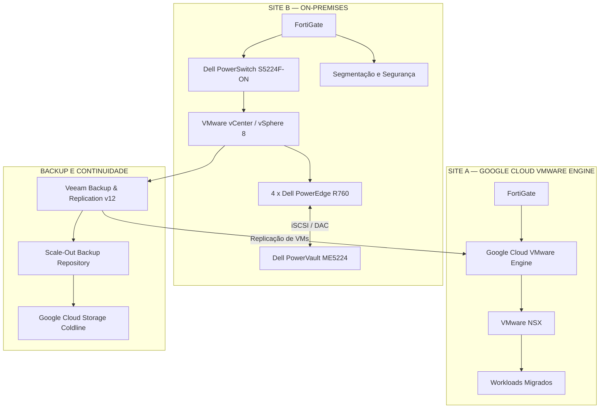

# Modernização de Data Center Corporativo e Migração para Private Cloud

**Arquitetura de Infraestrutura | Modernização de Data Center | Cloud | Segurança | Continuidade de Negócios**

[English Version](README.md) | **Português**

---

## 1. Resumo Executivo

Este projeto apresenta uma iniciativa de modernização de infraestrutura corporativa, envolvendo a transformação de dois ambientes de data center, com foco em evolução tecnológica, segurança, resiliência operacional, continuidade de negócios e governança de TI.

A iniciativa contemplou a migração integral da infraestrutura virtualizada do **Site A para o Google Cloud VMware Engine (GCVE)** e a modernização do **Site B**, que permaneceu em ambiente on-premises, com uma nova arquitetura VMware baseada em hardware Dell.

O projeto também envolveu a evolução dos processos de segurança, conectividade, backup, disaster recovery, automação, monitoramento e governança operacional.

A documentação apresenta decisões arquiteturais, tecnologias utilizadas, estratégias de implementação, procedimentos técnicos e resultados da transformação.

## 2. Visão Geral da Transformação

### Site A — Migração para Google Cloud VMware Engine

Toda a infraestrutura virtualizada do Site A foi migrada para o Google Cloud VMware Engine (GCVE).

A estratégia de migração envolveu abordagens de VMware Export/Import, RackWare e Lift and Shift, considerando as características e necessidades dos workloads.

Principais componentes:

- Migração da infraestrutura virtualizada para GCVE.
- VMware NSX para microsegmentação de rede.
- FortiGate para segurança de perímetro e conectividade.
- VMware HA e DRS para disponibilidade e balanceamento de recursos.
- Correção de vulnerabilidades nos sistemas operacionais.
- Atualização e migração de aplicações para versões mais recentes.
- Manutenção dos componentes de conectividade L2 e L3 no site físico.

### Site B — Modernização da Infraestrutura On-Premises

O Site B permaneceu em ambiente on-premises, passando por uma modernização de sua infraestrutura de virtualização, computação, armazenamento e rede.

Principais componentes:

- Cluster VMware vSphere 8 com quatro nós de computação.
- Servidores Dell PowerEdge R760.
- VMware vCenter, HA e DRS.
- Storage Dell PowerVault ME5224 com conectividade iSCSI.
- Interconexão por cabos DAC.
- Switches Dell PowerSwitch S5224F-ON.
- FortiGate para segmentação por VLANs e roteamento L3.
- Soluções Illumio/Guardicore no contexto de segurança e segmentação.
- Integração com a estratégia de Disaster Recovery baseada em Veeam e GCVE.

## 3. Arquitetura de Alto Nível

O diagrama abaixo representa conceitualmente a arquitetura resultante da transformação.

*Representação conceitual. Não representa todos os componentes físicos, caminhos de rede ou detalhes de conectividade.*

## 4. Principais Tecnologias

| Categoria | Tecnologias |
|---|---|
| Virtualização | VMware vSphere 8, vCenter, HA, DRS |
| Cloud | Google Cloud Platform, GCVE |
| Migração | RackWare, VMware Export/Import |
| Segurança | FortiGate, VMware NSX, Illumio/Guardicore |
| Computação | Dell PowerEdge R760 |
| Armazenamento | Dell PowerVault ME5224, iSCSI |
| Rede | Dell PowerSwitch S5224F-ON, DAC, SD-WAN, BGP |
| Backup e DR | Veeam Backup & Replication v12 |
| Cloud Storage | Google Cloud Storage Coldline |
| Automação | Terraform, Ansible, Packer |
| Monitoramento | Zabbix, Grafana |
| Segurança e Vulnerabilidades | Tenable, ManageEngine, BeyondTrust |
| Governança | ITSM, Change Management, Azure DevOps |

## 5. Frentes de Trabalho da Transformação

A iniciativa foi organizada em diferentes frentes técnicas e operacionais:

### 5.1 Modernização de Data Center e Cloud

Migração de workloads para GCVE, modernização do ambiente on-premises e evolução da arquitetura de infraestrutura.

### 5.2 Arquitetura de Rede e Conectividade

Implementação de conectividade redundante, SD-WAN, BGP, Equinix Enterprise Connectivity e Google Cloud Partner Interconnect.

### 5.3 Segurança e Gestão de Vulnerabilidades

Fortalecimento dos controles de segurança, hardening, gestão de vulnerabilidades, controle de acesso privilegiado, microsegmentação e governança de mudanças.

### 5.4 Backup e Disaster Recovery

Arquitetura Veeam com SOBR, Capacity Tier, Google Cloud Storage Coldline e replicação de máquinas virtuais do Site B para GCVE.

### 5.5 Automação e Infrastructure as Code

Uso de Terraform, Ansible e Packer para provisionamento, configuração e padronização de infraestrutura.

### 5.6 Governança Operacional

Estruturação de processos de monitoramento, incidentes, mudanças, documentação técnica e planejamento de capacidade.

### 5.7 Continuidade de Negócios

Definição de estratégias de recuperação, classificação de criticidade, RPO, RTO e testes periódicos de restauração e recuperação.

### 5.8 Monitoramento e Gestão de Serviços

Integração de alertas com ITSM e Microsoft Teams, abertura automática de incidentes, classificação de severidade e escalonamento conforme impacto.

## 6. Documentação Técnica do Projeto

A documentação está organizada por domínio técnico para facilitar a navegação e demonstrar as decisões e práticas utilizadas durante a transformação.

| Área | Documentação |
|---|---|
| Arquitetura | [Architecture](architecture/) |
| Visão executiva | [Architecture Overview](architecture-overview/) |
| Decisões técnicas | [Architecture Decisions](architecture-decisions/) |
| Governança | [Governance](governance/) |
| Segurança | [Security](security/) |
| Rede e conectividade | [Network](network/) |
| Backup e recuperação | [Backup](backup/) |
| Automação | [Automation](automation/) |
| Procedimentos operacionais | [Operational Runbooks](operational-runbooks/) |
| Troubleshooting e estudos de caso | [Troubleshooting](troubleshooting/) |
| Diagramas | [Diagrams](diagrams/) |
| Documentação complementar | [Docs](docs/) |

## 7. Liderança e Responsabilidades no Projeto

A iniciativa envolveu atividades de arquitetura, planejamento, execução técnica e governança de infraestrutura.

Entre as principais responsabilidades estão:

- Planejamento e evolução da arquitetura de infraestrutura.
- Coordenação técnica da modernização dos ambientes.
- Estratégia de migração de workloads para cloud.
- Modernização da infraestrutura on-premises.
- Definição de padrões de segurança e conectividade.
- Planejamento de backup, disaster recovery e continuidade de negócios.
- Evolução dos processos de automação e Infrastructure as Code.
- Implementação de controles de governança e gestão de mudanças.
- Acompanhamento de riscos, vulnerabilidades e capacidade.
- Alinhamento das soluções técnicas com as necessidades do negócio.

## 8. Resultados Estratégicos

A transformação estabeleceu uma arquitetura híbrida, combinando infraestrutura em cloud e ambiente on-premises modernizado.

Principais resultados:

- Migração integral da infraestrutura virtualizada do Site A para GCVE.
- Modernização da plataforma de virtualização e computação do Site B.
- Evolução da arquitetura de conectividade entre ambientes.
- Fortalecimento dos controles de segurança e segmentação.
- Aprimoramento dos processos de gestão de vulnerabilidades.
- Estruturação de uma estratégia de backup e recuperação com Veeam.
- Replicação de workloads do Site B para GCVE.
- Utilização de armazenamento em cloud para Capacity Tier.
- Evolução da automação de infraestrutura.
- Fortalecimento da governança operacional e da continuidade de negócios.

## 9. Sobre Este Portfólio

Este repositório apresenta uma documentação técnica e arquitetural de uma iniciativa real de modernização de infraestrutura corporativa.

O conteúdo foi estruturado para demonstrar experiência prática em arquitetura de infraestrutura, cloud híbrida, segurança, virtualização, automação, continuidade de negócios e governança de TI.

Informações sensíveis da organização, como endereços IP, nomes de servidores, credenciais, identificadores internos, configurações proprietárias e detalhes confidenciais, foram omitidas.

O objetivo é demonstrar a abordagem técnica, as decisões arquiteturais e a capacidade de conduzir iniciativas de transformação tecnológica em ambientes corporativos complexos.
