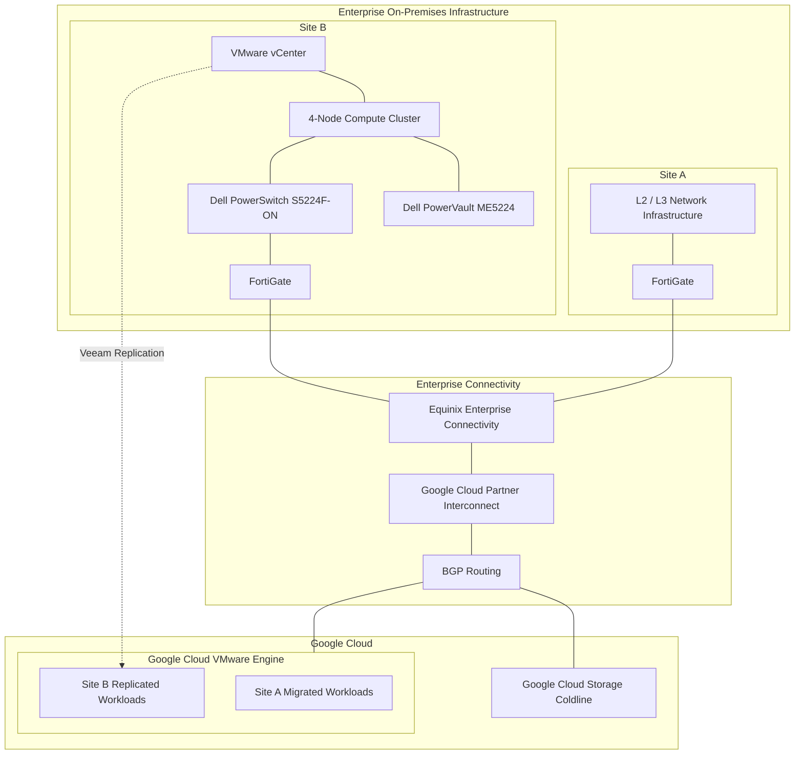

# Executive Architecture Overview

## 1. Purpose

This document provides a consolidated architectural overview of the enterprise infrastructure modernization initiative.

It describes the relationship between the two infrastructure sites, Google Cloud VMware Engine (GCVE), enterprise connectivity, backup and disaster recovery, security, monitoring, and infrastructure automation.

The architecture reflects the implemented environment and the technical decisions documented in the individual architecture chapters.

## 2. Executive Summary

The modernization initiative established a hybrid infrastructure architecture combining Google Cloud VMware Engine and an on-premises VMware environment.

The resulting architecture has two distinct infrastructure sites:

- **Site A:** Its entire virtualized infrastructure was migrated to Google Cloud VMware Engine. Only the Layer 2 and Layer 3 network infrastructure remained at the original physical site.
- **Site B:** Retained as an on-premises VMware environment, based on a four-node compute cluster and Dell block storage.
- **Google Cloud VMware Engine:** Hosts the migrated Site A workloads and provides the disaster recovery destination for Site B virtual machine replication.

The architecture is supported by redundant enterprise connectivity, centralized backup management, cloud-based backup capacity, network segmentation, privileged access controls, monitoring, and infrastructure automation.

## 3. High-Level Architecture

<small>Conceptual architecture diagram. It illustrates logical relationships and does not represent exact physical cabling, routing, VLANs, IP addressing, or circuit termination details.</small>

## 4. Infrastructure Architecture

### 4.1 Site A — Migrated Infrastructure

Site A's virtualized infrastructure was fully migrated to Google Cloud VMware Engine.

The migration combined VMware Export/Import, RackWare, and Lift-and-Shift approaches, alongside operating system vulnerability remediation and application upgrades where required.

Key architectural characteristics:

- VMware workloads hosted in GCVE.
- VMware NSX used for workload microsegmentation.
- FortiGate used for perimeter security and connectivity.
- Original physical site retained L2/L3 network infrastructure.

### 4.2 Site B — On-Premises VMware Infrastructure

Site B remained an on-premises VMware environment.

Its architecture includes:

- VMware vCenter.
- Four-node compute and memory cluster.
- VMware HA and DRS.
- Dell PowerVault ME5224 block storage.
- iSCSI connectivity using DAC cabling.
- Dell PowerSwitch S5224F-ON.
- FortiGate for VLAN segmentation and Layer 3 routing.

This environment continues to host local workloads and participates in the enterprise disaster recovery architecture.

### 4.3 Google Cloud VMware Engine

GCVE plays two important architectural roles:

1. Hosting the virtualized infrastructure migrated from Site A.
2. Providing the recovery destination for Site B virtual machine replication.

This creates an architecture in which the cloud VMware environment supports both production workloads and disaster recovery capabilities.

## 5. Enterprise Connectivity

Connectivity between the enterprise infrastructure and Google Cloud uses Equinix Enterprise Connectivity and Google Cloud Partner Interconnect.

The connectivity design includes:

- Two independent circuits.
- Physically diverse circuit locations.
- Redundant equipment and network paths.
- BGP routing.
- FortiGate firewalls at both sites.

Internet and Google Cloud connectivity are integrated through the FortiGate infrastructure at both sites.

## 6. Backup and Disaster Recovery

### 6.1 Backup Architecture

The backup environment uses Veeam Backup & Replication v12.

Its architecture includes:

- Veeam Backup Server at Site A.
- Veeam Backup Proxy at Site B.
- Local backup repositories.
- Scale-Out Backup Repository (SOBR).
- Capacity Tier.
- Google Cloud Storage Coldline.

The Capacity Tier strategy moves backup data to cloud object storage.

### 6.2 Disaster Recovery Architecture

Site B virtual machines are replicated through Veeam to GCVE.

Recovery validation includes:

- Periodic restore and recovery exercises.
- Individual virtual machine and application restoration.
- Instant VM Recovery and Full VM Restore procedures.
- Annual simulation of a total Site B outage.

Recovery objectives are defined according to business and workload criticality, using Tier 0, Tier 1, Tier 2, and Tier 3 classifications.

## 7. Security Architecture

Security controls are implemented across identity, privileged access, infrastructure configuration, vulnerability management, and change governance.

Key components include:

- Active Directory for centralized authentication and access groups.
- Role-Based Access Control (RBAC).
- Administrative access tiers 0, 1, and 2.
- Multi-Factor Authentication (MFA).
- BeyondTrust Privileged Access Management (PAM).
- Password vaulting and privileged session recording.
- CIS Benchmarks and internal hardening policies.
- Tenable vulnerability scanning.
- ManageEngine patch management processes.
- Formal change management and rollback procedures.

## 8. Monitoring and Operational Management

Infrastructure monitoring combines Zabbix, Grafana, and native vendor monitoring capabilities.

Monitoring covers:

- CPU and memory utilization.
- VMware hosts and virtual machines.
- Storage capacity and latency.
- Network links and devices.
- Infrastructure services.
- Applications and databases.

Alerts are integrated with the ITSM interface and Microsoft Teams.

Incident tickets are automatically opened and classified, with severity and priority levels 0, 1, 2, and 3. Escalation workflows and service-level agreements support incident response and resolution.

Capacity planning is performed annually, covering compute, memory, storage, backup capacity, utilization trends, and potential infrastructure bottlenecks.

## 9. Infrastructure Automation

Infrastructure automation is implemented using a multi-tool approach:

| Technology | Architectural Responsibility |
|---|---|
| Terraform | Infrastructure provisioning across GCP, VMware, and on-premises environments |
| Ansible | Server configuration and software installation |
| Packer | Server image creation |
| Azure DevOps | Corporate automation pipelines |
| PowerShell | Windows Server and Active Directory automation |
| Bash | Linux administration and automation |

Azure DevOps pipelines automatically execute Terraform, Ansible, and Packer workflows.

## 10. Architectural Outcomes

The implemented architecture established:

- A fully migrated Site A virtualized environment hosted in GCVE.
- A retained on-premises VMware environment at Site B.
- Cloud-based disaster recovery for Site B workloads.
- Local and cloud-based backup storage integration.
- Redundant enterprise connectivity to Google Cloud.
- Site-specific network segmentation.
- Centralized privileged access and infrastructure security controls.
- Integrated monitoring and incident management.
- Automated infrastructure provisioning and configuration.

## 11. Documentation Boundaries

This overview represents the confirmed logical architecture.

It does not specify physical network diagrams, IP addressing, VLAN identifiers, BGP autonomous system numbers, circuit bandwidth, firewall rule sets, exact storage capacity, or measured availability and recovery metrics.

Those details should be documented in their respective technical design documents when validated project information is available.

## 12. Related Architecture Documents

- Operational Governance.
- Veeam Backup Architecture.
- Veeam Infrastructure Topology.
- Network and Connectivity Architecture.
- Infrastructure Automation and IaC.
- Infrastructure Security and Hardening.
- Architecture Decisions and Technical Outcomes.
