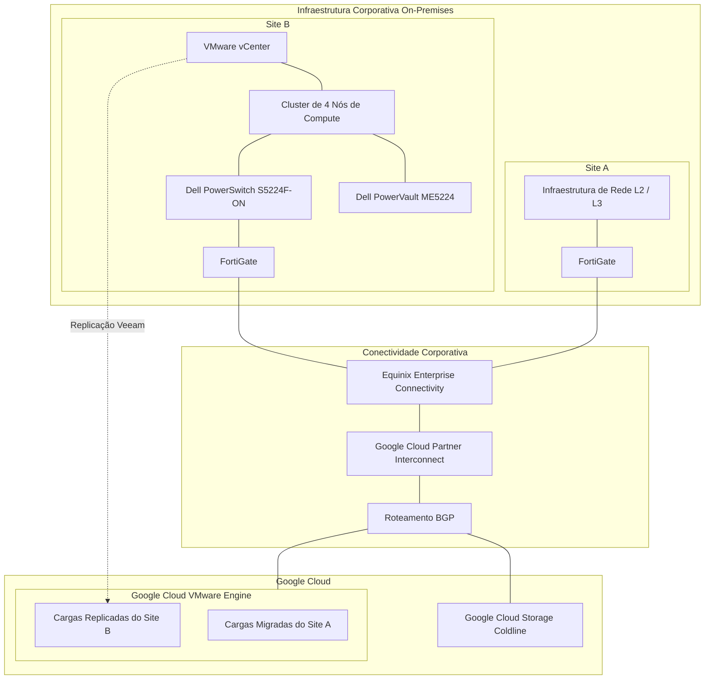

# Visão Executiva da Arquitetura de Infraestrutura

## 1. Objetivo

Este documento apresenta uma visão consolidada da arquitetura da iniciativa de modernização da infraestrutura corporativa.

Ele descreve o relacionamento entre os dois sites de infraestrutura, o Google Cloud VMware Engine (GCVE), a conectividade corporativa, backup e disaster recovery, segurança, monitoramento e automação de infraestrutura.

A arquitetura representa o ambiente implementado e as decisões técnicas documentadas nos capítulos específicos do portfólio.

## 2. Resumo Executivo

A iniciativa de modernização estabeleceu uma arquitetura híbrida, combinando Google Cloud VMware Engine e um ambiente VMware on-premises.

A arquitetura resultante possui dois sites de infraestrutura distintos:

- **Site A:** toda a infraestrutura virtualizada foi migrada para o Google Cloud VMware Engine. Somente a infraestrutura de rede Layer 2 e Layer 3 permaneceu no site físico original.
- **Site B:** mantido como ambiente VMware on-premises, baseado em um cluster de quatro nós de processamento e storage block Dell.
- **Google Cloud VMware Engine:** hospeda as cargas de trabalho migradas do Site A e fornece o destino de recuperação para a replicação das máquinas virtuais do Site B.

A arquitetura é suportada por conectividade corporativa redundante, gerenciamento centralizado de backup, armazenamento de backup em cloud, segmentação de rede, controles de acesso privilegiado, monitoramento e automação de infraestrutura.

## 3. Arquitetura de Alto Nível

<small>Diagrama conceitual da arquitetura. Representa relacionamentos lógicos e não representa cabeamento físico, roteamento, VLANs, endereçamento IP ou detalhes exatos de terminação dos circuitos.</small>

## 4. Arquitetura de Infraestrutura

### 4.1 Site A — Infraestrutura Migrada

Toda a infraestrutura virtualizada do Site A foi migrada para o Google Cloud VMware Engine.

A migração combinou VMware Export/Import, RackWare e estratégias Lift-and-Shift, juntamente com correção de vulnerabilidades dos sistemas operacionais e atualização de aplicações quando necessário.

Principais características arquiteturais:

- Cargas VMware hospedadas no GCVE.
- VMware NSX utilizado para microsegmentação das cargas de trabalho.
- FortiGate utilizado para segurança de perímetro e conectividade.
- Infraestrutura física original mantendo a rede L2/L3.

### 4.2 Site B — Infraestrutura VMware On-Premises

O Site B permaneceu como ambiente VMware on-premises.

Sua arquitetura inclui:

- VMware vCenter.
- Cluster de quatro nós de processamento e memória.
- VMware HA e DRS.
- Storage block Dell PowerVault ME5224.
- Conectividade iSCSI utilizando cabeamento DAC.
- Dell PowerSwitch S5224F-ON.
- FortiGate para segmentação por VLANs e roteamento Layer 3.

Esse ambiente continua hospedando cargas de trabalho locais e participa da arquitetura corporativa de disaster recovery.

### 4.3 Google Cloud VMware Engine

O GCVE possui dois papéis importantes na arquitetura:

1. Hospedar a infraestrutura virtualizada migrada do Site A.
2. Disponibilizar o destino de recuperação para a replicação das máquinas virtuais do Site B.

Isso estabelece uma arquitetura na qual o ambiente VMware em cloud suporta tanto cargas de produção quanto recursos de recuperação de desastres.

## 5. Conectividade Corporativa

A conectividade entre a infraestrutura corporativa e o Google Cloud utiliza Equinix Enterprise Connectivity e Google Cloud Partner Interconnect.

O projeto de conectividade inclui:

- Dois circuitos independentes.
- Circuitos em localidades físicas distintas.
- Equipamentos e caminhos de rede redundantes.
- Roteamento BGP.
- Firewalls FortiGate nos dois sites.

A conectividade com a Internet e com o Google Cloud é integrada por meio da infraestrutura FortiGate em ambos os sites.

## 6. Backup e Disaster Recovery

### 6.1 Arquitetura de Backup

O ambiente de backup utiliza Veeam Backup & Replication v12.

Sua arquitetura inclui:

- Veeam Backup Server no Site A.
- Veeam Backup Proxy no Site B.
- Repositórios locais de backup.
- Scale-Out Backup Repository (SOBR).
- Capacity Tier.
- Google Cloud Storage Coldline.

A estratégia de Capacity Tier realiza a movimentação dos dados de backup para armazenamento de objetos em cloud.

### 6.2 Arquitetura de Disaster Recovery

As máquinas virtuais do Site B são replicadas pelo Veeam para o GCVE.

A validação da recuperação inclui:

- Exercícios periódicos de restore e recuperação.
- Restauração individual de máquinas virtuais e aplicações.
- Procedimentos de Instant VM Recovery e Full VM Restore.
- Simulação anual de indisponibilidade total do Site B.

Os objetivos de recuperação são definidos conforme a criticidade do negócio e das cargas de trabalho, utilizando as classificações Tier 0, Tier 1, Tier 2 e Tier 3.

## 7. Arquitetura de Segurança

Os controles de segurança são implementados nas camadas de identidade, acesso privilegiado, configuração da infraestrutura, gerenciamento de vulnerabilidades e governança de mudanças.

Os principais componentes incluem:

- Active Directory para autenticação centralizada e grupos de acesso.
- Role-Based Access Control (RBAC).
- Níveis administrativos 0, 1 e 2.
- Autenticação Multifator (MFA).
- BeyondTrust Privileged Access Management (PAM).
- Cofre de senhas e gravação de sessões privilegiadas.
- CIS Benchmarks e políticas internas de hardening.
- Varredura de vulnerabilidades com Tenable.
- Processos de gerenciamento de patches com ManageEngine.
- Gerenciamento formal de mudanças e procedimentos de rollback.

## 8. Monitoramento e Gestão Operacional

O monitoramento da infraestrutura combina Zabbix, Grafana e recursos nativos de monitoramento dos fabricantes.

O monitoramento contempla:

- Utilização de CPU e memória.
- Hosts VMware e máquinas virtuais.
- Capacidade e latência de storage.
- Links e equipamentos de rede.
- Serviços de infraestrutura.
- Aplicações e bancos de dados.

Os alertas são integrados à interface do ITSM e ao Microsoft Teams.

Chamados de incidentes são abertos e classificados automaticamente, utilizando níveis de severidade e prioridade 0, 1, 2 e 3. Os fluxos de escalonamento e os SLAs apoiam o atendimento e a resolução dos incidentes.

O planejamento de capacidade é realizado anualmente, contemplando processamento, memória, armazenamento, capacidade de backup, tendências de utilização e possíveis gargalos da infraestrutura.

## 9. Automação de Infraestrutura

A automação de infraestrutura é implementada por meio de uma abordagem baseada em múltiplas ferramentas:

| Tecnologia | Responsabilidade Arquitetural |
|---|---|
| Terraform | Provisionamento de infraestrutura em GCP, VMware e ambientes on-premises |
| Ansible | Configuração de servidores e instalação de softwares |
| Packer | Criação de imagens de servidores |
| Azure DevOps | Pipelines corporativos de automação |
| PowerShell | Automação de Windows Server e Active Directory |
| Bash | Administração e automação Linux |

Os pipelines do Azure DevOps executam automaticamente os fluxos de Terraform, Ansible e Packer.

## 10. Resultados Arquiteturais

A arquitetura implementada estabeleceu:

- Ambiente virtualizado do Site A integralmente migrado e hospedado no GCVE.
- Ambiente VMware on-premises mantido no Site B.
- Disaster recovery em cloud para as cargas de trabalho do Site B.
- Integração entre armazenamento local e armazenamento de backup em cloud.
- Conectividade corporativa redundante com o Google Cloud.
- Segmentação de rede específica para cada site.
- Controles centralizados de acesso privilegiado e segurança da infraestrutura.
- Monitoramento integrado e gestão de incidentes.
- Provisionamento e configuração automatizados da infraestrutura.

## 11. Limites da Documentação

Esta visão representa a arquitetura lógica confirmada.

Ela não especifica diagramas físicos de rede, endereçamento IP, identificadores de VLAN, números de sistemas autônomos BGP, largura de banda dos circuitos, regras de firewall, capacidade exata de armazenamento ou métricas medidas de disponibilidade e recuperação.

Esses detalhes deverão ser documentados nos respectivos documentos de desenho técnico quando houver informações validadas do projeto.

## 12. Documentos Relacionados

- Governança Operacional.
- Arquitetura de Backup Veeam.
- Topologia da Infraestrutura Veeam.
- Arquitetura de Rede e Conectividade.
- Automação de Infraestrutura e IaC.
- Segurança e Hardening da Infraestrutura.
- Decisões de Arquitetura e Resultados Técnicos.
