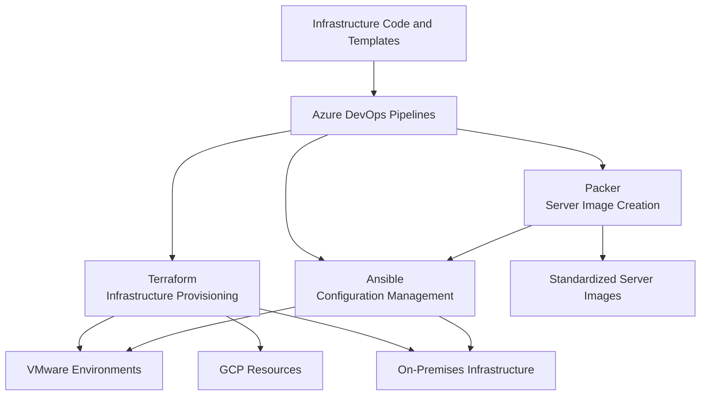

# Infrastructure Automation and Infrastructure as Code

## 1. Overview

Infrastructure automation was adopted to standardize provisioning, configuration, and server image creation across infrastructure environments.

The automation strategy combined Infrastructure as Code (IaC), configuration management, image building, and CI/CD pipelines.

The main technologies used were:

- **Terraform:** infrastructure provisioning.
- **Ansible:** server configuration and software installation.
- **Packer:** server image creation.
- **Azure DevOps:** CI/CD pipeline orchestration.
- **PowerShell:** automation of Windows Server and Active Directory administrative tasks.
- **Bash:** automation of Linux administrative tasks.

## 2. Automation Architecture

The automation workflow integrated infrastructure provisioning, configuration management, and image generation through Azure DevOps pipelines.

*Conceptual representation of the automation toolchain. The diagram does not imply that every pipeline executed all tools or targeted every environment.*

## 3. Infrastructure Provisioning with Terraform

Terraform was used to provision infrastructure resources across different environments, including:

- VMware environments.
- Google Cloud Platform resources.
- On-premises infrastructure.

The use of Terraform supported a more consistent and repeatable provisioning approach, reducing dependence on manual configuration activities.

Infrastructure definitions were maintained as code and executed through automated pipelines.

## 4. Configuration Management with Ansible

Ansible was used to automate server configuration and software installation.

Its activities included:

- Server configuration.
- Software installation.
- Standardization of server settings.
- Automation of repeatable configuration tasks.

Ansible was also used in conjunction with Packer during server image generation workflows.

This approach helped establish repeatable configuration processes and reduce manual intervention.

## 5. Server Image Creation with Packer

Packer was used to generate server images.

Ansible was integrated into the image generation process to apply server configurations and install required software.

The combination supported a standardized approach to preparing server images for infrastructure deployment.

## 6. CI/CD Automation with Azure DevOps

Azure DevOps was the corporate platform used to orchestrate infrastructure automation pipelines.

The pipelines executed Terraform, Ansible, and Packer automatically as part of infrastructure automation workflows.

This enabled infrastructure operations to be organized into repeatable execution processes.

The automation workflow supported:

- Automated execution of infrastructure provisioning.
- Automated server configuration.
- Automated server image generation.
- Standardized execution of infrastructure automation tasks.

GitHub was used for personal laboratory projects, while Azure DevOps was used in the corporate environment.

## 7. Scripting and Administrative Automation

In addition to IaC and configuration management tools, scripting was used to automate administrative activities.

| Technology | Automation Scope |
|---|---|
| PowerShell | Windows Server and Active Directory administrative routines |
| Bash | Linux administrative routines |

These scripts complemented Terraform and Ansible by automating operational tasks that were not limited to infrastructure provisioning.

## 8. Key Architecture Decisions

| Decision | Technical rationale |
|---|---|
| Terraform | Define and provision infrastructure through code |
| Ansible | Standardize server configuration and software installation |
| Packer | Generate standardized server images |
| Azure DevOps | Orchestrate automated infrastructure pipelines |
| PowerShell | Automate Windows Server and Active Directory routines |
| Bash | Automate Linux administrative routines |
| Combined automation toolchain | Integrate provisioning, configuration, and image generation |

## 9. Architecture Outcomes

The automation strategy provided:

- Repeatable infrastructure provisioning.
- Standardized server configuration.
- Automated software installation.
- Standardized server image generation.
- Automated execution of infrastructure workflows through Azure DevOps.
- Reduced dependence on repetitive manual administration.
- A consistent automation approach across VMware, GCP, and on-premises environments.

## 10. Scope and Technical Accuracy

This document describes the confirmed automation technologies and their roles.

The following implementation details are intentionally not specified:

- Exact Terraform providers, modules, and state backend configuration.
- Ansible inventory structure, roles, and playbooks.
- Packer builders and image formats.
- Azure DevOps pipeline YAML definitions and stage structure.
- Approval gates, secrets management, and deployment controls.
- Specific automation metrics and time savings.

These details can be added when the corresponding technical records are available.
