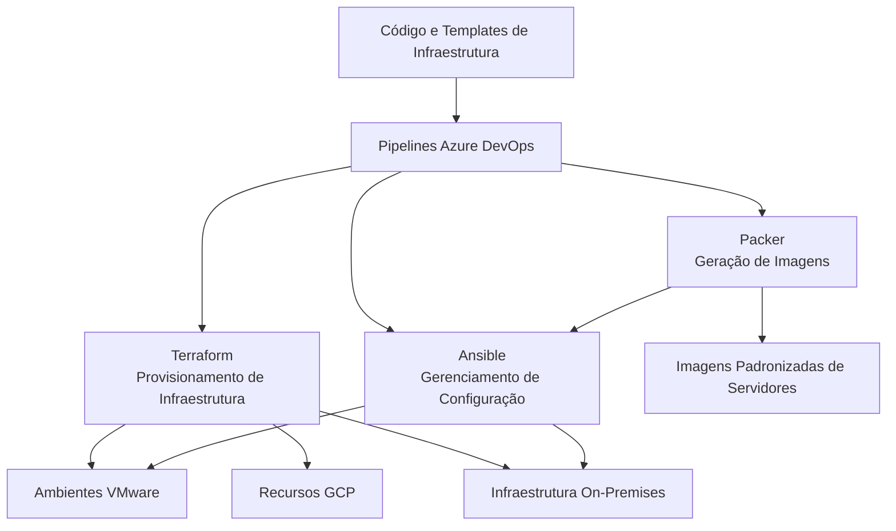
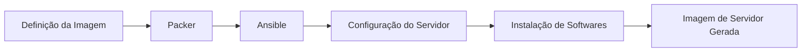

# Automação de Infraestrutura e Infrastructure as Code

## 1. Visão Geral

A automação de infraestrutura foi adotada para padronizar as atividades de provisionamento, configuração e geração de imagens de servidores nos diferentes ambientes de infraestrutura.

A estratégia combinava Infrastructure as Code (IaC), gerenciamento de configuração, geração de imagens e pipelines de CI/CD.

As principais tecnologias utilizadas foram:

- **Terraform:** provisionamento de infraestrutura.
- **Ansible:** configuração de servidores e instalação de softwares.
- **Packer:** geração de imagens de servidores.
- **Azure DevOps:** orquestração de pipelines de CI/CD.
- **PowerShell:** automação de atividades administrativas em Windows Server e Active Directory.
- **Bash:** automação de atividades administrativas em Linux.

## 2. Arquitetura de Automação

O fluxo de automação integrava provisionamento de infraestrutura, gerenciamento de configuração e geração de imagens por meio de pipelines do Azure DevOps.

*Representação conceitual do conjunto de ferramentas de automação. O diagrama não pressupõe que todos os pipelines executavam todas as ferramentas ou atuavam em todos os ambientes.*

## 3. Provisionamento de Infraestrutura com Terraform

O Terraform era utilizado para provisionar recursos de infraestrutura em diferentes ambientes, incluindo:

- Ambientes VMware.
- Recursos do Google Cloud Platform.
- Infraestrutura on-premises.

A utilização do Terraform permitia adotar uma abordagem mais consistente e repetível de provisionamento, reduzindo a dependência de atividades manuais de configuração.

As definições de infraestrutura eram mantidas como código e executadas por meio de pipelines automatizados.

## 4. Gerenciamento de Configuração com Ansible

O Ansible era utilizado para automatizar a configuração de servidores e a instalação de softwares.

Suas atividades incluíam:

- Configuração de servidores.
- Instalação de softwares.
- Padronização das configurações dos servidores.
- Automação de tarefas repetitivas de configuração.

O Ansible também era utilizado em conjunto com o Packer nos processos de geração de imagens de servidores.

Essa abordagem contribuía para estabelecer processos de configuração repetíveis e reduzir intervenções manuais.

## 5. Geração de Imagens de Servidores com Packer

O Packer era utilizado para gerar imagens de servidores.

O Ansible era integrado ao processo de geração das imagens para aplicar configurações aos servidores e instalar os softwares necessários.

A combinação permitia estabelecer uma abordagem padronizada para preparar imagens de servidores destinadas à implantação na infraestrutura.

## 6. Automação de CI/CD com Azure DevOps

O Azure DevOps era a plataforma corporativa utilizada para orquestrar os pipelines de automação de infraestrutura.

Os pipelines executavam Terraform, Ansible e Packer automaticamente como parte dos fluxos de automação.

Isso permitia organizar as operações de infraestrutura em processos de execução repetíveis.

Os fluxos de automação suportavam:

- Execução automatizada do provisionamento de infraestrutura.
- Configuração automatizada de servidores.
- Geração automatizada de imagens de servidores.
- Execução padronizada das tarefas de automação de infraestrutura.

O GitHub era utilizado nos laboratórios pessoais, enquanto o Azure DevOps era utilizado no ambiente corporativo.

## 7. Scripts e Automação Administrativa

Além das ferramentas de IaC e gerenciamento de configuração, scripts eram utilizados para automatizar atividades administrativas.

| Tecnologia | Escopo de Automação |
|---|---|
| PowerShell | Rotinas administrativas de Windows Server e Active Directory |
| Bash | Rotinas administrativas de Linux |

Esses scripts complementavam o Terraform e o Ansible, automatizando atividades operacionais que não se limitavam ao provisionamento de infraestrutura.

## 8. Decisões Técnicas da Arquitetura

| Decisão | Justificativa técnica |
|---|---|
| Terraform | Definir e provisionar infraestrutura por meio de código |
| Ansible | Padronizar a configuração de servidores e a instalação de softwares |
| Packer | Gerar imagens padronizadas de servidores |
| Azure DevOps | Orquestrar pipelines automatizados de infraestrutura |
| PowerShell | Automatizar rotinas de Windows Server e Active Directory |
| Bash | Automatizar rotinas administrativas de Linux |
| Integração das ferramentas de automação | Integrar provisionamento, configuração e geração de imagens |

## 9. Resultados da Arquitetura

A estratégia de automação proporcionou:

- Provisionamento de infraestrutura repetível.
- Padronização das configurações de servidores.
- Instalação automatizada de softwares.
- Geração padronizada de imagens de servidores.
- Execução automatizada dos fluxos de infraestrutura pelo Azure DevOps.
- Redução da dependência de atividades administrativas manuais e repetitivas.
- Abordagem consistente de automação em ambientes VMware, GCP e on-premises.

## 10. Escopo e Precisão Técnica

Este documento descreve as tecnologias de automação confirmadas e suas respectivas funções.

Os seguintes detalhes de implementação não foram especificados:

- Providers, módulos e configuração do backend de estado do Terraform.
- Estrutura de inventários, roles e playbooks do Ansible.
- Builders e formatos de imagem utilizados pelo Packer.
- Definições YAML dos pipelines Azure DevOps e estrutura de stages.
- Gates de aprovação, gerenciamento de secrets e controles de implantação.
- Métricas específicas de automação e economia de tempo.

Essas informações poderão ser acrescentadas quando os respectivos registros técnicos estiverem disponíveis.
