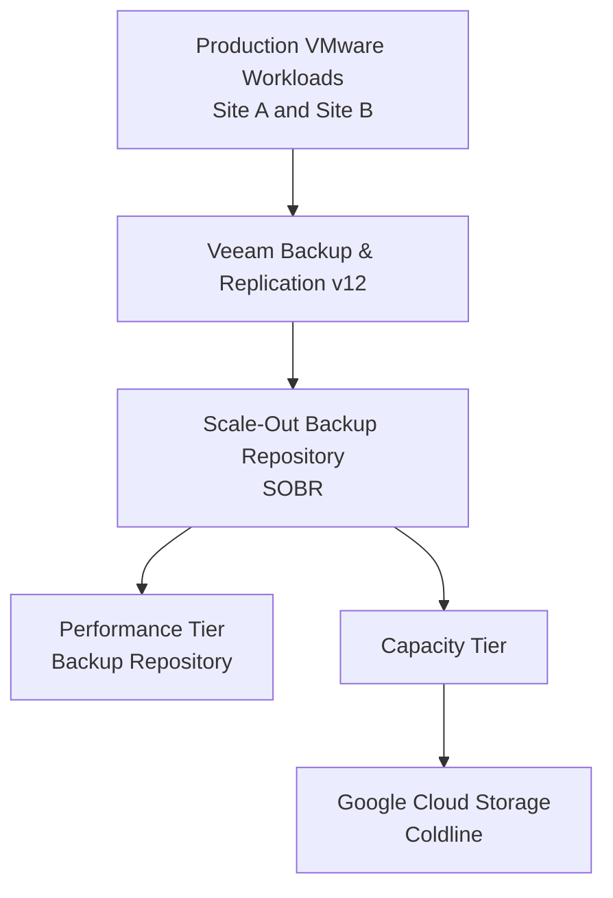
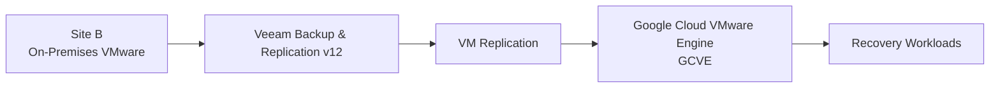
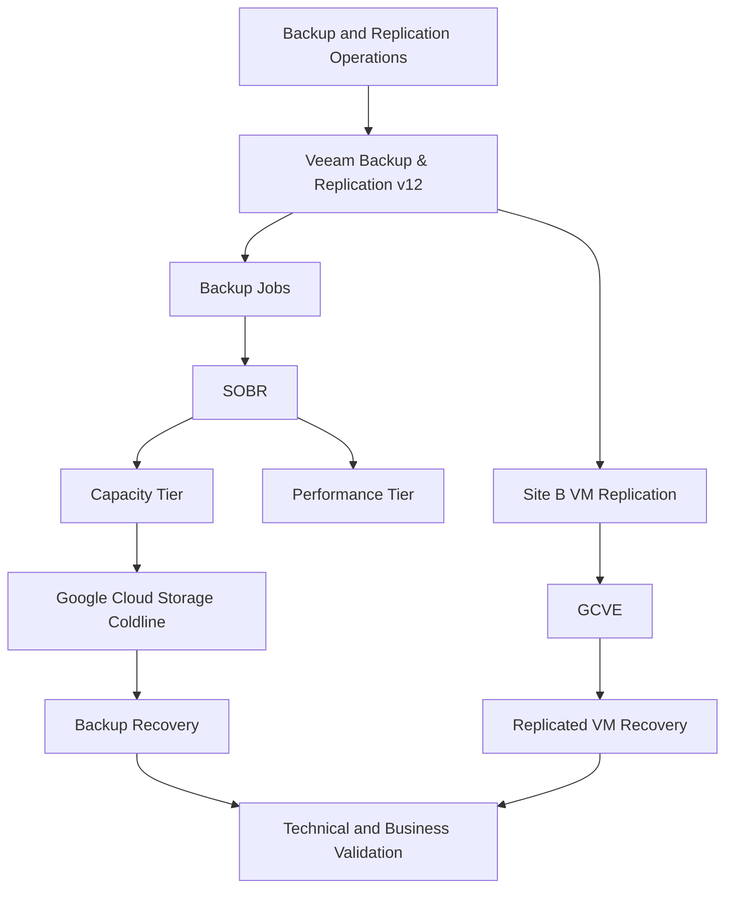

# Veeam Backup Architecture

## 1. Overview

This document describes the backup and virtual machine recovery architecture implemented across Site A and Site B, using **Veeam Backup & Replication v12**.

The solution was designed to support data protection, workload recovery, disaster recovery readiness, and business continuity.

Two complementary mechanisms were implemented:

- **Backup and off-site storage:** Veeam Scale-Out Backup Repository (SOBR), using the Capacity Tier to move backup data to Google Cloud Storage Coldline.
- **Virtual machine replication for disaster recovery:** Veeam replication of Site B virtual machines to Google Cloud VMware Engine (GCVE).

Backup and replication were treated as distinct protection mechanisms, with different purposes and recovery procedures.

## 2. Architecture

### 2.1 Backup architecture

The backup infrastructure used a Scale-Out Backup Repository (SOBR), combining the backup repository capacity with a Capacity Tier for off-site storage.

The Capacity Tier was configured to move backup data to **Google Cloud Storage Coldline**, providing an additional storage location outside the primary environment.

### 2.2 Disaster recovery replication architecture

For Site B, Veeam replication was used to maintain replicated virtual machines in Google Cloud VMware Engine (GCVE).

This approach provided a recovery destination for workloads in the event of a major Site B outage.

**Important distinction:** the SOBR Capacity Tier and GCVE replication served different purposes. Coldline was the off-site destination for backup data, while GCVE was the recovery environment for replicated Site B virtual machines.

## 3. Backup Design

The backup design used Veeam Backup & Replication v12 and SOBR to organize backup storage across repository tiers.

The main components were:

- Veeam Backup & Replication v12 as the backup management platform.
- Scale-Out Backup Repository (SOBR) to aggregate backup storage.
- Performance Tier as the primary backup repository tier.
- Capacity Tier to move backup data to Google Cloud Storage Coldline.

This architecture extended backup storage beyond the primary environment and supported an additional layer of data protection.

Specific retention periods, backup schedules, and repository sizing are workload-dependent and are not specified in this document.

## 4. Disaster Recovery Design

### 4.1 Site B replication to GCVE

Site B virtual machines were replicated using Veeam directly to Google Cloud VMware Engine.

The replication architecture provided an alternative recovery location for workloads hosted in the on-premises VMware environment.

The recovery strategy considered workload criticality and the corresponding Recovery Point Objective (RPO) and Recovery Time Objective (RTO).

### 4.2 RPO and RTO alignment

RPO and RTO requirements varied according to the criticality of each system.

Workloads were classified into four service tiers:

| Tier | Classification |
|---|---|
| Tier 0 | Highest criticality |
| Tier 1 | High criticality |
| Tier 2 | Medium criticality |
| Tier 3 | Lower criticality |

Applications with direct financial impact on the business were considered during criticality assessment.

Exact RPO and RTO values were defined according to each workload's requirements and are not generalized in this document.

## 5. Recovery Procedures

The recovery process included different restoration methods according to the scenario.

### 5.1 Instant VM Recovery

Instant VM Recovery was used during selected recovery tests.

The procedure followed these principles:

1. Shut down the original virtual machine when required by the test procedure.
2. Start the recovery operation without overwriting the original virtual machine.
3. Restore the recovered virtual machine alongside the original one.
4. Assign a different Display Name to the recovered virtual machine in the VMware cluster.
5. Validate operating system startup, connectivity, services, and application functionality.

The original virtual machine was preserved to allow comparison and avoid destructive changes during the validation process.

### 5.2 Full VM Restore

Full VM Restore was also used according to the recovery scenario.

The restoration method was selected based on the recovery objective and the type of test being performed.

## 6. Recovery Testing and Validation

Recovery testing was performed to verify that protected workloads could be restored and that recovered systems were operational.

### 6.1 Testing frequency and scope

| Environment | Test scope | Frequency |
|---|---|---|
| Site A | Virtual machine and application restoration | Semi-annually |
| Site B | Virtual machine and application restoration | Semi-annually |
| Site B | Full-site unavailability simulation | Annually |

The full-site outage simulation was performed for Site B. Site A testing focused on virtual machine and application restoration.

### 6.2 Technical validation

The validation process included:

- Operating system boot and integrity checks.
- Network connectivity verification.
- Connectivity to dependent servers and infrastructure services.
- Application service startup and availability.
- Database connectivity.
- Functional testing performed with the relevant business users or departments.

### 6.3 Evidence and governance

Recovery tests were tracked using an annual Excel control spreadsheet.

The evidence and records included:

- Test execution records.
- Operating system and application validation evidence.
- Infrastructure and Cloud support tickets.
- Change Management records.
- Formal business validation and acceptance.

This process provided traceability for recovery activities and supported the governance of backup and disaster recovery procedures.

## 7. Operational Workflow

## 8. Architecture Decisions

| Decision | Rationale |
|---|---|
| Veeam Backup & Replication v12 | Centralized backup and replication management |
| SOBR architecture | Consolidation of backup repository tiers |
| Capacity Tier with Coldline | Off-site storage for backup data |
| Veeam replication to GCVE | Recovery destination for Site B virtual machines |
| Instant VM Recovery and Full VM Restore | Different restoration methods for different recovery scenarios |
| Tier-based RPO/RTO | Recovery requirements aligned with workload criticality |
| Periodic recovery testing | Validation of recovery capability and operational readiness |

## 9. Outcomes

The implemented architecture established:

- Centralized backup and replication management.
- An off-site backup storage tier using Google Cloud Storage Coldline.
- A dedicated replication-based recovery destination for Site B in GCVE.
- Recovery procedures covering individual virtual machines and applications.
- Periodic technical recovery tests and annual Site B full-site outage simulation.
- Documented evidence and business validation for recovery activities.

The solution strengthened data protection and disaster recovery readiness while aligning recovery procedures with workload criticality.

## 10. Scope and Documentation Notes

This document describes the architecture and operational practices confirmed for the project.

The following implementation details are intentionally not generalized because specific values have not been documented here:

- Backup job schedules.
- Retention periods.
- Repository capacity and sizing.
- Exact RPO and RTO values per workload.
- Detailed network and security configurations for the replication path.

These details should be added when the corresponding configuration records and project evidence are available.
