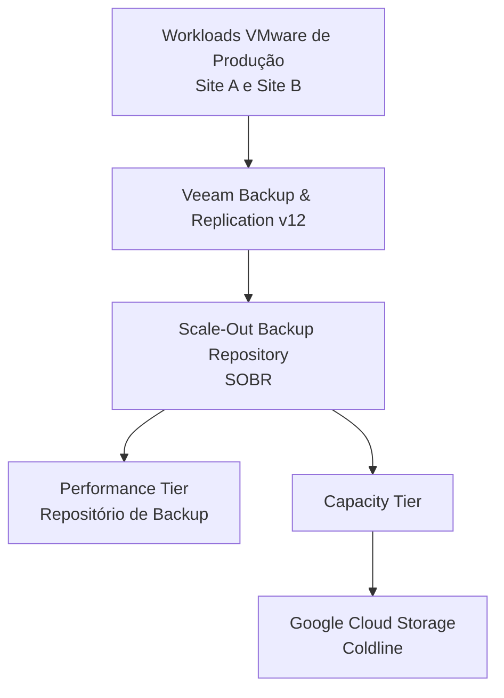
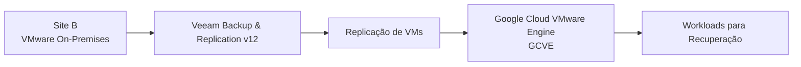
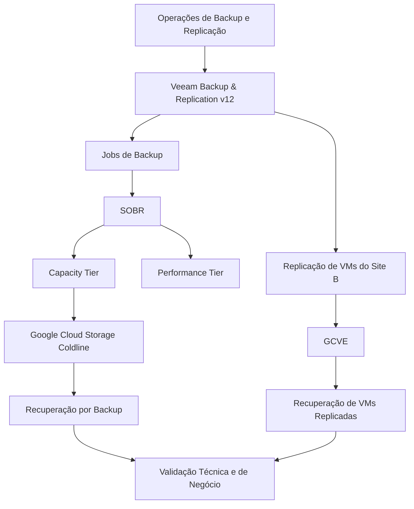

# Arquitetura de Backup com Veeam

## 1. Visão geral

Este documento descreve a arquitetura de backup e recuperação de máquinas virtuais implementada entre o Site A e o Site B, utilizando o **Veeam Backup & Replication v12**.

A solução foi projetada para suportar a proteção de dados, a recuperação de workloads, a preparação para Disaster Recovery e a continuidade dos negócios.

Foram implementados dois mecanismos complementares:

- **Backup e armazenamento externo:** Scale-Out Backup Repository (SOBR) do Veeam, utilizando o Capacity Tier para movimentar os dados de backup para o Google Cloud Storage Coldline.
- **Replicação de máquinas virtuais para Disaster Recovery:** replicação das VMs do Site B para o Google Cloud VMware Engine (GCVE), utilizando o Veeam.

Backup e replicação foram tratados como mecanismos distintos de proteção, com finalidades e procedimentos de recuperação diferentes.

## 2. Arquitetura

### 2.1 Arquitetura de backup

A infraestrutura de backup utilizou um Scale-Out Backup Repository (SOBR), combinando a capacidade dos repositórios de backup com um Capacity Tier para armazenamento externo.

O Capacity Tier foi configurado para movimentar os dados de backup para o **Google Cloud Storage Coldline**, proporcionando uma camada adicional de armazenamento fora do ambiente primário.

### 2.2 Arquitetura de replicação para Disaster Recovery

Para o Site B, foi utilizada a replicação de máquinas virtuais por meio do Veeam, mantendo as VMs replicadas no Google Cloud VMware Engine (GCVE).

Essa abordagem disponibilizou um ambiente alternativo para recuperação dos workloads em caso de indisponibilidade significativa do Site B.

**Distinção importante:** o Capacity Tier do SOBR e a replicação para GCVE tinham finalidades diferentes. O Coldline era o destino externo dos dados de backup, enquanto o GCVE era o ambiente de recuperação das máquinas virtuais replicadas do Site B.

## 3. Projeto de Backup

O projeto de backup utilizou o Veeam Backup & Replication v12 e o SOBR para organizar o armazenamento dos backups em diferentes camadas de repositório.

Os principais componentes eram:

- Veeam Backup & Replication v12 como plataforma de gerenciamento de backup.
- Scale-Out Backup Repository (SOBR) para agrupar os repositórios de armazenamento.
- Performance Tier como camada primária de repositório de backup.
- Capacity Tier para movimentação dos dados de backup para o Google Cloud Storage Coldline.

Essa arquitetura ampliou a capacidade de armazenamento dos backups para além do ambiente primário e adicionou uma camada de proteção de dados.

Os períodos de retenção, as agendas de backup e o dimensionamento dos repositórios dependem das configurações específicas de cada workload e não são especificados neste documento.

## 4. Estratégia de Disaster Recovery

### 4.1 Replicação do Site B para GCVE

As máquinas virtuais do Site B eram replicadas utilizando o Veeam diretamente para o Google Cloud VMware Engine.

A arquitetura de replicação disponibilizou um local alternativo para recuperação dos workloads hospedados no ambiente VMware on-premises.

A estratégia de recuperação considerava a criticidade de cada workload e os respectivos objetivos de Recovery Point Objective (RPO) e Recovery Time Objective (RTO).

### 4.2 Alinhamento de RPO e RTO

Os requisitos de RPO e RTO variavam conforme a criticidade de cada sistema.

Os workloads eram classificados em quatro níveis de serviço:

| Tier | Classificação |
|---|---|
| Tier 0 | Criticidade máxima |
| Tier 1 | Alta criticidade |
| Tier 2 | Média criticidade |
| Tier 3 | Menor criticidade |

Aplicações com impacto financeiro direto para o negócio também eram consideradas na avaliação de criticidade.

Os valores exatos de RPO e RTO eram definidos conforme os requisitos de cada workload e não são generalizados neste documento.

## 5. Procedimentos de Recuperação

O processo de recuperação contemplava diferentes métodos de restauração, conforme o cenário.

### 5.1 Instant VM Recovery

O Instant VM Recovery foi utilizado em determinados testes de recuperação.

O procedimento seguia os seguintes princípios:

1. Desligar a máquina virtual original quando necessário, conforme o procedimento do teste.
2. Iniciar a recuperação sem sobrescrever a máquina virtual original.
3. Restaurar a máquina virtual recuperada em paralelo à original.
4. Atribuir um Display Name diferente à VM recuperada no cluster VMware.
5. Validar a inicialização e integridade do sistema operacional, conectividade, serviços e funcionalidades da aplicação.

A máquina virtual original era preservada, permitindo comparação e evitando alterações destrutivas durante a validação.

### 5.2 Full VM Restore

O Full VM Restore também era utilizado conforme o cenário de recuperação.

O método de restauração era selecionado de acordo com o objetivo da recuperação e o tipo de teste executado.

## 6. Testes e Validação de Recuperação

Os testes de recuperação eram realizados para verificar se os workloads protegidos poderiam ser restaurados e se os sistemas recuperados permaneceriam operacionais.

### 6.1 Periodicidade e escopo dos testes

| Ambiente | Escopo do teste | Periodicidade |
|---|---|---|
| Site A | Restauração de máquinas virtuais e aplicações | Semestral |
| Site B | Restauração de máquinas virtuais e aplicações | Semestral |
| Site B | Simulação de indisponibilidade total do site | Anual |

A simulação de indisponibilidade total era realizada no Site B. Os testes do Site A eram focados na restauração de máquinas virtuais e aplicações.

### 6.2 Validação técnica

O processo de validação contemplava:

- Verificação de boot e integridade do sistema operacional.
- Validação de conectividade de rede.
- Verificação de conectividade com servidores e serviços de infraestrutura dependentes.
- Inicialização e disponibilidade dos serviços das aplicações.
- Conectividade com bancos de dados.
- Testes funcionais realizados com os usuários ou departamentos de negócio responsáveis.

### 6.3 Evidências e governança

Os testes de recuperação eram controlados por meio de uma planilha Excel anual.

As evidências e os registros incluíam:

- Registros de execução dos testes.
- Evidências de validação do sistema operacional e das aplicações.
- Chamados de suporte das equipes de Infraestrutura e Cloud.
- Registros de Change Management.
- Validação e homologação formal das áreas de negócio.

Esse processo proporcionava rastreabilidade às atividades de recuperação e apoiava a governança dos procedimentos de backup e Disaster Recovery.

## 7. Fluxo operacional

## 8. Decisões de Arquitetura

| Decisão | Justificativa |
|---|---|
| Veeam Backup & Replication v12 | Gerenciamento centralizado de backup e replicação |
| Arquitetura SOBR | Consolidação das camadas de repositório de backup |
| Capacity Tier com Coldline | Armazenamento externo dos dados de backup |
| Replicação Veeam para GCVE | Destino de recuperação das máquinas virtuais do Site B |
| Instant VM Recovery e Full VM Restore | Diferentes métodos de restauração para diferentes cenários |
| RPO/RTO baseado em tiers | Alinhamento dos requisitos de recuperação à criticidade dos workloads |
| Testes periódicos de recuperação | Validação da capacidade de recuperação e prontidão operacional |

## 9. Resultados

A arquitetura implementada estabeleceu:

- Gerenciamento centralizado de backup e replicação.
- Uma camada externa de armazenamento de backups utilizando Google Cloud Storage Coldline.
- Um destino dedicado à recuperação por replicação do Site B no GCVE.
- Procedimentos de recuperação de máquinas virtuais e aplicações individuais.
- Testes técnicos periódicos e simulação anual de indisponibilidade total do Site B.
- Evidências documentadas e validação das áreas de negócio nas atividades de recuperação.

A solução fortaleceu a proteção de dados e a preparação para Disaster Recovery, alinhando os procedimentos de recuperação à criticidade dos workloads.

## 10. Escopo e observações da documentação

Este documento descreve a arquitetura e as práticas operacionais confirmadas para o projeto.

Os seguintes detalhes de implementação não foram generalizados porque seus valores específicos ainda não foram documentados aqui:

- Agendas dos jobs de backup.
- Períodos de retenção.
- Capacidade e dimensionamento dos repositórios.
- Valores exatos de RPO e RTO por workload.
- Configurações detalhadas de rede e segurança do caminho de replicação.

Esses detalhes poderão ser adicionados quando os respectivos registros de configuração e evidências do projeto estiverem disponíveis.
