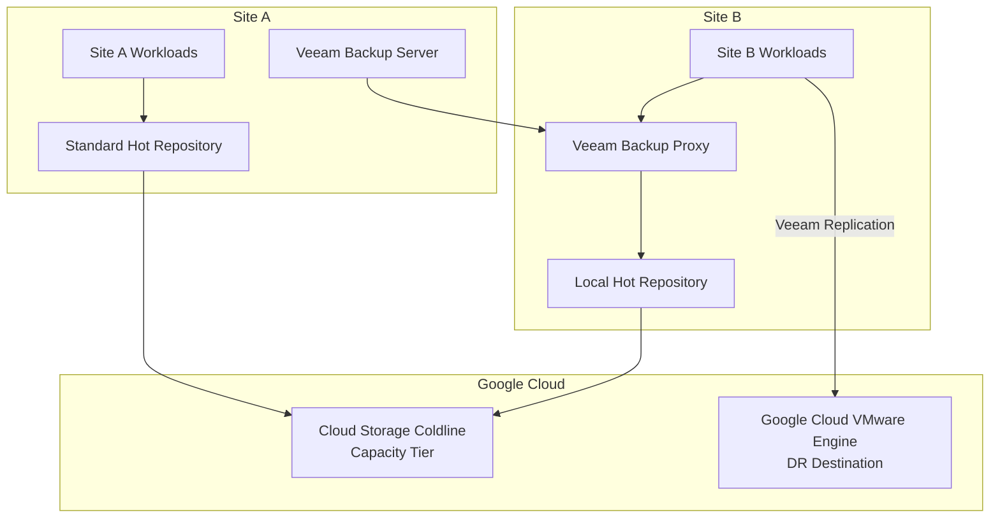
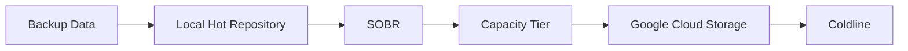
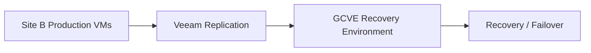

# Veeam Infrastructure Topology

## 1. Overview

The Veeam infrastructure was distributed across two sites, with centralized backup management at Site A and a Veeam Backup Proxy deployed at Site B.

The storage architecture used local hot repositories at each site, combined with Google Cloud Storage Coldline as the cloud-based Capacity Tier.

This design provided local backup storage while extending backup capacity to cloud object storage.

The architecture also included a separate replication workflow for Site B virtual machines to Google Cloud VMware Engine (GCVE), supporting Disaster Recovery requirements.

## 2. Component Distribution

| Component | Location | Role |
|---|---|---|
| Veeam Backup Server | Site A | Centralized backup infrastructure management |
| Veeam Backup Proxy | Site B | Backup data processing and transport |
| Standard hot repository | Site A | Local backup storage |
| Local hot repository | Site B | Local backup storage |
| Google Cloud Storage Coldline | Google Cloud | Capacity Tier for backup data |
| GCVE | Google Cloud | Recovery destination for Site B VM replication |

## 3. Logical Architecture Diagram

*Logical representation of the confirmed component placement and protection destinations. The diagram does not imply undocumented network paths or repository transport configurations.*

## 4. Site A Architecture

Site A hosted the central Veeam Backup Server, responsible for managing backup infrastructure operations.

The site also had a Standard hot backup repository, used as local backup storage.

The backup storage strategy extended this repository through the SOBR Capacity Tier, moving backup data to Google Cloud Storage Coldline.

**Site A components:**
- Veeam Backup Server.
- Standard hot backup repository.
- SOBR with Capacity Tier.
- Google Cloud Storage Coldline as the cloud storage destination.

## 5. Site B Architecture

Site B hosted the Veeam Backup Proxy, responsible for participating in backup data processing and transport.

A local hot repository was also available at this site, providing local backup storage.

As with Site A, the storage strategy used the SOBR Capacity Tier to move backup data to Google Cloud Storage Coldline.

Site B also had a separate Veeam replication workflow for virtual machines, with GCVE as the recovery destination.

**Site B components:**
- Veeam Backup Proxy.
- Local hot backup repository.
- SOBR with Capacity Tier.
- Google Cloud Storage Coldline as the cloud storage destination.
- Veeam VM replication to GCVE for Disaster Recovery.

## 6. Backup Storage Flow

The backup storage architecture combined local hot repositories with cloud-based Capacity Tier storage.

The storage strategy provided two logical storage levels:

- **Local hot storage:** Standard repository at Site A and local repository at Site B.
- **Cloud capacity tier:** Google Cloud Storage Coldline.

The confirmed operational behavior was the movement of backup data to Coldline. The exact SOBR placement, extent configuration, tiering policy, and job-level repository assignments are not specified in this document.

## 7. Disaster Recovery Replication Flow

The replication workflow was separate from the backup storage tiering process.

Virtual machines hosted at Site B were replicated through Veeam to GCVE.

This workflow provided a recovery copy of Site B workloads in the cloud VMware environment.

The replication destination should not be confused with the Google Cloud Storage Coldline Capacity Tier: GCVE was the destination for replicated virtual machines, while Coldline was the destination for backup data.

## 8. Architecture Decisions

| Decision | Rationale |
|---|---|
| Centralized Veeam Backup Server at Site A | Centralized management of backup operations |
| Veeam Backup Proxy at Site B | Distributed backup processing across the sites |
| Local hot repository at each site | Local backup storage availability |
| SOBR Capacity Tier | Extend backup storage to cloud object storage |
| Google Cloud Storage Coldline | Cloud-based storage for backup data |
| Separate replication to GCVE | Provide a recovery environment for Site B workloads |

## 9. Operational Considerations

The topology required operational monitoring of:

1. Veeam Backup Server availability and job execution.
2. Veeam Backup Proxy availability and processing operations.
3. Local repository capacity and utilization at both sites.
4. SOBR and Capacity Tier operations.
5. Backup data movement to Google Cloud Storage Coldline.
6. Veeam replication job status and recovery readiness in GCVE.

Failures in backup, repository, Capacity Tier, or replication operations should be investigated through the established infrastructure incident and change management processes.

## 10. Architecture Outcomes

The distributed topology provided:

- Centralized backup management from Site A.
- Backup processing support at Site B.
- Local hot backup repositories at both sites.
- Extended backup storage through Google Cloud Storage Coldline.
- A separate replication path from Site B to GCVE.
- Clear separation between backup storage and Disaster Recovery replication.

## 11. Scope and Technical Accuracy

This document records the confirmed logical topology.

The following details are intentionally left open until supported by technical records:

- Exact number of SOBRs and extents.
- Whether each site's repository belonged to a separate SOBR or a shared SOBR.
- Exact backup job-to-repository assignments.
- Backup transport mode and network paths.
- Capacity Tier operational policy details beyond the confirmed movement to Coldline.
- Proxy sizing, concurrency, and throughput configuration.
