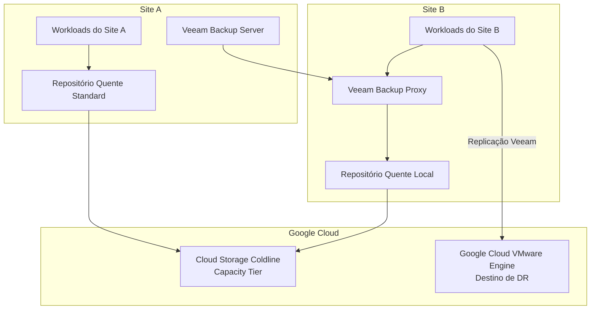
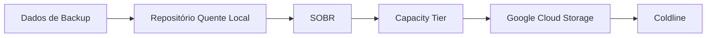
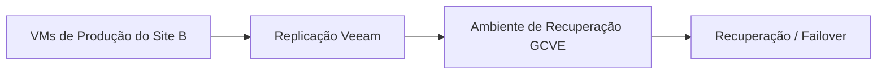

# Topologia da Infraestrutura Veeam

## 1. Visão Geral

A infraestrutura Veeam era distribuída entre dois sites, com o gerenciamento centralizado de backup no Site A e um Veeam Backup Proxy implantado no Site B.

A arquitetura de armazenamento utilizava repositórios locais de backup em cada site, combinados com o Google Cloud Storage Coldline como Capacity Tier.

Esse desenho permitia manter armazenamento local de backups e, ao mesmo tempo, ampliar a capacidade de armazenamento utilizando object storage em nuvem.

A arquitetura também contemplava um fluxo independente de replicação das máquinas virtuais do Site B para o Google Cloud VMware Engine (GCVE), atendendo aos requisitos de Disaster Recovery.

## 2. Distribuição dos Componentes

| Componente | Localização | Função |
|---|---|---|
| Veeam Backup Server | Site A | Gerenciamento centralizado da infraestrutura de backup |
| Veeam Backup Proxy | Site B | Processamento e transporte dos dados de backup |
| Repositório quente Standard | Site A | Armazenamento local dos backups |
| Repositório quente local | Site B | Armazenamento local dos backups |
| Google Cloud Storage Coldline | Google Cloud | Capacity Tier para os dados de backup |
| GCVE | Google Cloud | Destino de recuperação das VMs replicadas do Site B |

## 3. Diagrama Lógico da Arquitetura

*Representação lógica da localização confirmada dos componentes e dos destinos de proteção. O diagrama não pressupõe caminhos de rede ou configurações de transporte que não foram documentados.*

## 4. Arquitetura do Site A

O Site A hospedava o Veeam Backup Server, responsável pelo gerenciamento centralizado das operações da infraestrutura de backup.

O site também possuía um repositório quente Standard, utilizado como armazenamento local dos backups.

A estratégia de armazenamento ampliava esse repositório por meio do Capacity Tier do SOBR, movimentando os dados de backup para o Google Cloud Storage Coldline.

**Componentes do Site A:**
- Veeam Backup Server.
- Repositório quente Standard.
- SOBR com Capacity Tier.
- Google Cloud Storage Coldline como destino de armazenamento em nuvem.

## 5. Arquitetura do Site B

O Site B hospedava o Veeam Backup Proxy, responsável por participar do processamento e transporte dos dados de backup.

O site também possuía um repositório quente local, oferecendo armazenamento local para os backups.

Assim como no Site A, a estratégia de armazenamento utilizava o Capacity Tier do SOBR para movimentar os dados de backup para o Google Cloud Storage Coldline.

O Site B também possuía um fluxo independente de replicação de máquinas virtuais pelo Veeam, tendo o GCVE como destino de recuperação.

**Componentes do Site B:**
- Veeam Backup Proxy.
- Repositório quente local.
- SOBR com Capacity Tier.
- Google Cloud Storage Coldline como destino de armazenamento em nuvem.
- Replicação de VMs pelo Veeam para o GCVE como estratégia de Disaster Recovery.

## 6. Fluxo de Armazenamento dos Backups

A arquitetura de armazenamento combinava repositórios quentes locais com armazenamento em nuvem por meio do Capacity Tier.

A estratégia de armazenamento contemplava dois níveis lógicos:

- **Armazenamento quente local:** repositório Standard no Site A e repositório local no Site B.
- **Capacity Tier em nuvem:** Google Cloud Storage Coldline.

O comportamento operacional confirmado era a movimentação dos dados de backup para Coldline. A localização exata do SOBR, a configuração de extents, a política de tiering e a associação de cada job aos repositórios não estão especificadas neste documento.

## 7. Fluxo de Replicação para Disaster Recovery

O fluxo de replicação era independente do processo de tiering do armazenamento de backup.

As máquinas virtuais hospedadas no Site B eram replicadas pelo Veeam para o GCVE.

Esse fluxo disponibilizava uma cópia de recuperação das workloads do Site B no ambiente VMware em nuvem.

O destino da replicação não deve ser confundido com o Capacity Tier do Google Cloud Storage Coldline: o GCVE era o destino das máquinas virtuais replicadas, enquanto o Coldline era o destino dos dados de backup.

## 8. Decisões Técnicas da Arquitetura

| Decisão | Justificativa |
|---|---|
| Veeam Backup Server centralizado no Site A | Gerenciamento centralizado das operações de backup |
| Veeam Backup Proxy no Site B | Distribuição do processamento de backup entre os sites |
| Repositório quente local em cada site | Disponibilidade de armazenamento local para backups |
| SOBR com Capacity Tier | Ampliação do armazenamento de backup para object storage em nuvem |
| Google Cloud Storage Coldline | Armazenamento de backup em nuvem |
| Replicação independente para GCVE | Disponibilização de um ambiente de recuperação para workloads do Site B |

## 9. Considerações Operacionais

A topologia exigia monitoramento operacional dos seguintes componentes e processos:

1. Disponibilidade do Veeam Backup Server e execução dos jobs.
2. Disponibilidade do Veeam Backup Proxy e operações de processamento.
3. Capacidade e utilização dos repositórios locais dos dois sites.
4. Operações do SOBR e Capacity Tier.
5. Movimentação dos dados de backup para o Google Cloud Storage Coldline.
6. Status dos jobs de replicação Veeam e prontidão do ambiente de recuperação no GCVE.

Falhas nas operações de backup, repositórios, Capacity Tier ou replicação deveriam ser investigadas por meio dos processos estabelecidos de gerenciamento de incidentes e mudanças da infraestrutura.

## 10. Resultados da Arquitetura

A topologia distribuída proporcionou:

- Gerenciamento centralizado dos backups a partir do Site A.
- Suporte ao processamento de backup no Site B.
- Repositórios quentes locais nos dois sites.
- Ampliação do armazenamento de backup por meio do Google Cloud Storage Coldline.
- Fluxo independente de replicação do Site B para o GCVE.
- Separação clara entre armazenamento de backup e replicação para Disaster Recovery.

## 11. Escopo e Precisão Técnica

Este documento registra a topologia lógica confirmada.

Os detalhes abaixo permanecem em aberto até que existam registros técnicos que os comprovem:

- Quantidade exata de SOBRs e extents.
- Se os repositórios de cada site pertenciam a SOBRs separados ou a um SOBR compartilhado.
- Associação exata dos jobs de backup aos repositórios.
- Modo de transporte do backup e caminhos de rede.
- Detalhes da política operacional do Capacity Tier além da movimentação confirmada para Coldline.
- Dimensionamento, concorrência e throughput do Proxy.
