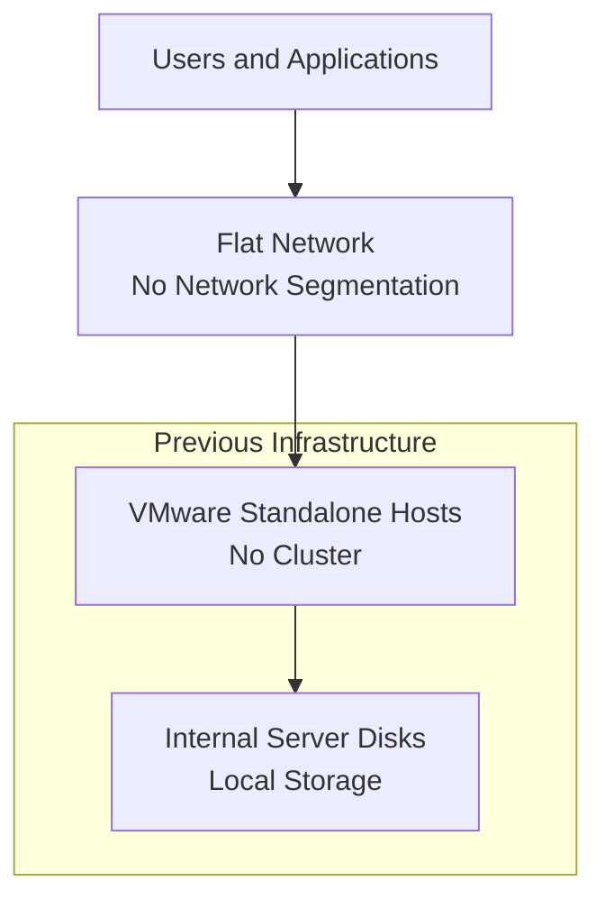
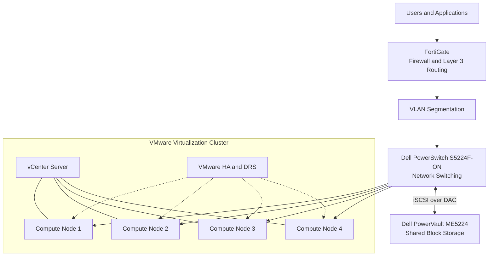

# Site B — Architecture Before & After

## 1. BEFORE — Legacy Infrastructure

## 2. AFTER — Modernized Infrastructure

---

**Note:** Conceptual architecture diagrams. They do not represent exact physical connections, quantities of network links or detailed configurations.
