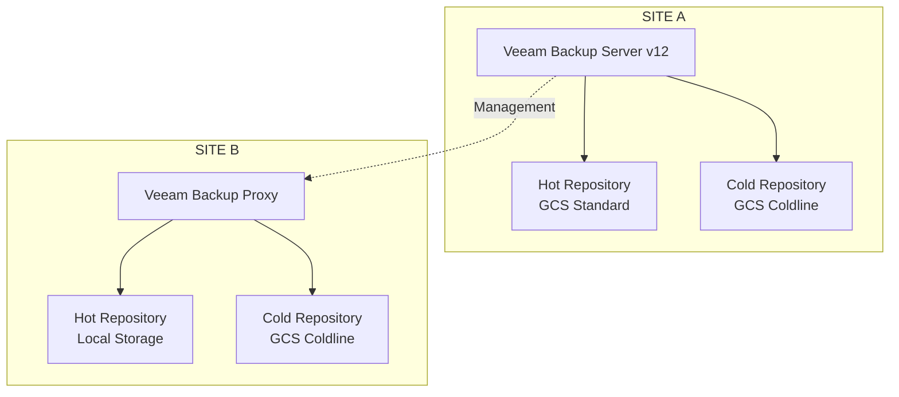

# Arquitetura de Backup — Veeam Backup & Replication v12

## 1. Visão Geral

Foi implementada uma arquitetura de proteção de dados utilizando Veeam Backup & Replication v12, contemplando os ambientes Site A e Site B.

A solução utilizava um servidor Veeam centralizado no Site A e um Veeam Backup Proxy no Site B, com diferentes níveis de armazenamento para os repositórios de backup.

## 2. Componentes da Arquitetura

### Site A

- Veeam Backup Server v12.
- Repositório quente utilizando Google Cloud Storage Standard.
- Repositório frio utilizando Google Cloud Storage Coldline.

### Site B

- Veeam Backup Proxy.
- Repositório quente com armazenamento local.
- Repositório frio utilizando Google Cloud Storage Coldline.

## 3. Estratégia de Armazenamento

A arquitetura contemplava diferentes níveis de armazenamento:

**Hot Storage**

Utilizado como camada de armazenamento quente para os backups, permitindo acesso operacional aos dados protegidos.

- Site A: Google Cloud Storage Standard.
- Site B: Repositório local.

**Cold Storage**

Utilizado como camada de armazenamento frio, baseada na classe Coldline do Google Cloud Storage.

- Site A: Google Cloud Storage Coldline.
- Site B: Google Cloud Storage Coldline.

## 4. Distribuição da Infraestrutura

O servidor Veeam Backup Server estava localizado no Site A, centralizando a administração e o gerenciamento das operações de backup.

O Site B possuía um Veeam Backup Proxy responsável pelo processamento das operações de backup atribuídas a esse ambiente.

## 5. Arquitetura Conceitual



## 6. Benefícios da Arquitetura

- Administração centralizada da solução de backup.
- Distribuição dos componentes entre os dois sites.
- Utilização de armazenamento local e em nuvem.
- Diferentes classes de armazenamento conforme a estratégia adotada.
- Ampliação das opções de recuperação de dados.

## 7. Considerações

A arquitetura apresentada representa a distribuição dos componentes e repositórios informados.

Políticas de retenção, frequência de backup, configuração de SOBR, Capacity Tier, imutabilidade, replicação e mecanismos de movimentação entre camadas deverão ser documentados conforme a configuração efetivamente implementada.
```

### 2.2 English version

Crie `governance/backup-architecture.md`:

<CodeBlock language="markdown" editable>
# Backup Architecture — Veeam Backup & Replication v12

## 1. Overview

A data protection architecture was implemented using Veeam Backup & Replication v12, covering both Site A and Site B environments.

The solution used a centralized Veeam Backup Server located at Site A and a Veeam Backup Proxy at Site B, with different storage tiers for backup repositories.

## 2. Architecture Components

### Site A

- Veeam Backup Server v12.
- Hot repository using Google Cloud Storage Standard.
- Cold repository using Google Cloud Storage Coldline.

### Site B

- Veeam Backup Proxy.
- Hot repository using local storage.
- Cold repository using Google Cloud Storage Coldline.

## 3. Storage Strategy

The architecture included different storage tiers:

**Hot Storage**

Used as the hot storage layer for backups, providing operational access to protected data.

- Site A: Google Cloud Storage Standard.
- Site B: Local repository.

**Cold Storage**

Used as the cold storage layer, based on Google Cloud Storage Coldline.

- Site A: Google Cloud Storage Coldline.
- Site B: Google Cloud Storage Coldline.

## 4. Infrastructure Distribution

The Veeam Backup Server was located at Site A, centralizing backup administration and management operations.

Site B hosted a Veeam Backup Proxy responsible for processing backup operations assigned to that environment.

## 5. Conceptual Architecture


## 6. Architecture Benefits

- Centralized backup solution administration.
- Distributed infrastructure components across both sites.
- Combination of local and cloud storage.
- Different storage classes according to the adopted strategy.
- Expanded data recovery options.

## 7. Considerations

This architecture represents the distribution of the components and repositories provided.

Retention policies, backup frequency, SOBR configuration, Capacity Tier, immutability, replication and data movement mechanisms between storage tiers should be documented according to the actual implementation.
