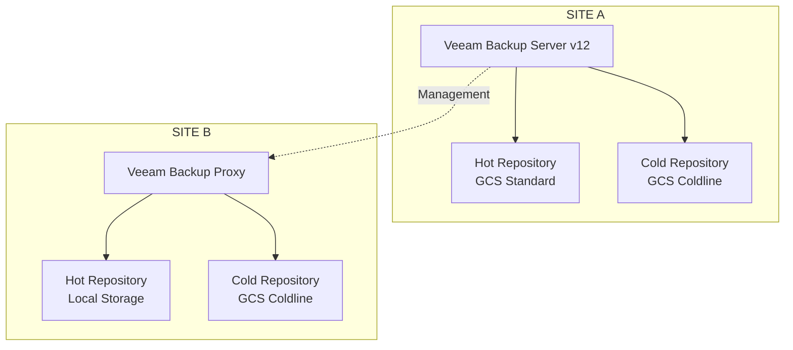

# Arquitetura de Backup — Veeam Backup & Replication v12

## 1. Visão Geral

Foi implementada uma arquitetura de proteção de dados utilizando Veeam Backup & Replication v12, contemplando os ambientes Site A e Site B.

A solução utilizava um servidor Veeam centralizado no Site A e um Veeam Backup Proxy no Site B, com diferentes níveis de armazenamento para os repositórios de backup.

## 2. Componentes da Arquitetura

### Site A

- Veeam Backup Server v12.
- Repositório quente utilizando Google Cloud Storage Standard.
- Repositório frio utilizando Google Cloud Storage Coldline.

### Site B

- Veeam Backup Proxy.
- Repositório quente com armazenamento local.
- Repositório frio utilizando Google Cloud Storage Coldline.

## 3. Estratégia de Armazenamento

A arquitetura contemplava diferentes níveis de armazenamento:

**Hot Storage**

Utilizado como camada de armazenamento quente para os backups, permitindo acesso operacional aos dados protegidos.

- Site A: Google Cloud Storage Standard.
- Site B: Repositório local.

**Cold Storage**

Utilizado como camada de armazenamento frio, baseada na classe Coldline do Google Cloud Storage.

- Site A: Google Cloud Storage Coldline.
- Site B: Google Cloud Storage Coldline.

## 4. Distribuição da Infraestrutura

O servidor Veeam Backup Server estava localizado no Site A, centralizando a administração e o gerenciamento das operações de backup.

O Site B possuía um Veeam Backup Proxy responsável pelo processamento das operações de backup atribuídas a esse ambiente.

## 5. Arquitetura Conceitual



## 6. Benefícios da Arquitetura

- Administração centralizada da solução de backup.
- Distribuição dos componentes entre os dois sites.
- Utilização de armazenamento local e em nuvem.
- Diferentes classes de armazenamento conforme a estratégia adotada.
- Ampliação das opções de recuperação de dados.

## 7. Considerações

A arquitetura apresentada representa a distribuição dos componentes e repositórios informados.

Políticas de retenção, frequência de backup, configuração de SOBR, Capacity Tier, imutabilidade, replicação e mecanismos de movimentação entre camadas deverão ser documentados conforme a configuração efetivamente implementada.
```
