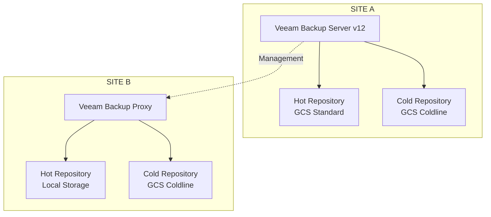

# Backup Architecture — Veeam Backup & Replication v12

## 1. Overview

A data protection architecture was implemented using Veeam Backup & Replication v12, covering both Site A and Site B environments.

The solution used a centralized Veeam Backup Server located at Site A and a Veeam Backup Proxy at Site B, with different storage tiers for backup repositories.

## 2. Architecture Components

### Site A

- Veeam Backup Server v12.
- Hot repository using Google Cloud Storage Standard.
- Cold repository using Google Cloud Storage Coldline.

### Site B

- Veeam Backup Proxy.
- Hot repository using local storage.
- Cold repository using Google Cloud Storage Coldline.

## 3. Storage Strategy

The architecture included different storage tiers:

**Hot Storage**

Used as the hot storage layer for backups, providing operational access to protected data.

- Site A: Google Cloud Storage Standard.
- Site B: Local repository.

**Cold Storage**

Used as the cold storage layer, based on Google Cloud Storage Coldline.

- Site A: Google Cloud Storage Coldline.
- Site B: Google Cloud Storage Coldline.

## 4. Infrastructure Distribution

The Veeam Backup Server was located at Site A, centralizing backup administration and management operations.

Site B hosted a Veeam Backup Proxy responsible for processing backup operations assigned to that environment.

## 5. Conceptual Architecture

## 6. Architecture Benefits

- Centralized backup solution administration.
- Distributed infrastructure components across both sites.
- Combination of local and cloud storage.
- Different storage classes according to the adopted strategy.
- Expanded data recovery options.

## 7. Considerations

This architecture represents the distribution of the components and repositories provided.

Retention policies, backup frequency, SOBR configuration, Capacity Tier, immutability, replication and data movement mechanisms between storage tiers should be documented according to the actual implementation.
