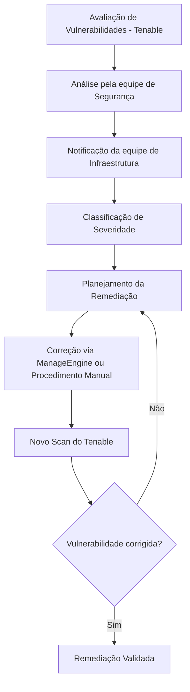
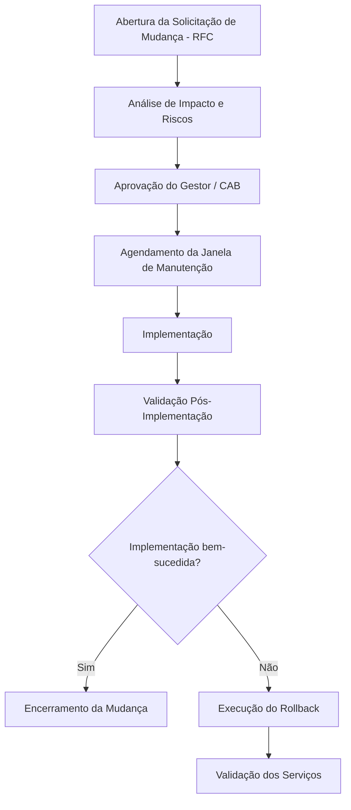
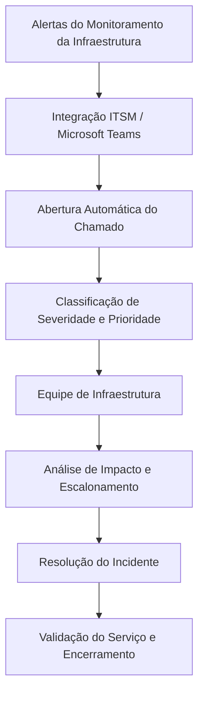

# Governança Operacional e Gestão de Infraestrutura

## 1. Visão Geral

Este documento descreve o modelo de governança operacional implementado nos ambientes Site A e Site B, abrangendo segurança da infraestrutura, gerenciamento de acessos privilegiados, gestão de vulnerabilidades, gerenciamento de mudanças, monitoramento, gestão de incidentes, planejamento de capacidade e documentação técnica.

O objetivo era estabelecer processos operacionais padronizados, fortalecer a segurança da infraestrutura, garantir a disponibilidade dos serviços e manter o alinhamento entre as operações de TI e as necessidades do negócio.

## 2. Gerenciamento de Identidade e Acesso (IAM)

A autenticação e autorização centralizadas eram realizadas por meio do Microsoft Active Directory.

Os principais controles implementados incluíam:

- Autenticação centralizada e gerenciamento de acessos.
- Grupos de segurança para controle de acesso baseado em funções (RBAC).
- Níveis de acesso administrativo (Tier 0, Tier 1 e Tier 2).
- Contas nominais individuais para administradores.
- Autenticação multifator (MFA).
- Separação entre contas privilegiadas e contas de uso cotidiano.
- Acesso administrativo restrito à plataforma de Gerenciamento de Acessos Privilegiados (PAM).

Esses controles contribuíam para a governança de acessos, responsabilização individual e segregação das atividades administrativas.

## 3. Gerenciamento de Acessos Privilegiados (PAM)

**Plataforma:** BeyondTrust

O BeyondTrust era utilizado para centralizar e controlar os acessos privilegiados aos componentes da infraestrutura.

As funcionalidades utilizadas incluíam:

- Cofre de senhas (Password Vault) para gerenciamento de credenciais privilegiadas.
- Gravação e auditoria de sessões administrativas.
- Fluxos de aprovação para acessos privilegiados.
- Rotação automática de senhas.
- Acesso remoto controlado a servidores e equipamentos de rede.
- Controle de duração e horários das sessões administrativas.

A plataforma PAM proporcionava maior controle sobre as atividades privilegiadas e rastreabilidade das operações administrativas.

## 4. Hardening de Segurança

Os procedimentos de hardening eram aplicados aos componentes da infraestrutura, incluindo:

- VMware ESXi e vCenter.
- Windows Server e Linux.
- Switches, firewalls e roteadores.
- Storages Dell.
- Servidores físicos e máquinas virtuais.

As atividades de hardening seguiam uma combinação de:

- CIS Benchmarks.
- Políticas internas de segurança.
- Recomendações de segurança dos fabricantes.
- Procedimentos específicos desenvolvidos pela equipe de infraestrutura.

O objetivo era reduzir a superfície de ataque, padronizar configurações e fortalecer a postura de segurança dos componentes da infraestrutura.

## 5. Gerenciamento de Patches e Vulnerabilidades

### 5.1 Ferramentas e plataformas

| Plataforma | Responsabilidade |
|---|---|
| ManageEngine | Gerenciamento de patches de sistemas operacionais e softwares de terceiros |
| Tenable | Identificação e avaliação de vulnerabilidades |

### 5.2 Fluxo de remediação de vulnerabilidades

O processo de remediação seguia um fluxo estruturado:

1. A equipe de Segurança identificava as vulnerabilidades e encaminhava os relatórios de avaliação para a equipe de Infraestrutura.
2. As vulnerabilidades eram classificadas conforme sua severidade: Critical, High, Medium e Low.
3. Os prazos de correção eram definidos de acordo com a criticidade das vulnerabilidades.
4. A equipe de Infraestrutura executava as correções utilizando o ManageEngine ou procedimentos específicos.
5. Novos scans do Tenable eram realizados para validar a remediação.

### 5.3 Fluxo do processo

## 6. Gerenciamento de Mudanças (Change Management)

Foi estabelecido um processo formal de Gerenciamento de Mudanças para controlar alterações na infraestrutura e reduzir riscos operacionais.

O processo contemplava:

- Abertura de RFC (Request for Change).
- Análise de impacto e avaliação de riscos.
- Aprovação por gestores responsáveis e/ou CAB (Change Advisory Board).
- Definição de janelas de manutenção.
- Elaboração de plano de rollback.
- Validação após a implementação.

### Fluxo de gerenciamento de mudanças

## 7. Monitoramento da Infraestrutura

O monitoramento da infraestrutura era realizado por meio de diferentes plataformas:

| Plataforma | Escopo de monitoramento |
|---|---|
| Zabbix | Disponibilidade, desempenho e alertas da infraestrutura |
| Grafana | Dashboards e visibilidade operacional |
| Monitoramento nativo dos fabricantes | Indicadores de integridade de hardware e plataformas |

O monitoramento abrangia:

- Utilização de CPU e memória.
- Capacidade, utilização e latência de storage.
- Disponibilidade de hosts, hipervisores e máquinas virtuais.
- Disponibilidade de serviços de infraestrutura.
- Links de rede e equipamentos.
- Aplicações e bancos de dados.
- Alertas de indisponibilidade e incidentes.

## 8. Gerenciamento de Incidentes

Os alertas de monitoramento eram integrados à interface ITSM e ao Microsoft Teams.

Quando incidentes eram identificados, chamados eram abertos automaticamente e encaminhados à equipe de Infraestrutura com sua classificação inicial.

O processo de gerenciamento de incidentes incluía:

- Abertura automática de chamados de incidentes.
- Classificação por níveis de severidade e prioridade: 0, 1, 2 e 3.
- Atribuição e escalonamento para as equipes responsáveis conforme o impacto no negócio.
- Acompanhamento dos incidentes pela plataforma ITSM.
- SLAs (Service Level Agreements) para atendimento e resolução.

### Fluxo de gerenciamento de incidentes

## 9. Planejamento de Capacidade (Capacity Planning)

As atividades de planejamento de capacidade eram realizadas anualmente para avaliar a utilização da infraestrutura, identificar tendências de crescimento e antecipar necessidades de expansão.

As avaliações contemplavam:

- Análise do crescimento de CPU e memória dos clusters VMware.
- Acompanhamento da capacidade e utilização dos storages.
- Monitoramento do crescimento dos volumes de backup.
- Planejamento de expansão de recursos computacionais.
- Planejamento de expansão de capacidade de storage.
- Análise de tendências de utilização e identificação antecipada de possíveis gargalos.
- Elaboração de relatórios periódicos de capacidade e utilização.

O objetivo era apoiar a escalabilidade da infraestrutura, otimizar a utilização dos recursos e permitir um gerenciamento proativo da capacidade.

## 10. Documentação Técnica e Procedimentos Operacionais

A documentação técnica e operacional era mantida em todo o ambiente de infraestrutura.

A documentação incluía:

- Diagramas de arquitetura e topologia de rede.
- Inventário de servidores físicos, máquinas virtuais e equipamentos.
- Documentação de VLANs, endereçamento IP e regras de firewall.
- Procedimentos operacionais padrão (SOPs).
- Runbooks para resposta a incidentes e recuperação.
- Registros de mudanças e documentação de configurações.

Essas práticas contribuíam para a padronização operacional, gestão do conhecimento, troubleshooting e gerenciamento do ciclo de vida da infraestrutura.

## 11. Resultados da Governança Operacional

O modelo de governança estabeleceu uma estrutura operacional padronizada para os ambientes Site A e Site B.

Os principais resultados operacionais incluíam:

- Centralização da governança de identidade e acessos privilegiados.
- Maior rastreabilidade das atividades administrativas.
- Padronização dos processos de hardening de segurança.
- Processo estruturado de remediação de vulnerabilidades e gerenciamento de patches.
- Controle de mudanças na infraestrutura por meio de fluxos formais de aprovação.
- Monitoramento centralizado e notificações automatizadas de incidentes.
- Gerenciamento de incidentes orientado por SLAs e processos de escalonamento.
- Planejamento proativo da capacidade da infraestrutura.
- Padronização da documentação técnica e dos procedimentos operacionais.

## 12. Escopo e Ambiente Tecnológico

As práticas de governança descritas neste documento eram aplicadas aos ambientes de infraestrutura associados ao Site A e ao Site B.

A arquitetura abrangia VMware, infraestrutura Dell, segurança de rede Fortinet, proteção de dados com Veeam e Google Cloud VMware Engine (GCVE).

Os detalhes adicionais de arquitetura, backup, migração e Disaster Recovery estão documentados nas respectivas seções deste repositório.
