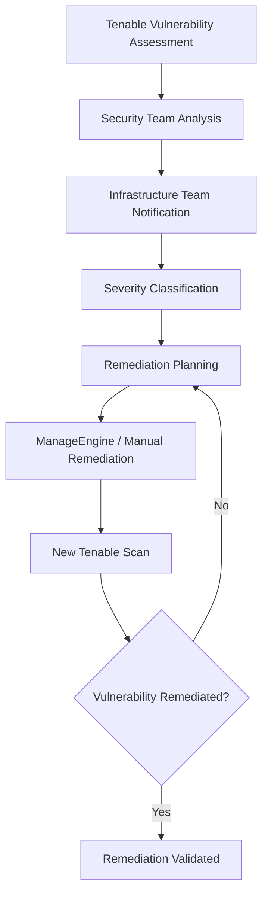
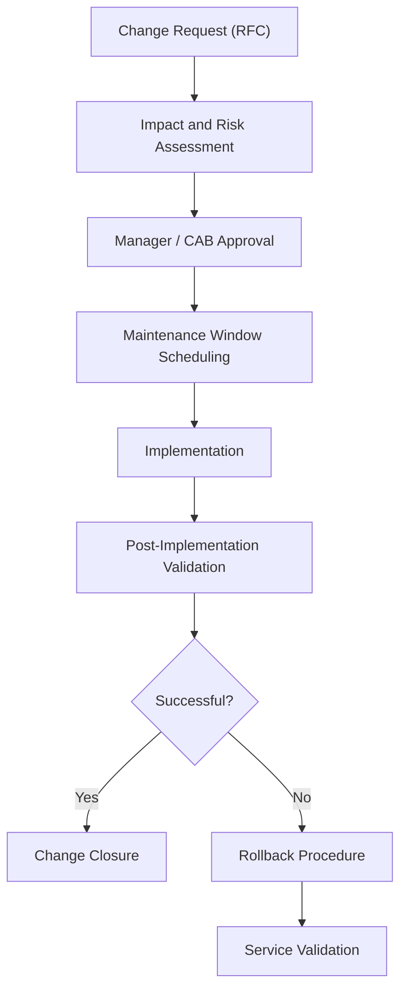
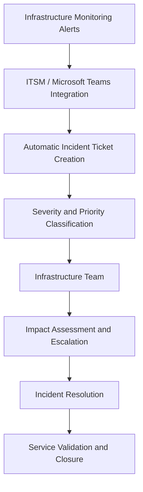

# Operational Governance & Infrastructure Management

## 1. Overview

This document describes the operational governance framework implemented across Site A and Site B, covering infrastructure security, privileged access management, vulnerability remediation, change management, monitoring, incident management, capacity planning, and technical documentation.

The objective was to establish standardized operational processes, improve infrastructure security, ensure service availability, and maintain alignment between IT operations and business requirements.

## 2. Identity and Access Management (IAM)

Centralized authentication and authorization were implemented through Microsoft Active Directory.

Key controls included:

- Centralized authentication and access management.
- Security groups for role-based access control (RBAC).
- Administrative access tiers (Tier 0, Tier 1, and Tier 2).
- Individual named accounts for administrators.
- Multi-Factor Authentication (MFA).
- Separation of privileged accounts from everyday user accounts.
- Administrative access restricted to the Privileged Access Management (PAM) platform.

These controls supported access governance, accountability, and segregation of administrative responsibilities.

## 3. Privileged Access Management (PAM)

**Platform:** BeyondTrust

BeyondTrust was used to centralize and control privileged access to infrastructure components.

Implemented capabilities included:

- Password Vault for privileged credential management.
- Administrative session recording and auditing.
- Approval workflows for privileged access.
- Automated password rotation.
- Controlled remote access to servers and network equipment.
- Session duration and access time restrictions.

The PAM platform provided centralized oversight of privileged activities and improved traceability of administrative operations.

## 4. Security Hardening

Hardening procedures were applied across the infrastructure environment, including:

- VMware ESXi and vCenter.
- Windows Server and Linux systems.
- Network switches, firewalls, and routers.
- Dell storage systems.
- Physical servers and virtual machines.

Hardening activities followed a combination of:

- CIS Benchmarks.
- Internal security policies.
- Vendor security recommendations.
- Infrastructure team-specific procedures.

The objective was to reduce the attack surface, standardize configurations, and improve the security posture of infrastructure components.

## 5. Patch and Vulnerability Management

### 5.1 Tools and Platforms

| Platform | Responsibility |
|---|---|
| ManageEngine | Operating system and third-party software patch management |
| Tenable | Vulnerability identification and assessment |

### 5.2 Vulnerability Remediation Workflow

The remediation process followed a structured workflow:

1. The Security team identified vulnerabilities and forwarded assessment reports to Infrastructure.
2. Findings were classified according to severity: Critical, High, Medium, and Low.
3. Remediation deadlines were established based on vulnerability severity.
4. The Infrastructure team implemented corrections using ManageEngine or specific remediation procedures.
5. Follow-up Tenable scans were performed to validate remediation.

### 5.3 Process Flow

## 6. Change Management

A formal Change Management process was established to control infrastructure modifications and reduce operational risks.

The process included:

- RFC (Request for Change) creation.
- Impact and risk assessment.
- Approval by responsible managers and/or the Change Advisory Board (CAB).
- Maintenance window definition.
- Rollback plan preparation.
- Post-implementation validation.

### Change Management Workflow

## 7. Infrastructure Monitoring

Infrastructure monitoring was supported by multiple platforms:

| Platform | Monitoring Scope |
|---|---|
| Zabbix | Infrastructure availability, performance, and alerts |
| Grafana | Monitoring dashboards and operational visibility |
| Native vendor monitoring | Hardware and platform-specific health indicators |

Monitoring covered:

- CPU and memory utilization.
- Storage capacity, utilization, and latency.
- Hypervisor and virtual machine availability.
- Infrastructure services.
- Network links and equipment.
- Applications and databases.
- Availability alerts and incident notifications.

## 8. Incident Management

Monitoring alerts were integrated with the ITSM interface and Microsoft Teams.

When incidents were detected, tickets were automatically generated and delivered to the Infrastructure team with their initial classification.

The incident management process included:

- Automatic incident ticket creation.
- Severity and priority classification using levels 0, 1, 2, and 3.
- Assignment and escalation to responsible teams according to business impact.
- Incident tracking through the ITSM platform.
- Service Level Agreements (SLAs) for response and resolution.

### Incident Management Workflow

## 9. Capacity Planning

Capacity Planning activities were performed annually to evaluate infrastructure utilization, identify growth trends, and anticipate expansion requirements.

The assessment covered:

- VMware cluster CPU and memory growth.
- Storage capacity and utilization.
- Backup repository and backup data growth.
- Compute resource expansion planning.
- Storage expansion planning.
- Utilization trend analysis and potential bottleneck identification.
- Periodic capacity and utilization reporting.

The objective was to support infrastructure scalability, resource optimization, and proactive capacity management.

## 10. Technical Documentation and Operational Procedures

Technical and operational documentation was maintained across the infrastructure environment.

Documentation included:

- Architecture and network topology diagrams.
- Physical server, virtual machine, and equipment inventories.
- VLANs, IP addressing, and firewall rules.
- Standard Operating Procedures (SOPs).
- Incident response and recovery runbooks.
- Change records and configuration documentation.

These practices supported operational consistency, knowledge management, troubleshooting, and infrastructure lifecycle management.

## 11. Governance Outcomes

The governance framework established a structured operational model across Site A and Site B.

Key operational outcomes included:

- Centralized identity and privileged access governance.
- Improved traceability of administrative activities.
- Standardized security hardening practices.
- Structured vulnerability remediation and patch management.
- Controlled infrastructure changes through formal approval workflows.
- Centralized monitoring and automated incident notification.
- SLA-driven incident management and escalation.
- Proactive infrastructure capacity planning.
- Standardized technical documentation and operational procedures.

## 12. Scope and Technical Environment

The governance practices described in this document applied to the infrastructure environments associated with Site A and Site B.

The broader architecture included VMware virtualization, Dell infrastructure, Fortinet network security, Veeam data protection, and Google Cloud VMware Engine (GCVE).

Additional architecture, backup, migration, and disaster recovery details are documented in their respective sections of this repository.
