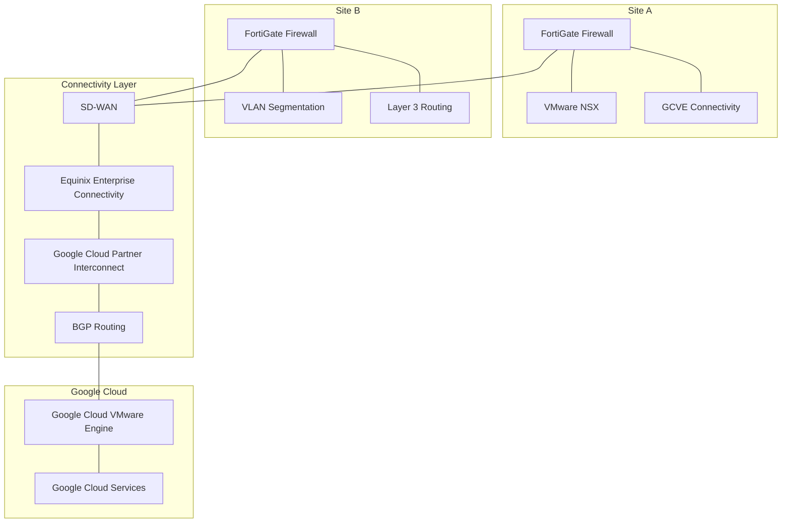

# Network and Connectivity Architecture

## 1. Overview

The network architecture supported connectivity between two infrastructure sites and Google Cloud services, providing redundant communication paths, controlled traffic routing, and security enforcement.

The solution incorporated:

- SD-WAN connectivity.
- FortiGate firewalls at both sites.
- Equinix Enterprise Connectivity for Google Cloud Partner Interconnect.
- Redundant connectivity circuits deployed through physically distinct locations.
- BGP routing.
- Site-specific network segmentation strategies.
- Connectivity between Site A and Google Cloud VMware Engine (GCVE).

## 2. High-Level Architecture

*Conceptual logical diagram. Exact circuit termination, routing adjacencies, and physical interfaces are not represented.*

## 3. Site Connectivity

### 3.1 Site A

Site A used a FortiGate firewall for Internet and Google Cloud connectivity, including connectivity to GCVE.

VMware NSX was used for workload microsegmentation.

Following the infrastructure migration to GCVE, the on-premises environment retained Layer 2 and Layer 3 network infrastructure.

### 3.2 Site B

Site B remained on-premises and used FortiGate firewalls for network security, VLAN segmentation, and Layer 3 routing.

The network segmentation strategy was based on VLANs and firewall policies, providing traffic control between network segments.

## 4. Google Cloud Connectivity

Connectivity to Google Cloud was implemented through **Equinix Enterprise Connectivity**, using Google Cloud Partner Interconnect.

Equinix acted as the connectivity partner between the on-premises infrastructure and Google Cloud.

The architecture included two independent circuits deployed through physically distinct locations, reducing dependency on a single physical connectivity path.

BGP was used for dynamic routing.

## 5. Redundancy and Resilience

The connectivity design incorporated multiple layers of redundancy:

- Two independent connectivity circuits.
- Physical diversity between circuit locations.
- Redundant network equipment and paths.
- Dynamic routing through BGP.
- SD-WAN connectivity.
- FortiGate security infrastructure at both sites.

These mechanisms were intended to reduce single points of failure and improve network resilience.

## 6. Network Security and Segmentation

Network segmentation followed different implementation strategies at each site.

| Site | Technology | Segmentation Strategy |
|---|---|---|
| Site A | VMware NSX | Workload microsegmentation |
| Site B | FortiGate | VLAN segmentation and Layer 3 routing |

FortiGate firewalls were also responsible for network security enforcement and controlled traffic routing.

This design allowed segmentation controls to be aligned with each site's infrastructure architecture.

## 7. Key Architecture Decisions

| Decision | Technical rationale |
|---|---|
| SD-WAN | Support connectivity across the infrastructure sites |
| Equinix Enterprise Connectivity | Provide the connectivity partner for Google Cloud Partner Interconnect |
| Two independent circuits | Reduce dependency on a single connectivity circuit |
| Physical path diversity | Improve resilience against localized physical failures |
| BGP | Enable dynamic routing |
| FortiGate at both sites | Provide firewall enforcement and network traffic control |
| VMware NSX at Site A | Implement workload microsegmentation |
| FortiGate VLAN and Layer 3 segmentation at Site B | Provide network segmentation aligned with the on-premises architecture |

## 8. Architecture Outcomes

The network architecture provided:

- Connectivity between the infrastructure sites and Google Cloud.
- Integration with Google Cloud through Partner Interconnect.
- Redundant connectivity circuits and physically diverse paths.
- Dynamic routing using BGP.
- Network security enforcement through FortiGate.
- Workload microsegmentation at Site A through VMware NSX.
- VLAN and Layer 3 segmentation at Site B.
- Connectivity supporting the GCVE environment.

## 9. Scope and Technical Accuracy

This document describes the confirmed logical network architecture.

The following implementation details are intentionally not specified:

- Circuit bandwidth and service-level agreements.
- BGP autonomous system numbers and routing policies.
- VLAN IDs and IP addressing schemes.
- SD-WAN vendor, configuration, and failover policies.
- Exact physical topology and circuit termination points.
- Firewall rule sets and security policy details.
- Routing convergence and failover measurements.

These details can be added when the corresponding technical records are available.
