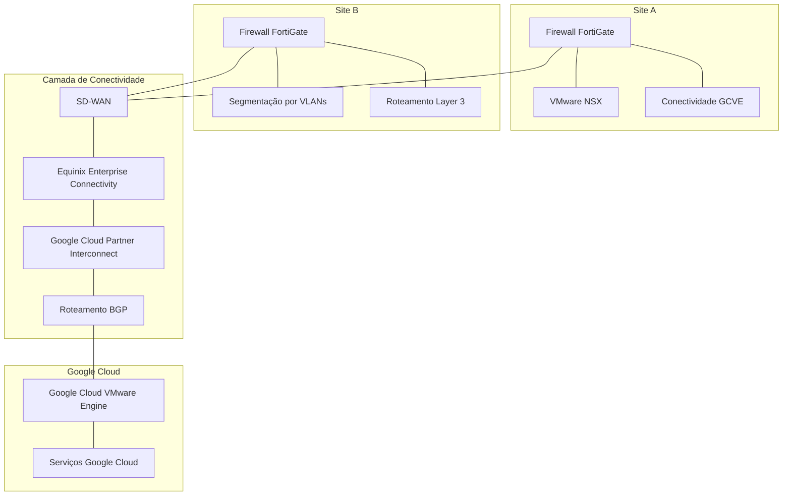

# Arquitetura de Rede e Conectividade

## 1. Visão Geral

A arquitetura de rede suportava a conectividade entre dois sites de infraestrutura e os serviços do Google Cloud, oferecendo caminhos redundantes de comunicação, controle de roteamento de tráfego e aplicação de políticas de segurança.

A solução incorporava:

- Conectividade SD-WAN.
- Firewalls FortiGate nos dois sites.
- Equinix Enterprise Connectivity para Google Cloud Partner Interconnect.
- Circuitos de conectividade redundantes, implantados por localidades físicas distintas.
- Roteamento BGP.
- Estratégias de segmentação de rede específicas para cada site.
- Conectividade entre o Site A e o Google Cloud VMware Engine (GCVE).

## 2. Arquitetura de Alto Nível

*Diagrama lógico conceitual. Terminações exatas dos circuitos, adjacências de roteamento e interfaces físicas não estão representadas.*

## 3. Conectividade dos Sites

### 3.1 Site A

O Site A utilizava um firewall FortiGate para conectividade com a Internet e o Google Cloud, incluindo a comunicação com o GCVE.

O VMware NSX era utilizado para implementar a microsegmentação das workloads.

Após a migração da infraestrutura para o GCVE, o ambiente on-premises manteve a infraestrutura de rede Layer 2 e Layer 3.

### 3.2 Site B

O Site B permaneceu on-premises e utilizava firewalls FortiGate para segurança de rede, segmentação por VLANs e roteamento Layer 3.

A estratégia de segmentação era baseada em VLANs e políticas de firewall, permitindo o controle do tráfego entre os segmentos de rede.

## 4. Conectividade com o Google Cloud

A conectividade com o Google Cloud foi implementada por meio do **Equinix Enterprise Connectivity**, utilizando Google Cloud Partner Interconnect.

A Equinix atuava como parceira de conectividade entre a infraestrutura on-premises e o Google Cloud.

A arquitetura contemplava dois circuitos independentes, implantados por localidades físicas distintas, reduzindo a dependência de um único caminho físico de conectividade.

O BGP era utilizado para roteamento dinâmico.

## 5. Redundância e Resiliência

O desenho de conectividade incorporava múltiplas camadas de redundância:

- Dois circuitos de conectividade independentes.
- Diversidade física entre as localidades dos circuitos.
- Redundância de equipamentos e caminhos de rede.
- Roteamento dinâmico por meio de BGP.
- Conectividade SD-WAN.
- Infraestrutura de segurança FortiGate nos dois sites.

Esses mecanismos tinham como objetivo reduzir pontos únicos de falha e aumentar a resiliência da rede.

## 6. Segurança e Segmentação de Rede

A segmentação de rede seguia estratégias de implementação diferentes em cada site.

| Site | Tecnologia | Estratégia de Segmentação |
|---|---|---|
| Site A | VMware NSX | Microsegmentação de workloads |
| Site B | FortiGate | Segmentação por VLANs e roteamento Layer 3 |

Os firewalls FortiGate também eram responsáveis pela aplicação das políticas de segurança e pelo controle do roteamento de tráfego.

Esse desenho permitia alinhar os controles de segmentação à arquitetura de infraestrutura de cada site.

## 7. Decisões Técnicas da Arquitetura

| Decisão | Justificativa técnica |
|---|---|
| SD-WAN | Suportar a conectividade entre os sites da infraestrutura |
| Equinix Enterprise Connectivity | Disponibilizar a parceira de conectividade para o Google Cloud Partner Interconnect |
| Dois circuitos independentes | Reduzir a dependência de um único circuito |
| Diversidade de caminhos físicos | Aumentar a resiliência contra falhas físicas localizadas |
| BGP | Habilitar roteamento dinâmico |
| FortiGate nos dois sites | Aplicar políticas de firewall e controle de tráfego de rede |
| VMware NSX no Site A | Implementar microsegmentação de workloads |
| Segmentação por VLANs e Layer 3 com FortiGate no Site B | Implementar segmentação de rede alinhada à arquitetura on-premises |

## 8. Resultados da Arquitetura

A arquitetura de rede proporcionou:

- Conectividade entre os sites de infraestrutura e o Google Cloud.
- Integração com o Google Cloud por meio do Partner Interconnect.
- Circuitos de conectividade redundantes e caminhos fisicamente distintos.
- Roteamento dinâmico utilizando BGP.
- Aplicação de políticas de segurança por meio do FortiGate.
- Microsegmentação de workloads no Site A por meio do VMware NSX.
- Segmentação por VLANs e Layer 3 no Site B.
- Conectividade de suporte ao ambiente GCVE.

## 9. Escopo e Precisão Técnica

Este documento descreve a arquitetura lógica de rede confirmada.

Os seguintes detalhes de implementação não foram especificados:

- Banda dos circuitos e respectivos SLAs.
- Números de sistemas autônomos BGP e políticas de roteamento.
- IDs de VLANs e esquemas de endereçamento IP.
- Fabricante, configuração e políticas de failover do SD-WAN.
- Topologia física exata e pontos de terminação dos circuitos.
- Regras de firewall e detalhes das políticas de segurança.
- Métricas de convergência de roteamento e failover.

Essas informações poderão ser acrescentadas quando os respectivos registros técnicos estiverem disponíveis.
