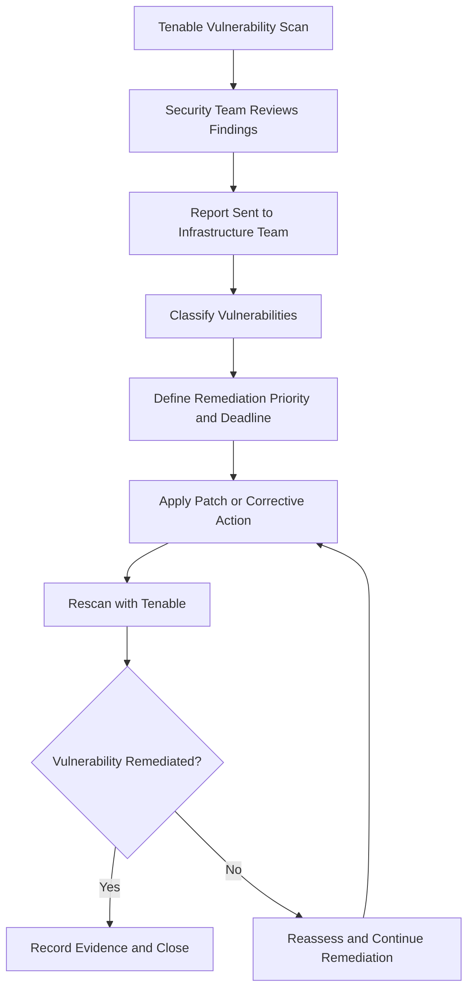
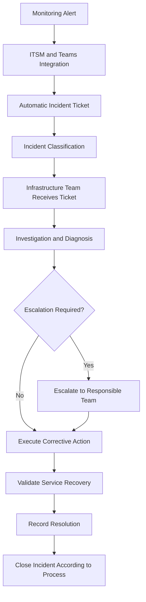
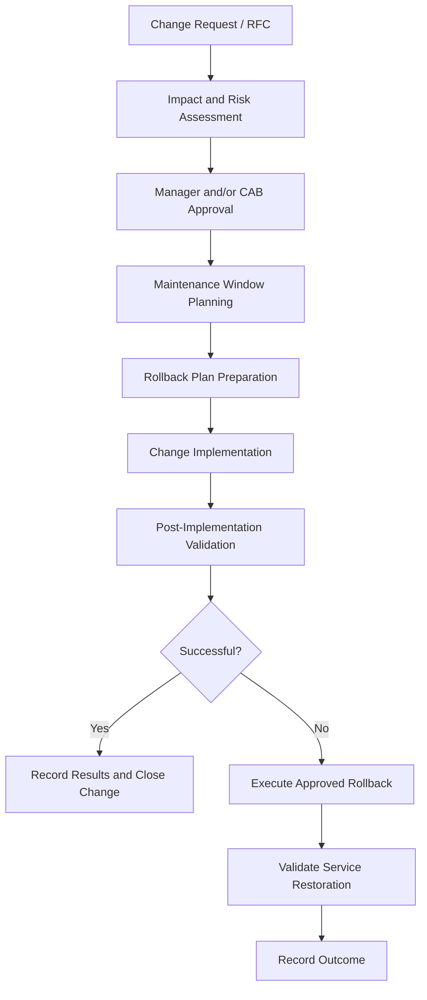

# Technical Procedures & Operational Runbooks

## 1. Purpose

This document defines operational procedures for critical infrastructure activities across the enterprise environment.

The runbooks cover backup restoration, disaster recovery validation, vulnerability remediation, incident management, and change management.

They are designed to provide a consistent operational approach, support repeatability, and establish evidence of execution.

---

## 2. Runbook — Virtual Machine and Application Recovery Using Veeam

**Platform:** Veeam Backup & Replication v12  
**Scope:** VMware virtual machines and supported application workloads.

### 2.1 Objective

Restore a virtual machine or application workload while preserving the original production VM for comparison and validation whenever the recovery procedure allows it.

### 2.2 Prerequisites

- Identify the affected VM or application.
- Confirm the recovery requirement and business impact.
- Identify the appropriate backup restore point.
- Confirm the target VMware environment and available resources.
- Follow the applicable incident and change management procedures.

### 2.3 Procedure

1. Identify the VM and the recovery requirement.
2. Locate the appropriate backup restore point in Veeam.
3. Initiate the applicable recovery workflow:
   - Instant VM Recovery.
   - Full VM Restore.
4. For the documented side-by-side validation procedure:
   - Shut down the original VM.
   - Restore the VM alongside the original rather than overwriting it.
   - Assign a different display name to the restored VM in the VMware cluster.
   - Preserve the original VM for comparison and validation.
5. Start the restored VM in the designated recovery environment.
6. Perform the technical and functional validation.

### 2.4 Validation Checklist

- [ ] VM boots successfully.
- [ ] Operating system integrity is verified.
- [ ] Network connectivity is validated.
- [ ] Required infrastructure services are running.
- [ ] Application services are operational.
- [ ] Database connectivity is confirmed, where applicable.
- [ ] Functional testing is performed by the responsible users or business areas.
- [ ] Business validation is formally recorded.

### 2.5 Evidence and Closure

Record the recovery activity in the applicable test-control spreadsheet and retain supporting evidence, including:

- VM boot validation.
- Application validation.
- Infrastructure and Cloud team incident records.
- Related Change Management records.
- Formal business acceptance.

The recovery activity should only be considered validated after the required technical and business checks have been completed.

---

## 3. Runbook — Site B Disaster Recovery Validation to GCVE

**Platform:** Veeam Backup & Replication v12 and Google Cloud VMware Engine  
**Scope:** Site B virtual machine replication and disaster recovery.

### 3.1 Objective

Validate the ability to recover Site B workloads using the replication environment hosted in GCVE.

### 3.2 Validation Frequency

- Periodic restore and recovery exercises.
- Annual simulation of a total Site B outage.

### 3.3 Prerequisites

- Identify the workloads included in the recovery exercise.
- Confirm their business criticality and applicable recovery objectives.
- Confirm the availability of the replicated workloads in GCVE.
- Coordinate the exercise with Infrastructure, Cloud, and the responsible business areas.
- Establish the test scope and expected validation evidence.
- Follow the applicable change and incident management processes.

### 3.4 Procedure

1. Define the recovery exercise scope.
2. Identify the VMs selected for validation.
3. Confirm the applicable replication and recovery information in Veeam.
4. Execute the approved recovery exercise in the GCVE environment.
5. Validate the recovered workloads.
6. Perform application and database connectivity checks where applicable.
7. Request functional validation from the responsible business users.
8. Record the results, issues, and evidence.
9. Obtain formal business acceptance.

### 3.5 Recovery Validation

| Validation Area | Expected Evidence |
|---|---|
| VM recovery | Recovered VM is available and boots successfully |
| Operating system | OS integrity and startup validation |
| Network | Required connectivity is available |
| Infrastructure services | Required services are operational |
| Applications | Application services respond as expected |
| Databases | Database connectivity and application integration are validated |
| Business | Functional validation and formal acceptance |

### 3.6 Recovery Objectives

Recovery objectives vary according to workload criticality.

The environment uses the following classifications:

- Tier 0
- Tier 1
- Tier 2
- Tier 3

Measured RPO and RTO values must be taken from the approved workload-specific recovery requirements. They should not be inferred from the tier classification alone.

### 3.7 Evidence and Closure

Maintain an annual test-control spreadsheet and retain:

- Test scope and date.
- Workloads included in the exercise.
- Technical validation evidence.
- Application and business validation.
- Infrastructure and Cloud team records.
- Related changes and incident records.
- Formal business approval.

---

## 4. Runbook — Vulnerability Remediation and Patch Management

**Tools:** Tenable and ManageEngine  
**Scope:** Operating systems, infrastructure servers, and applicable infrastructure components.

### 4.1 Objective

Identify, classify, remediate, and validate infrastructure vulnerabilities through a controlled remediation process.

### 4.2 Process Overview

### 4.3 Procedure

1. Execute or receive the results of a Tenable vulnerability scan.
2. The Security team reviews the findings.
3. Security sends the vulnerability report to the Infrastructure team.
4. Classify findings according to:
   - Critical.
   - High.
   - Medium.
   - Low.
5. Define remediation deadlines according to vulnerability criticality.
6. Plan the remediation activity and assess operational impact.
7. Apply the required patches through ManageEngine or use the applicable technical remediation procedure.
8. Perform the required post-remediation checks.
9. Execute a new Tenable scan to validate remediation.
10. Record the results and supporting evidence.

### 4.4 Validation and Closure

A vulnerability should only be considered remediated after the validation scan confirms the corrective action.

Retain:

- Original vulnerability report.
- Classification and remediation priority.
- Patch or corrective action records.
- Related change records, when applicable.
- Post-remediation Tenable scan results.
- Closure evidence.

---

## 5. Runbook — Infrastructure Incident Management

**Tools:** Zabbix, Grafana, native vendor monitoring, ITSM interface, and Microsoft Teams.

### 5.1 Objective

Ensure infrastructure incidents are detected, classified, assigned, escalated, and resolved through a structured operational process.

### 5.2 Monitoring Scope

Monitoring covers:

- CPU and memory utilization.
- VMware hosts and virtual machines.
- Storage capacity and latency.
- Network links and devices.
- Infrastructure services.
- Applications and databases.

### 5.3 Incident Workflow

### 5.4 Procedure

1. Detect the alert through Zabbix, Grafana, or native vendor monitoring.
2. The monitoring integration generates an incident through the ITSM interface and Microsoft Teams.
3. The incident is automatically classified.
4. The Infrastructure team receives the classified ticket.
5. Investigate the affected component and determine the operational impact.
6. Apply the appropriate corrective action.
7. Escalate to the responsible team according to the impact and established escalation process.
8. Validate service restoration.
9. Record the resolution and supporting evidence.
10. Close the incident according to the ITSM process.

### 5.5 Severity, Priority, and SLAs

The incident management process uses levels 0, 1, 2, and 3 for severity and priority.

Escalation is performed according to business impact and the responsible teams.

Service Level Agreements (SLAs) are defined for incident response and resolution.

Specific classification criteria and SLA targets should be referenced from the organization's approved ITSM configuration.

---

## 6. Runbook — Change Management and Rollback

**Scope:** Infrastructure changes across on-premises and cloud environments.

### 6.1 Objective

Ensure infrastructure changes are assessed, approved, implemented, and validated in a controlled manner, with rollback procedures considered before implementation.

### 6.2 Change Workflow

### 6.3 Procedure

1. Create a formal Request for Change (RFC).
2. Describe the proposed change, its scope, and expected impact.
3. Perform an impact and risk assessment.
4. Obtain approval from the responsible managers and/or Change Advisory Board (CAB).
5. Define the maintenance window.
6. Prepare the rollback plan before implementation.
7. Execute the approved change during the authorized window.
8. Perform post-implementation validation.
9. If the change is unsuccessful, follow the approved rollback procedure.
10. Record the outcome and close the change according to the governance process.

### 6.4 Validation and Evidence

Retain:

- RFC and change description.
- Impact and risk assessment.
- Approval records.
- Maintenance window.
- Rollback plan.
- Implementation evidence.
- Post-change validation.
- Rollback evidence, when applicable.

---

## 7. Operational Governance and Evidence

The runbooks operate within the established infrastructure governance model.

Operational evidence is retained through the applicable systems and records, including:

- ITSM incident tickets.
- Change Management records.
- Veeam restore and recovery test records.
- Annual recovery test-control spreadsheet.
- Tenable vulnerability reports and validation scans.
- Business acceptance records.
- Infrastructure and Cloud team evidence.

## 8. Document Control

These procedures describe the confirmed operational practices.

Exact command sequences, product-specific screen paths, approval thresholds, detailed SLA values, and environment-specific execution parameters must be maintained in the corresponding internal procedures and technical records.

This document serves as the consolidated operational reference for the infrastructure portfolio.
