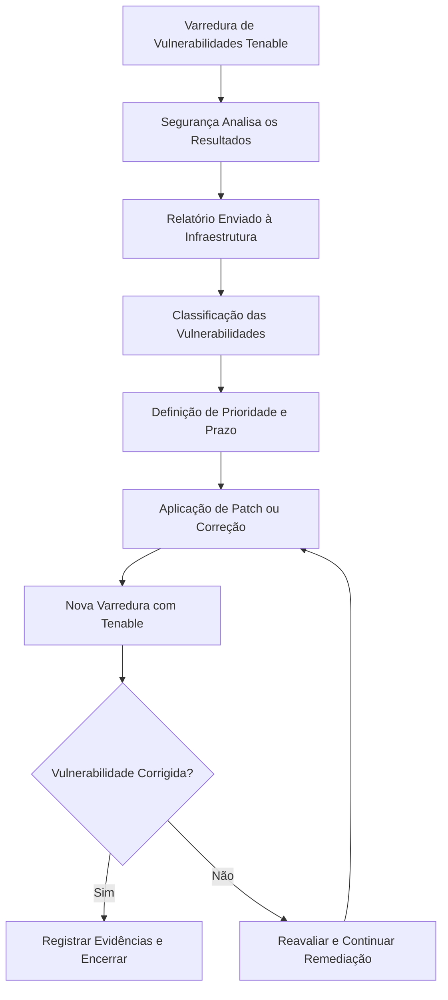
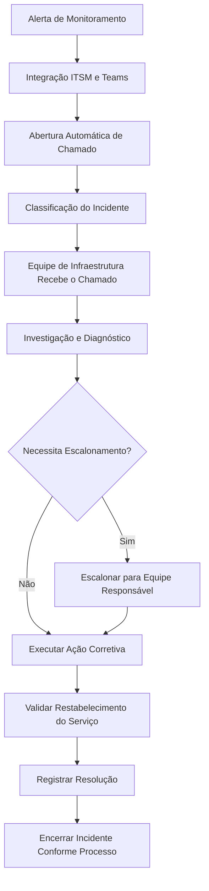
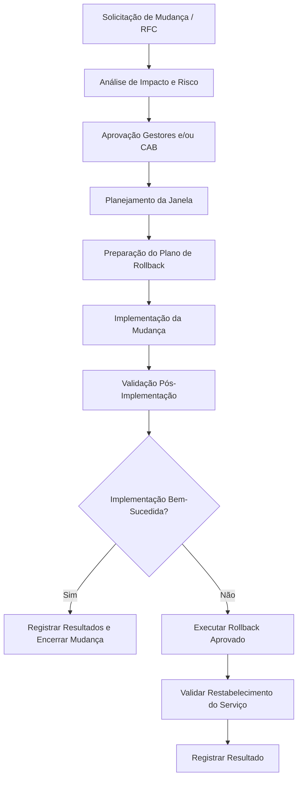

# Procedimentos Técnicos e Runbooks Operacionais

## 1. Objetivo

Este documento define procedimentos operacionais para atividades críticas da infraestrutura corporativa.

Os runbooks contemplam restauração de backups, validação de disaster recovery, remediação de vulnerabilidades, gerenciamento de incidentes e gerenciamento de mudanças.

O objetivo é estabelecer uma abordagem operacional consistente, apoiar a repetibilidade dos processos e manter evidências de execução.

---

## 2. Runbook — Recuperação de Máquinas Virtuais e Aplicações com Veeam

**Plataforma:** Veeam Backup & Replication v12  
**Escopo:** Máquinas virtuais VMware e aplicações suportadas.

### 2.1 Objetivo

Restaurar uma máquina virtual ou aplicação preservando a VM original de produção para comparação e validação sempre que o procedimento de recuperação permitir.

### 2.2 Pré-requisitos

- Identificar a VM ou aplicação afetada.
- Confirmar a necessidade de recuperação e o impacto para o negócio.
- Identificar o ponto de restauração adequado.
- Confirmar o ambiente VMware de destino e os recursos disponíveis.
- Seguir os procedimentos aplicáveis de gerenciamento de incidentes e mudanças.

### 2.3 Procedimento

1. Identificar a máquina virtual e a necessidade de recuperação.
2. Localizar o ponto de restauração adequado no Veeam.
3. Iniciar o fluxo de recuperação aplicável:
   - Instant VM Recovery.
   - Full VM Restore.
4. Para o procedimento documentado de validação lado a lado:
   - Desligar a VM original.
   - Restaurar a VM ao lado da original, sem sobrescrevê-la.
   - Atribuir um Display Name diferente à VM restaurada no cluster VMware.
   - Preservar a VM original para comparação e validação.
5. Inicializar a VM restaurada no ambiente de recuperação designado.
6. Executar as validações técnicas e funcionais.

### 2.4 Checklist de Validação

- [ ] A VM inicializa corretamente.
- [ ] A integridade do sistema operacional é verificada.
- [ ] A conectividade de rede é validada.
- [ ] Os serviços de infraestrutura necessários estão em execução.
- [ ] Os serviços da aplicação estão operacionais.
- [ ] A conectividade com o banco de dados é confirmada, quando aplicável.
- [ ] Os usuários ou responsáveis pelas áreas de negócio realizam testes funcionais.
- [ ] A homologação do negócio é formalmente registrada.

### 2.5 Evidências e Encerramento

Registrar a atividade de recuperação na planilha de controle de testes aplicável e manter as evidências de suporte, incluindo:

- Validação de inicialização da VM.
- Validação da aplicação.
- Registros de chamados das equipes de Infraestrutura e Cloud.
- Registros relacionados ao Change Management.
- Homologação formal do negócio.

A recuperação somente deve ser considerada validada após a conclusão das verificações técnicas e de negócio exigidas.

---

## 3. Runbook — Validação de Disaster Recovery do Site B para GCVE

**Plataforma:** Veeam Backup & Replication v12 e Google Cloud VMware Engine  
**Escopo:** Replicação de máquinas virtuais do Site B e disaster recovery.

### 3.1 Objetivo

Validar a capacidade de recuperação das cargas de trabalho do Site B utilizando o ambiente de replicação hospedado no GCVE.

### 3.2 Frequência de Validação

- Exercícios periódicos de restore e recuperação.
- Simulação anual de indisponibilidade total do Site B.

### 3.3 Pré-requisitos

- Identificar as cargas de trabalho incluídas no exercício.
- Confirmar a criticidade de negócio e os objetivos de recuperação aplicáveis.
- Confirmar a disponibilidade das cargas replicadas no GCVE.
- Coordenar o exercício com as equipes de Infraestrutura, Cloud e as áreas de negócio responsáveis.
- Definir o escopo do teste e as evidências esperadas.
- Seguir os processos aplicáveis de Change Management e gerenciamento de incidentes.

### 3.4 Procedimento

1. Definir o escopo do exercício de recuperação.
2. Identificar as máquinas virtuais selecionadas para validação.
3. Confirmar as informações aplicáveis de replicação e recuperação no Veeam.
4. Executar o exercício de recuperação aprovado no ambiente GCVE.
5. Validar as cargas de trabalho recuperadas.
6. Realizar testes de aplicação e conectividade com bancos de dados, quando aplicável.
7. Solicitar a validação funcional dos usuários responsáveis pelas áreas de negócio.
8. Registrar os resultados, problemas e evidências.
9. Obter a homologação formal do negócio.

### 3.5 Validação da Recuperação

| Área de Validação | Evidência Esperada |
|---|---|
| Recuperação da VM | VM recuperada disponível e inicializando corretamente |
| Sistema operacional | Integridade e inicialização do SO |
| Rede | Conectividade necessária disponível |
| Serviços de infraestrutura | Serviços necessários operacionais |
| Aplicações | Serviços de aplicação respondendo conforme esperado |
| Bancos de dados | Conectividade e integração com aplicações validadas |
| Negócio | Testes funcionais e homologação formal |

### 3.6 Objetivos de Recuperação

Os objetivos de recuperação variam conforme a criticidade das cargas de trabalho.

O ambiente utiliza as seguintes classificações:

- Tier 0
- Tier 1
- Tier 2
- Tier 3

Os valores medidos de RPO e RTO devem ser consultados nos requisitos de recuperação aprovados para cada carga de trabalho. Eles não devem ser inferidos apenas pela classificação de Tier.

### 3.7 Evidências e Encerramento

Manter uma planilha anual de controle dos testes e preservar:

- Escopo e data do teste.
- Cargas de trabalho incluídas no exercício.
- Evidências de validação técnica.
- Validação das aplicações e do negócio.
- Registros das equipes de Infraestrutura e Cloud.
- Mudanças e chamados relacionados.
- Aprovação formal do negócio.

---

## 4. Runbook — Remediação de Vulnerabilidades e Gerenciamento de Patches

**Ferramentas:** Tenable e ManageEngine  
**Escopo:** Sistemas operacionais, servidores de infraestrutura e componentes aplicáveis.

### 4.1 Objetivo

Identificar, classificar, corrigir e validar vulnerabilidades da infraestrutura por meio de um processo controlado de remediação.

### 4.2 Visão Geral do Processo

### 4.3 Procedimento

1. Executar ou receber os resultados de uma varredura de vulnerabilidades do Tenable.
2. A equipe de Segurança analisa os resultados.
3. A Segurança encaminha o relatório de vulnerabilidades para a equipe de Infraestrutura.
4. Classificar os apontamentos conforme os níveis:
   - Critical.
   - High.
   - Medium.
   - Low.
5. Definir os prazos de correção de acordo com a criticidade das vulnerabilidades.
6. Planejar a atividade de remediação e avaliar o impacto operacional.
7. Aplicar os patches necessários por meio do ManageEngine ou utilizar o procedimento técnico de correção aplicável.
8. Realizar as verificações necessárias após a correção.
9. Executar uma nova varredura no Tenable para validar a remediação.
10. Registrar os resultados e as evidências de suporte.

### 4.4 Validação e Encerramento

Uma vulnerabilidade somente deve ser considerada corrigida após a varredura de validação confirmar a ação corretiva.

Manter:

- Relatório original de vulnerabilidades.
- Classificação e prioridade de remediação.
- Registros de patches ou ações corretivas.
- Registros de mudanças relacionados, quando aplicável.
- Resultados da varredura Tenable após a correção.
- Evidências de encerramento.

---

## 5. Runbook — Gerenciamento de Incidentes de Infraestrutura

**Ferramentas:** Zabbix, Grafana, monitoramento nativo dos fabricantes, interface ITSM e Microsoft Teams.

### 5.1 Objetivo

Garantir que incidentes de infraestrutura sejam detectados, classificados, direcionados, escalonados e resolvidos por meio de um processo operacional estruturado.

### 5.2 Escopo do Monitoramento

O monitoramento contempla:

- Utilização de CPU e memória.
- Hosts VMware e máquinas virtuais.
- Capacidade e latência de storage.
- Links e equipamentos de rede.
- Serviços de infraestrutura.
- Aplicações e bancos de dados.

### 5.3 Fluxo de Incidentes

### 5.4 Procedimento

1. Detectar o alerta por meio do Zabbix, Grafana ou monitoramento nativo dos fabricantes.
2. A integração de monitoramento gera um incidente pela interface ITSM e pelo Microsoft Teams.
3. O incidente é classificado automaticamente.
4. A equipe de Infraestrutura recebe o chamado já classificado.
5. Investigar o componente afetado e determinar o impacto operacional.
6. Executar a ação corretiva apropriada.
7. Escalonar para a equipe responsável conforme o impacto e o processo de escalonamento estabelecido.
8. Validar o restabelecimento do serviço.
9. Registrar a resolução e as evidências de suporte.
10. Encerrar o incidente conforme o processo ITSM.

### 5.5 Severidade, Prioridade e SLAs

O processo de gerenciamento de incidentes utiliza os níveis 0, 1, 2 e 3 para severidade e prioridade.

O escalonamento ocorre conforme o impacto no negócio e as equipes responsáveis.

Existem SLAs definidos para atendimento e resolução dos incidentes.

Os critérios específicos de classificação e as metas de SLA devem ser consultados na configuração ITSM aprovada pela organização.

---

## 6. Runbook — Gerenciamento de Mudanças e Rollback

**Escopo:** Mudanças de infraestrutura nos ambientes on-premises e cloud.

### 6.1 Objetivo

Garantir que as mudanças na infraestrutura sejam avaliadas, aprovadas, implementadas e validadas de maneira controlada, considerando os procedimentos de rollback antes da implementação.

### 6.2 Fluxo de Mudanças

### 6.3 Procedimento

1. Criar uma solicitação formal de mudança (RFC).
2. Descrever a mudança proposta, seu escopo e impacto esperado.
3. Realizar a análise de impacto e risco.
4. Obter aprovação dos gestores responsáveis e/ou do Change Advisory Board (CAB).
5. Definir a janela de manutenção.
6. Preparar o plano de rollback antes da implementação.
7. Executar a mudança aprovada durante a janela autorizada.
8. Realizar a validação pós-implementação.
9. Caso a mudança não seja bem-sucedida, seguir o procedimento de rollback aprovado.
10. Registrar o resultado e encerrar a mudança conforme o processo de governança.

### 6.4 Validação e Evidências

Manter:

- RFC e descrição da mudança.
- Análise de impacto e risco.
- Registros de aprovação.
- Janela de manutenção.
- Plano de rollback.
- Evidências da implementação.
- Validação pós-mudança.
- Evidências de rollback, quando aplicável.

---

## 7. Governança Operacional e Evidências

Os runbooks fazem parte do modelo de governança estabelecido para a infraestrutura.

As evidências operacionais são mantidas nos sistemas e registros aplicáveis, incluindo:

- Chamados de incidentes no ITSM.
- Registros de Change Management.
- Registros de testes de restore e recuperação do Veeam.
- Planilha anual de controle dos testes de recuperação.
- Relatórios de vulnerabilidades e varreduras de validação do Tenable.
- Registros de homologação do negócio.
- Evidências das equipes de Infraestrutura e Cloud.

## 8. Controle da Documentação

Estes procedimentos descrevem as práticas operacionais confirmadas.

Sequências exatas de comandos, caminhos de telas específicos dos produtos, limites de aprovação, valores detalhados de SLA e parâmetros de execução específicos dos ambientes devem ser mantidos nos procedimentos internos e registros técnicos correspondentes.

Este documento funciona como referência operacional consolidada para o portfólio de infraestrutura.
