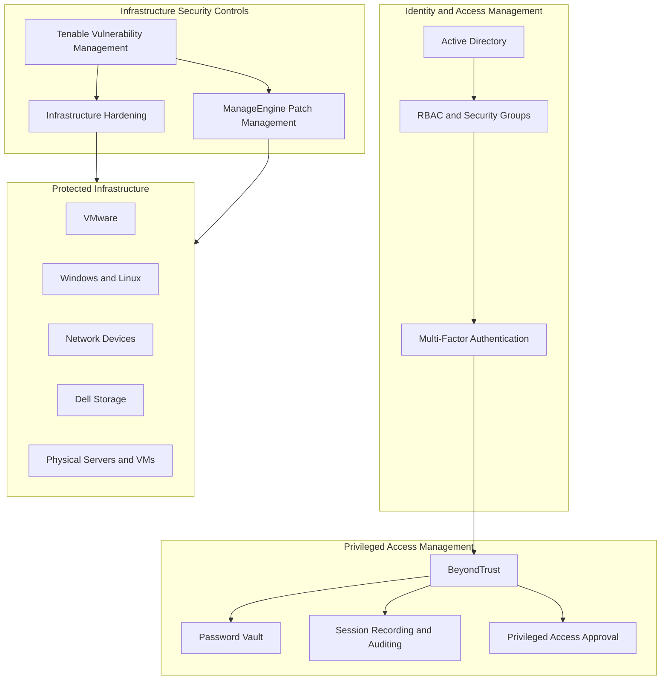
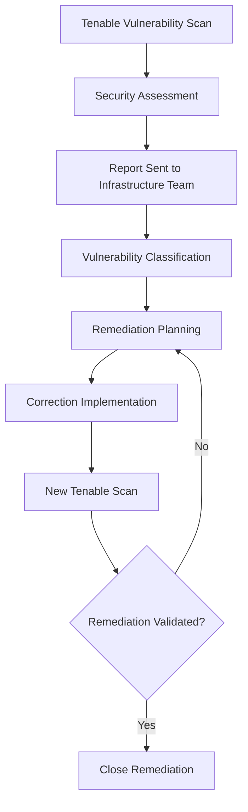

# Infrastructure Security and Hardening

## 1. Overview

Infrastructure security was implemented through a combination of identity and access controls, privileged access management, infrastructure hardening, vulnerability management, and patch management.

These controls applied across the infrastructure environments, including:

- VMware ESXi and vCenter.
- Windows Server and Linux.
- Network infrastructure, including switches, firewalls, and routers.
- Dell storage systems.
- Physical servers and virtual machines.

The security approach combined internal policies, CIS Benchmarks, vendor recommendations, and documented operational procedures.

## 2. Security Architecture

*Conceptual security architecture showing the relationship between identity, privileged access, security assessment, remediation, and protected infrastructure.*

## 3. Identity and Access Management

Active Directory provided centralized authentication and authorization support through security groups and access policies.

The access management strategy included:

- Role-Based Access Control (RBAC).
- Centralized identity management through Active Directory.
- Named individual administrator accounts.
- Multi-Factor Authentication (MFA).
- Separation between privileged and everyday user accounts.
- Administrative access restricted to controlled privileged access processes.

Administrative access levels followed a tiered model:

| Administrative Tier | Purpose |
|---|---|
| Tier 0 | Highest-privilege administrative access |
| Tier 1 | Infrastructure and server administration |
| Tier 2 | Lower-level administrative and operational access |

The tier model supported separation of administrative privileges and access boundaries.

## 4. Privileged Access Management

**BeyondTrust** was used as the Privileged Access Management (PAM) solution.

The platform provided centralized control and auditing of privileged access activities.

Implemented capabilities included:

- Password Vault for privileged credentials.
- Recording and auditing of administrative sessions.
- Approval workflows for privileged access.
- Automatic password rotation.
- Controlled remote access to servers and infrastructure equipment.
- Session duration and access schedule restrictions.

Privileged access activities were subject to controlled access procedures, improving traceability and accountability for administrative operations.

## 5. Infrastructure Hardening

Hardening practices were applied across the infrastructure stack.

The security baseline incorporated:

- CIS Benchmarks.
- Internal security policies.
- Manufacturer security recommendations.
- Organization-specific hardening procedures.

The hardening scope included:

| Infrastructure Layer | Scope |
|---|---|
| Virtualization | VMware ESXi and vCenter |
| Operating Systems | Windows Server and Linux |
| Network | Switches, firewalls, and routers |
| Storage | Dell storage systems |
| Compute | Physical servers and virtual machines |

The objective was to reduce the attack surface, improve configuration consistency, and align infrastructure components with established security requirements.

## 6. Vulnerability Management

Tenable was used to identify and assess infrastructure vulnerabilities.

The vulnerability management process followed a remediation lifecycle:

Vulnerabilities were classified according to severity:

- Critical.
- High.
- Medium.
- Low.

The Security team provided vulnerability reports to the Infrastructure team.

Remediation deadlines were defined according to vulnerability severity. Infrastructure teams implemented the required corrections and coordinated remediation activities with the relevant stakeholders.

A subsequent Tenable scan was performed to validate whether the identified vulnerabilities had been remediated.

## 7. Patch Management

ManageEngine was used to support patch management activities.

The patch management process included:

1. Identification of required operating system and software updates.
2. Assessment and prioritization of applicable patches.
3. Planning of remediation activities.
4. Patch deployment through ManageEngine or specific operational procedures.
5. Validation after implementation.
6. Tracking of pending corrections and remediation status.

Patch activities were aligned with infrastructure operational requirements and established change management procedures.

## 8. Security Governance and Operational Controls

Security implementation was integrated with the organization's operational governance processes.

The controls included:

- Controlled privileged access.
- Administrative session auditing.
- Vulnerability classification and remediation deadlines.
- Patch deployment and validation.
- Infrastructure hardening standards.
- Change management coordination.
- Documentation of security remediation activities.

These practices supported accountability, traceability, and consistency across infrastructure operations.

## 9. Key Architecture Decisions

| Decision | Technical rationale |
|---|---|
| Active Directory | Centralized identity and access management |
| RBAC and security groups | Role-based access control |
| MFA | Additional authentication protection |
| BeyondTrust PAM | Centralized privileged access control and auditing |
| CIS Benchmarks | Established security configuration baselines |
| Tenable | Infrastructure vulnerability identification and validation |
| ManageEngine | Patch management support |
| Post-remediation scanning | Verify that identified vulnerabilities were addressed |

## 10. Architecture Outcomes

The security architecture provided:

- Centralized identity and access management.
- Separation of privileged and everyday accounts.
- Controlled and auditable administrative sessions.
- Standardized hardening practices across infrastructure layers.
- Structured vulnerability classification and remediation.
- Patch management processes with post-deployment validation.
- Improved traceability of infrastructure security activities.

## 11. Scope and Technical Accuracy

This document records the confirmed security technologies, controls, and operational practices.

The following implementation details are intentionally not specified:

- Exact CIS Benchmark versions and compliance scores.
- Specific hardening settings and configuration baselines.
- BeyondTrust product modules and integration details.
- Tenable product edition and scan configuration.
- ManageEngine product edition and deployment architecture.
- Exact remediation deadlines for each vulnerability severity.
- Patch deployment schedules and maintenance windows.
- Security metrics and vulnerability reduction measurements.

These details can be added when the corresponding technical records are available.
