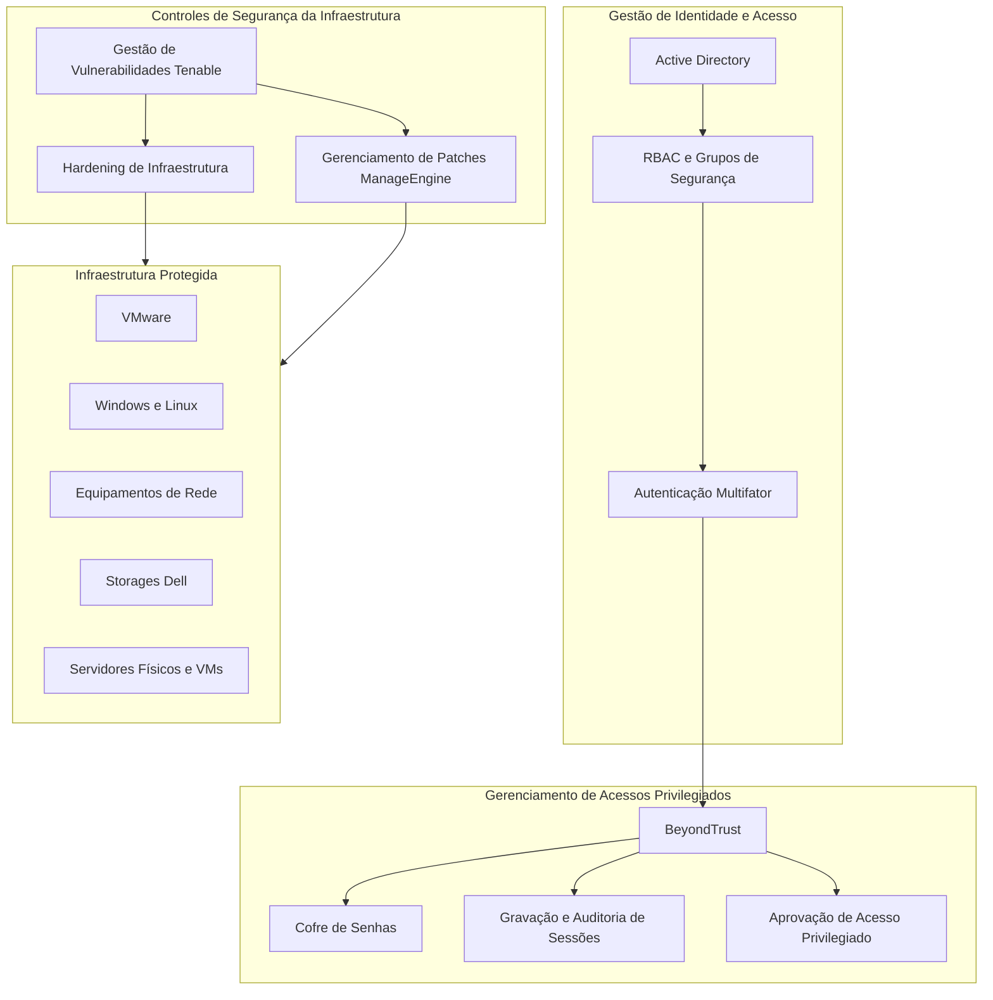
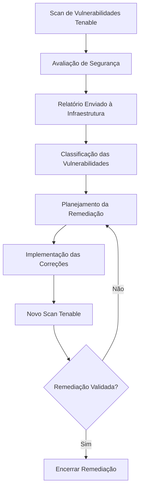

# Segurança e Hardening de Infraestrutura

## 1. Visão Geral

A segurança da infraestrutura era implementada por meio de uma combinação de controles de identidade e acesso, gerenciamento de acessos privilegiados, hardening de infraestrutura, gestão de vulnerabilidades e gerenciamento de patches.

Esses controles eram aplicados aos diferentes componentes da infraestrutura, incluindo:

- VMware ESXi e vCenter.
- Windows Server e Linux.
- Infraestrutura de rede, incluindo switches, firewalls e roteadores.
- Storages Dell.
- Servidores físicos e máquinas virtuais.

A abordagem de segurança combinava políticas internas, CIS Benchmarks, recomendações dos fabricantes e procedimentos operacionais documentados.

## 2. Arquitetura de Segurança

*Arquitetura conceitual de segurança, demonstrando a relação entre identidade, acesso privilegiado, avaliação de segurança, remediação e infraestrutura protegida.*

## 3. Gestão de Identidade e Acesso

O Active Directory fornecia autenticação centralizada e suporte à autorização por meio de grupos de segurança e políticas de acesso.

A estratégia de gerenciamento de acesso contemplava:

- Role-Based Access Control (RBAC).
- Gerenciamento centralizado de identidades pelo Active Directory.
- Contas administrativas nominais e individuais.
- Autenticação Multifator (MFA).
- Separação entre contas privilegiadas e contas utilizadas nas atividades cotidianas.
- Acesso administrativo restrito aos processos controlados de acesso privilegiado.

Os níveis de acesso administrativo seguiam um modelo hierárquico:

| Nível Administrativo | Finalidade |
|---|---|
| Tier 0 | Acesso administrativo de maior privilégio |
| Tier 1 | Administração de infraestrutura e servidores |
| Tier 2 | Acesso administrativo e operacional de menor privilégio |

Esse modelo permitia separar privilégios administrativos e estabelecer limites de acesso entre diferentes níveis de administração.

## 4. Privileged Access Management

O **BeyondTrust** era utilizado como solução de Privileged Access Management (PAM).

A plataforma fornecia controle centralizado e auditoria das atividades que envolviam acessos privilegiados.

As funcionalidades implementadas incluíam:

- Password Vault para armazenamento de credenciais privilegiadas.
- Gravação e auditoria de sessões administrativas.
- Fluxos de aprovação para acessos privilegiados.
- Rotação automática de senhas.
- Acesso remoto controlado a servidores e equipamentos de infraestrutura.
- Restrições de duração e horários das sessões.

As atividades de acesso privilegiado estavam sujeitas a procedimentos controlados, aumentando a rastreabilidade e a responsabilização pelas operações administrativas.

## 5. Hardening de Infraestrutura

As práticas de hardening eram aplicadas em diferentes camadas da infraestrutura.

A baseline de segurança incorporava:

- CIS Benchmarks.
- Políticas internas de segurança.
- Recomendações de segurança dos fabricantes.
- Procedimentos próprios de hardening da organização.

O escopo de hardening incluía:

| Camada de Infraestrutura | Escopo |
|---|---|
| Virtualização | VMware ESXi e vCenter |
| Sistemas Operacionais | Windows Server e Linux |
| Rede | Switches, firewalls e roteadores |
| Armazenamento | Storages Dell |
| Computação | Servidores físicos e máquinas virtuais |

O objetivo era reduzir a superfície de ataque, melhorar a consistência das configurações e alinhar os componentes da infraestrutura aos requisitos de segurança estabelecidos.

## 6. Gestão de Vulnerabilidades

O Tenable era utilizado para identificar e avaliar vulnerabilidades na infraestrutura.

O processo de gestão de vulnerabilidades seguia um ciclo estruturado de remediação:

As vulnerabilidades eram classificadas conforme os seguintes níveis de severidade:

- Critical.
- High.
- Medium.
- Low.

A equipe de Segurança encaminhava os relatórios de vulnerabilidades à equipe de Infraestrutura.

Os prazos de remediação eram definidos conforme a severidade das vulnerabilidades. As equipes de infraestrutura implementavam as correções necessárias e coordenavam as atividades com as áreas responsáveis.

Após a implementação, um novo scan do Tenable era executado para validar se as vulnerabilidades identificadas haviam sido corrigidas.

## 7. Gerenciamento de Patches

O ManageEngine era utilizado para apoiar as atividades de gerenciamento de patches.

O processo contemplava:

1. Identificação de atualizações necessárias para sistemas operacionais e softwares.
2. Avaliação e priorização dos patches aplicáveis.
3. Planejamento das atividades de correção.
4. Implantação dos patches por meio do ManageEngine ou de procedimentos operacionais específicos.
5. Validação após a implementação.
6. Acompanhamento das correções pendentes e do status de remediação.

As atividades de patch management eram alinhadas aos requisitos operacionais da infraestrutura e aos procedimentos estabelecidos de gerenciamento de mudanças.

## 8. Governança de Segurança e Controles Operacionais

A implementação de segurança estava integrada aos processos de governança operacional da organização.

Os controles contemplavam:

- Acesso privilegiado controlado.
- Auditoria de sessões administrativas.
- Classificação de vulnerabilidades e prazos de remediação.
- Implantação e validação de patches.
- Padrões de hardening da infraestrutura.
- Integração com o processo de gerenciamento de mudanças.
- Documentação das atividades de remediação de segurança.

Essas práticas contribuíam para a responsabilização, rastreabilidade e consistência das operações de infraestrutura.

## 9. Decisões Técnicas da Arquitetura

| Decisão | Justificativa técnica |
|---|---|
| Active Directory | Gerenciamento centralizado de identidade e acesso |
| RBAC e grupos de segurança | Controle de acesso baseado em funções |
| MFA | Camada adicional de proteção na autenticação |
| BeyondTrust PAM | Controle centralizado e auditoria de acessos privilegiados |
| CIS Benchmarks | Baselines reconhecidas para configuração segura |
| Tenable | Identificação e validação de vulnerabilidades na infraestrutura |
| ManageEngine | Suporte ao gerenciamento de patches |
| Novo scan após remediação | Verificar se as vulnerabilidades identificadas foram corrigidas |

## 10. Resultados da Arquitetura

A arquitetura de segurança proporcionou:

- Gerenciamento centralizado de identidade e acesso.
- Separação entre contas privilegiadas e contas cotidianas.
- Sessões administrativas controladas e auditáveis.
- Padronização das práticas de hardening nas diferentes camadas da infraestrutura.
- Classificação e remediação estruturada de vulnerabilidades.
- Processos de gerenciamento de patches com validação após implantação.
- Maior rastreabilidade das atividades de segurança da infraestrutura.

## 11. Escopo e Precisão Técnica

Este documento registra as tecnologias, os controles e as práticas operacionais de segurança confirmadas.

Os seguintes detalhes de implementação não foram especificados:

- Versões exatas dos CIS Benchmarks e pontuações de conformidade.
- Configurações específicas de hardening e baselines.
- Módulos do produto BeyondTrust e detalhes de integração.
- Edição do produto Tenable e configuração dos scans.
- Edição do produto ManageEngine e arquitetura de implantação.
- Prazos exatos de remediação para cada nível de severidade.
- Agendamentos de implantação de patches e janelas de manutenção.
- Métricas de segurança e redução de vulnerabilidades.

Essas informações poderão ser acrescentadas quando os respectivos registros técnicos estiverem disponíveis.
