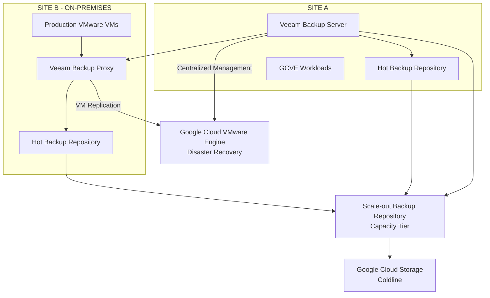

# Business Continuity & Disaster Recovery — Veeam Backup, Replication, Recovery Testing & Operational Governance

## 1. Executive Summary

This case study describes the Business Continuity and Disaster Recovery (BC/DR) strategy implemented across two infrastructure sites, combining enterprise backup operations, virtual machine replication, cloud-based disaster recovery capabilities, and recurring recovery validation.

The environment used **Veeam Backup & Replication v12** as its central backup and replication platform.

The strategy covered two complementary infrastructure models:

- **Site A:** Its virtualized infrastructure had been migrated to Google Cloud VMware Engine (GCVE).
- **Site B:** Its VMware infrastructure remained on-premises, with virtual machines replicated to GCVE for disaster recovery.

The solution combined local backup repositories, a Scale-out Backup Repository (SOBR) with Capacity Tier, Google Cloud Storage Coldline, and Veeam replication to GCVE.

Recovery objectives were defined according to application and business criticality, using service tiers 0, 1, 2, and 3. The strategy also included recurring restore tests, an annual full Site B unavailability simulation, documented validation procedures, and formal business acceptance.

## 2. Business Continuity Architecture

The BC/DR strategy was designed to protect workloads and support recovery operations across the two-site infrastructure.

The main architectural components were:

| Component | Technology | Responsibility |
|---|---|---|
| Backup management | Veeam Backup & Replication v12 | Centralized backup and replication management |
| Backup server | Veeam Backup Server at Site A | Centralized administration and job management |
| Backup processing | Veeam Backup Proxy at Site B | Data processing and transport |
| Local backup storage | Hot backup repositories | Local backup storage |
| Repository architecture | Scale-out Backup Repository (SOBR) | Logical repository management and Capacity Tier integration |
| Capacity Tier | Google Cloud Storage Coldline | Cloud-based backup capacity tier |
| Disaster recovery platform | Google Cloud VMware Engine | Recovery destination for replicated Site B virtual machines |

The architecture combined backup retention and restore capabilities with VM replication to support different recovery scenarios.

## 3. Conceptual Backup and Disaster Recovery Diagram

**Diagram note:** This is a conceptual representation of the confirmed architecture. It does not specify undocumented repository membership, job configuration, retention policies, replication schedules, or physical connectivity.

## 4. Backup Architecture

The backup platform was based on Veeam Backup & Replication v12.

The architecture included:

- A centralized Veeam Backup Server located at Site A.
- A Veeam Backup Proxy located at Site B.
- Local hot backup repositories.
- Scale-out Backup Repository (SOBR).
- Capacity Tier configured to move backup data to Google Cloud Storage Coldline.

The use of SOBR with Capacity Tier provided an architecture that combined local backup storage with cloud-based capacity.

This approach supported the broader data protection strategy by extending backup storage beyond the local infrastructure.

### 4.1 Veeam Backup Server and Proxy Roles

**Veeam Backup Server — Site A**

The Veeam Backup Server provided centralized administration and orchestration of the backup environment.

Its responsibilities included managing backup operations and coordinating the platform's processing components.

**Veeam Backup Proxy — Site B**

The Veeam Backup Proxy participated in backup data processing and transport.

Its placement at Site B supported the backup architecture for workloads hosted in the on-premises environment.

### 4.2 SOBR and Capacity Tier

The backup architecture used a Scale-out Backup Repository with Capacity Tier.

The Capacity Tier moved backup data to **Google Cloud Storage Coldline**, extending the backup storage architecture to cloud object storage.

The design combined:

- Local hot backup repositories.
- SOBR logical repository management.
- Capacity Tier integration.
- Google Cloud Storage Coldline as the cloud storage destination.

Specific retention periods, capacity thresholds, operational schedules, and repository membership details are not included because they were not confirmed as project specifications.

## 5. Disaster Recovery Architecture — Site B to GCVE

Site B's on-premises VMware environment was integrated with the disaster recovery strategy through Veeam VM replication.

Virtual machines were replicated from Site B to Google Cloud VMware Engine.

This established GCVE as the disaster recovery destination for the workloads covered by the replication strategy.

The architecture provided two complementary protection mechanisms:

| Protection mechanism | Primary objective |
|---|---|
| Backup | Protect data and support point-in-time restoration |
| VM replication | Maintain recovery copies of selected virtual machines in the DR environment |

The distinction is important: backup and replication address different recovery requirements and should not be treated as interchangeable technologies.

The project also recognized that recovery requirements varied according to workload criticality and business impact.

## 6. RPO, RTO and Workload Criticality

Recovery Point Objective (RPO) and Recovery Time Objective (RTO) were defined according to the criticality of each application and its impact on business operations.

The project used four service criticality tiers:

| Service Tier | Criticality | Recovery planning consideration |
|---|---|---|
| Tier 0 | Highest | Most critical infrastructure and business dependencies |
| Tier 1 | High | High-impact services requiring prioritized recovery |
| Tier 2 | Medium | Important services with comparatively lower recovery priority |
| Tier 3 | Lower | Services with lower business recovery priority |

Applications with direct financial impact on the business received particular consideration during recovery planning.

The tier classification was used to guide recovery priorities and the definition of application-specific RPO and RTO objectives.

**Important:** The tiers describe workload criticality. They do not represent fixed RPO or RTO values. Actual recovery objectives varied by application and were not identical across the environment.

## 7. Recovery Testing Strategy

Recovery validation was an established part of the operational governance model.

The testing strategy included two distinct activities:

### 7.1 Semiannual Restore Tests

Restore tests were conducted every six months.

These exercises validated the ability to restore infrastructure and application workloads using the available Veeam recovery mechanisms.

The testing scope included:

- Individual virtual machine restoration.
- Application recovery validation.
- Operating system boot verification.
- Network connectivity checks.
- Service and application validation.
- Database connectivity checks.
- Functional validation by business users or responsible departments.

### 7.2 Annual Full Site B Unavailability Simulation

Once a year, the organization conducted a simulation of complete Site B unavailability.

This exercise was intended to validate the disaster recovery strategy under a broader site-level failure scenario.

The simulation was distinct from the semiannual restore tests and focused on the recovery process associated with the loss of the Site B environment.

### 7.3 Site A Recovery Validation

Site A followed a different validation scope.

Its recovery tests focused on individual virtual machine and application restoration.

A full-site unavailability simulation was not performed for Site A as part of the described testing process.

## 8. Restore Procedures and Technical Validation

The recovery process included two main Veeam recovery approaches:

- Instant VM Recovery.
- Full VM Restore.

### 8.1 Instant VM Recovery — Validation Procedure

The Instant VM Recovery validation procedure was designed to preserve the original virtual machine while allowing the recovery copy to be tested.

The procedure followed these steps:

1. Identify the virtual machine selected for the recovery test.
2. Shut down the original virtual machine.
3. Start the recovery operation using Instant VM Recovery.
4. Restore the virtual machine alongside the original environment without overwriting the original VM.
5. Assign a different Display Name to the restored virtual machine in the VMware cluster.
6. Validate operating system startup and integrity.
7. Validate network connectivity and access to required infrastructure services.
8. Validate application services and database connectivity.
9. Perform functional testing with the responsible users or business areas.
10. Record the test evidence and formal validation results.

Using a different Display Name made it possible to distinguish the recovery instance from the original virtual machine during validation.

The purpose of this procedure was to validate recovery while preserving the original VM rather than replacing it.

### 8.2 Full VM Restore

Full VM Restore was also included in the recovery testing strategy.

It provided an additional recovery method for validating the restoration of complete virtual machines.

The validation process covered the recovered VM's boot process, operating system integrity, network connectivity, application services, and business functionality.

Specific restore durations and measured recovery performance were not included in this documentation because no verified measurements were provided.

## 9. Recovery Validation Criteria

Recovery tests were not considered complete solely because a virtual machine started successfully.

The validation process included multiple technical and business checks:

| Validation Area | Verification |
|---|---|
| Virtual machine | Successful recovery and startup |
| Operating system | Boot and basic integrity |
| Network | Connectivity to required servers and network services |
| Application | Availability and functionality of application services |
| Database | Database connectivity |
| Business functionality | Functional validation by users or responsible departments |
| Evidence | Documentation of test execution and results |
| Acceptance | Formal validation by the business area |

This approach connected technical recovery validation with actual application usability and business acceptance.

## 10. Test Evidence and Governance

Recovery tests were tracked through an annual Excel control spreadsheet.

The control process included:

- Recording the recovery tests performed.
- Documenting test evidence.
- Maintaining evidence of operating system startup and application validation.
- Recording related Infrastructure and Cloud team tickets.
- Linking activities to Change Management records.
- Documenting validation and business acceptance.

Formal approval from the business area was part of the recovery validation process.

The governance model helped establish traceability between technical recovery activities, supporting tickets, change records, and business acceptance.

## 11. Integration with Change Management

Recovery tests and infrastructure recovery activities were integrated into the organization's Change Management process.

Relevant governance activities included:

- Impact and risk analysis.
- Approval by managers and/or the Change Advisory Board (CAB).
- Maintenance window planning when applicable.
- Rollback planning.
- Post-implementation validation.
- Documentation of execution evidence.

This ensured that recovery activities were conducted within an established operational control framework.

## 12. Key Technical and Operational Decisions

### Decision 1 — Use Veeam Backup & Replication v12

**Decision:** Adopt Veeam Backup & Replication v12 as the central backup and replication platform.

**Rationale:** Consolidate backup management, restore operations, and VM replication within a common data protection platform.

### Decision 2 — Combine Local Repositories and Cloud Capacity Tier

**Decision:** Use SOBR with Capacity Tier and Google Cloud Storage Coldline.

**Rationale:** Extend the backup storage architecture beyond local repositories through cloud-based capacity.

### Decision 3 — Replicate Site B Virtual Machines to GCVE

**Decision:** Use Veeam replication to send selected Site B virtual machines to GCVE.

**Rationale:** Establish a cloud-based disaster recovery destination for the on-premises environment.

### Decision 4 — Define Recovery Objectives by Criticality

**Decision:** Classify workloads into service tiers 0, 1, 2, and 3 and define RPO/RTO objectives according to application requirements.

**Rationale:** Align recovery priorities with business impact, including applications with direct financial impact.

### Decision 5 — Establish Recurring Recovery Validation

**Decision:** Conduct restore tests every six months and a full Site B unavailability simulation annually.

**Rationale:** Validate the recovery process through recurring technical exercises and a broader site-level scenario.

### Decision 6 — Require Technical and Business Validation

**Decision:** Validate operating systems, network connectivity, application services, databases, and business functionality, with formal business acceptance.

**Rationale:** Ensure that recovery success represents application usability and business readiness, not merely successful VM startup.

## 13. Outcomes and Operational Value

The BC/DR strategy established a structured approach to infrastructure protection and recovery validation.

Key outcomes included:

- Centralized backup and replication management through Veeam Backup & Replication v12.
- Local hot backup repositories integrated with SOBR.
- Capacity Tier integration with Google Cloud Storage Coldline.
- Replication of Site B virtual machines to GCVE.
- Recovery planning based on service criticality tiers.
- Semiannual restore testing.
- Annual full Site B unavailability simulation.
- Use of Instant VM Recovery and Full VM Restore.
- Technical and business-level recovery validation.
- Annual test tracking and supporting evidence.
- Formal business acceptance and integration with Change Management.

The strategy connected data protection technologies with operational governance and business recovery requirements.

## 14. Documentation Boundaries and Metrics

This case study documents confirmed architecture, procedures, and governance practices.

The following values and configurations are intentionally not specified because they require additional project evidence:

- Exact RPO and RTO values for individual workloads.
- Backup retention periods.
- Backup and replication schedules.
- Replication bandwidth and measured performance.
- Actual recovery durations.
- Recovery success percentages.
- Detailed Veeam job and repository configurations.
- Exact list of workloads covered by replication.
- Measured business downtime avoided.

These details should only be added when supported by verified operational records, configuration exports, or test evidence.

## 15. Conclusion

The Business Continuity and Disaster Recovery strategy combined Veeam-based backup, cloud Capacity Tier storage, VM replication to GCVE, and recurring recovery validation.

The approach recognized the different infrastructure models of Site A and Site B while establishing a common data protection and governance framework.

By combining semiannual restore tests, annual Site B unavailability simulations, application-level validation, and formal business acceptance, the organization established a structured process for assessing recovery readiness and supporting business continuity.
