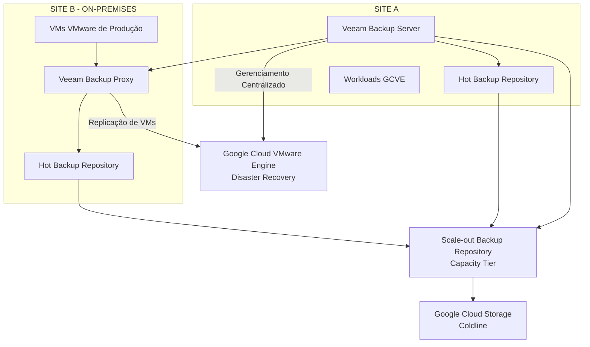

# Continuidade de Negócios e Disaster Recovery — Backup Veeam, Replicação, Testes de Recuperação e Governança Operacional

## 1. Resumo Executivo

Este estudo de caso apresenta a estratégia de Continuidade de Negócios e Disaster Recovery (BC/DR) implementada entre dois sites de infraestrutura, combinando operações corporativas de backup, replicação de máquinas virtuais, recursos de recuperação em nuvem e validações periódicas dos procedimentos de recuperação.

O ambiente utilizava o **Veeam Backup & Replication v12** como plataforma central de backup e replicação.

A estratégia contemplava dois modelos complementares de infraestrutura:

- **Site A:** sua infraestrutura virtualizada havia sido migrada para o Google Cloud VMware Engine (GCVE).
- **Site B:** sua infraestrutura VMware permanecia on-premises, com máquinas virtuais replicadas para o GCVE como destino de Disaster Recovery.

A solução combinava repositórios locais de backup, Scale-out Backup Repository (SOBR) com Capacity Tier, Google Cloud Storage Coldline e replicação de VMs para o GCVE.

Os objetivos de recuperação eram definidos conforme a criticidade das aplicações e seu impacto para o negócio, utilizando os níveis de serviço 0, 1, 2 e 3. A estratégia também contemplava testes recorrentes de restore, simulação anual de indisponibilidade total do Site B, procedimentos documentados de validação e homologação formal pelas áreas de negócio.

## 2. Arquitetura de Continuidade de Negócios

A estratégia de BC/DR foi projetada para proteger as cargas de trabalho e suportar operações de recuperação entre os dois sites.

Os principais componentes arquiteturais eram:

| Componente | Tecnologia | Responsabilidade |
|---|---|---|
| Gerenciamento de backup | Veeam Backup & Replication v12 | Gerenciamento centralizado de backup e replicação |
| Servidor de backup | Veeam Backup Server no Site A | Administração centralizada e gerenciamento dos jobs |
| Processamento de backup | Veeam Backup Proxy no Site B | Processamento e transporte de dados |
| Armazenamento local | Repositórios de backup hot | Armazenamento local dos backups |
| Arquitetura de repositórios | Scale-out Backup Repository (SOBR) | Gerenciamento lógico dos repositórios e integração com Capacity Tier |
| Capacity Tier | Google Cloud Storage Coldline | Camada de capacidade de armazenamento de backup em nuvem |
| Plataforma de Disaster Recovery | Google Cloud VMware Engine | Destino de recuperação das máquinas virtuais replicadas do Site B |

A arquitetura combinava retenção de backups e recursos de restauração com replicação de máquinas virtuais para atender a diferentes cenários de recuperação.

## 3. Diagrama Conceitual de Backup e Disaster Recovery

**Observação sobre o diagrama:** trata-se de uma representação conceitual da arquitetura confirmada. Não são especificados vínculos detalhados entre repositórios e SOBRs, configurações de jobs, políticas de retenção, agendamentos de replicação ou conectividade física.

## 4. Arquitetura de Backup

A plataforma de backup era baseada no Veeam Backup & Replication v12.

A arquitetura incluía:

- Veeam Backup Server centralizado no Site A.
- Veeam Backup Proxy localizado no Site B.
- Repositórios locais de backup hot.
- Scale-out Backup Repository (SOBR).
- Capacity Tier configurado para movimentar dados de backup para o Google Cloud Storage Coldline.

A utilização de SOBR com Capacity Tier proporcionava uma arquitetura que combinava armazenamento local de backup com capacidade de armazenamento em nuvem.

Essa abordagem suportava a estratégia de proteção de dados, estendendo o armazenamento de backup para além da infraestrutura local.

### 4.1 Responsabilidades do Veeam Backup Server e Proxy

**Veeam Backup Server — Site A**

O Veeam Backup Server fornecia administração e orquestração centralizadas do ambiente de backup.

Suas responsabilidades incluíam o gerenciamento das operações de backup e a coordenação dos componentes de processamento da plataforma.

**Veeam Backup Proxy — Site B**

O Veeam Backup Proxy participava do processamento e transporte dos dados de backup.

Sua localização no Site B integrava o processamento à arquitetura de proteção das cargas hospedadas no ambiente on-premises.

### 4.2 SOBR e Capacity Tier

A arquitetura de backup utilizava Scale-out Backup Repository com Capacity Tier.

O Capacity Tier movimentava dados de backup para o **Google Cloud Storage Coldline**, estendendo a arquitetura de armazenamento para object storage em nuvem.

O desenho combinava:

- Repositórios locais de backup hot.
- Gerenciamento lógico por meio do SOBR.
- Integração com Capacity Tier.
- Google Cloud Storage Coldline como destino de armazenamento em nuvem.

Períodos específicos de retenção, limites de capacidade, agendamentos operacionais e detalhes de associação dos repositórios não são incluídos, pois não foram confirmados como especificações do projeto.

## 5. Arquitetura de Disaster Recovery — Site B para GCVE

O ambiente VMware on-premises do Site B foi integrado à estratégia de Disaster Recovery por meio da replicação de máquinas virtuais com Veeam.

As máquinas virtuais eram replicadas do Site B para o Google Cloud VMware Engine.

Com isso, o GCVE foi estabelecido como destino de Disaster Recovery para as cargas de trabalho contempladas pela estratégia de replicação.

A arquitetura disponibilizava dois mecanismos complementares de proteção:

| Mecanismo de proteção | Objetivo principal |
|---|---|
| Backup | Proteger dados e permitir restaurações para pontos específicos no tempo |
| Replicação de VMs | Manter cópias recuperáveis de máquinas virtuais selecionadas no ambiente de DR |

Essa distinção é importante: backup e replicação atendem a requisitos diferentes de recuperação e não devem ser tratados como tecnologias intercambiáveis.

O projeto também considerava que os requisitos de recuperação variavam conforme a criticidade das cargas de trabalho e seu impacto para o negócio.

## 6. RPO, RTO e Criticidade das Aplicações

Os objetivos de Recovery Point Objective (RPO) e Recovery Time Objective (RTO) eram definidos conforme a criticidade de cada aplicação e seu impacto nas operações do negócio.

O projeto utilizava quatro níveis de criticidade:

| Service Tier | Criticidade | Consideração no planejamento |
|---|---|---|
| Tier 0 | Mais alta | Infraestrutura e dependências de negócio mais críticas |
| Tier 1 | Alta | Serviços de grande impacto que exigem prioridade na recuperação |
| Tier 2 | Média | Serviços importantes com prioridade de recuperação comparativamente menor |
| Tier 3 | Menor | Serviços com menor prioridade de recuperação para o negócio |

Aplicações com impacto financeiro direto para o negócio recebiam atenção especial durante o planejamento de recuperação.

A classificação por tiers era utilizada para orientar as prioridades de recuperação e a definição dos objetivos específicos de RPO e RTO de cada aplicação.

**Importante:** os tiers representam a criticidade das cargas de trabalho. Não representam valores fixos de RPO ou RTO. Os objetivos efetivos variavam conforme a aplicação e não eram iguais para todo o ambiente.

## 7. Estratégia de Testes de Recuperação

A validação da recuperação fazia parte do modelo de governança operacional.

A estratégia de testes contemplava duas atividades distintas:

### 7.1 Testes Semestrais de Restore

Os testes de restauração eram realizados a cada seis meses.

Esses exercícios validavam a capacidade de restaurar a infraestrutura e as aplicações utilizando os mecanismos de recuperação disponíveis no Veeam.

O escopo dos testes incluía:

- Restauração individual de máquinas virtuais.
- Validação da recuperação de aplicações.
- Verificação de inicialização do sistema operacional.
- Verificação de conectividade de rede.
- Validação de serviços e aplicações.
- Verificação de conectividade com bancos de dados.
- Testes funcionais realizados pelos usuários ou departamentos responsáveis.

### 7.2 Simulação Anual de Indisponibilidade Total do Site B

Uma vez por ano, a organização realizava uma simulação de indisponibilidade completa do Site B.

O exercício tinha como objetivo validar a estratégia de Disaster Recovery diante de um cenário mais amplo de falha do site.

Essa simulação era distinta dos testes semestrais de restore e tinha foco no processo de recuperação associado à perda do ambiente do Site B.

### 7.3 Validação de Recuperação do Site A

O Site A possuía um escopo de validação diferente.

Seus testes eram concentrados na restauração de máquinas virtuais e aplicações individuais.

Não era realizada uma simulação de indisponibilidade total do Site A como parte do processo de testes descrito.

## 8. Procedimentos de Restore e Validação Técnica

O processo de recuperação contemplava duas principais modalidades do Veeam:

- Instant VM Recovery.
- Full VM Restore.

### 8.1 Instant VM Recovery — Procedimento de Validação

O procedimento de validação com Instant VM Recovery foi estruturado para preservar a máquina virtual original enquanto permitia testar a cópia recuperada.

O procedimento seguia estas etapas:

1. Identificar a máquina virtual selecionada para o teste de recuperação.
2. Desligar a máquina virtual original.
3. Iniciar o processo de recuperação utilizando Instant VM Recovery.
4. Restaurar a máquina virtual ao lado do ambiente original, sem sobrescrever a VM original.
5. Atribuir um Display Name diferente à máquina virtual restaurada no cluster VMware.
6. Validar a inicialização e a integridade do sistema operacional.
7. Validar a conectividade de rede e o acesso aos serviços de infraestrutura necessários.
8. Validar os serviços da aplicação e a conectividade com bancos de dados.
9. Realizar testes funcionais com os usuários ou áreas de negócio responsáveis.
10. Registrar as evidências do teste e os resultados da validação formal.

A utilização de um Display Name diferente permitia distinguir a instância recuperada da máquina virtual original durante a validação.

O objetivo do procedimento era validar a recuperação preservando a VM original, em vez de substituí-la.

### 8.2 Full VM Restore

O Full VM Restore também fazia parte da estratégia de testes de recuperação.

Esse mecanismo disponibilizava um método adicional para validar a restauração completa de máquinas virtuais.

O processo de validação contemplava inicialização da VM recuperada, integridade do sistema operacional, conectividade de rede, serviços da aplicação e funcionalidade para o negócio.

Durações específicas de restauração e métricas de desempenho da recuperação não foram incluídas nesta documentação, pois não foram fornecidas medições verificadas.

## 9. Critérios de Validação da Recuperação

Os testes de recuperação não eram considerados concluídos apenas porque uma máquina virtual havia iniciado corretamente.

O processo de validação contemplava diferentes verificações técnicas e de negócio:

| Área de validação | Verificação |
|---|---|
| Máquina virtual | Recuperação e inicialização bem-sucedidas |
| Sistema operacional | Boot e integridade básica |
| Rede | Conectividade com servidores e serviços de rede necessários |
| Aplicação | Disponibilidade e funcionamento dos serviços da aplicação |
| Banco de dados | Conectividade com o banco de dados |
| Funcionalidade de negócio | Validação funcional pelos usuários ou departamentos responsáveis |
| Evidências | Documentação da execução e dos resultados dos testes |
| Homologação | Validação formal pela área de negócio |

Essa abordagem conectava a validação técnica da recuperação à usabilidade efetiva das aplicações e à homologação do negócio.

## 10. Evidências dos Testes e Governança

Os testes de recuperação eram controlados por meio de uma planilha Excel anual.

O processo de controle incluía:

- Registro dos testes de recuperação realizados.
- Documentação das evidências dos testes.
- Manutenção de evidências de inicialização dos sistemas operacionais e validação das aplicações.
- Registro dos chamados relacionados às equipes de Infraestrutura e Cloud.
- Associação das atividades aos registros de Change Management.
- Documentação da validação e homologação das áreas de negócio.

A aprovação formal pela área de negócio fazia parte do processo de validação da recuperação.

Esse modelo de governança permitia estabelecer rastreabilidade entre as atividades técnicas de recuperação, os chamados de suporte, os registros de mudança e a homologação do negócio.

## 11. Integração com Change Management

Os testes de recuperação e as atividades de recuperação da infraestrutura eram integrados ao processo corporativo de Change Management.

As atividades de governança relevantes incluíam:

- Análise de impacto e risco.
- Aprovação por gestores e/ou Change Advisory Board (CAB).
- Planejamento de janelas de manutenção, quando aplicável.
- Planejamento de rollback.
- Validação pós-implementação.
- Documentação das evidências de execução.

Esse processo garantia que as atividades de recuperação fossem realizadas dentro de um modelo estabelecido de controle operacional.

## 12. Principais Decisões Técnicas e Operacionais

### Decisão 1 — Utilizar Veeam Backup & Replication v12

**Decisão:** adotar o Veeam Backup & Replication v12 como plataforma central de backup e replicação.

**Justificativa:** consolidar o gerenciamento de backups, as operações de restore e a replicação de VMs em uma plataforma comum de proteção de dados.

### Decisão 2 — Combinar Repositórios Locais e Capacity Tier em Nuvem

**Decisão:** utilizar SOBR com Capacity Tier e Google Cloud Storage Coldline.

**Justificativa:** ampliar a arquitetura de armazenamento de backup para além dos repositórios locais, utilizando capacidade em nuvem.

### Decisão 3 — Replicar as Máquinas Virtuais do Site B para o GCVE

**Decisão:** utilizar a replicação do Veeam para enviar máquinas virtuais selecionadas do Site B para o GCVE.

**Justificativa:** estabelecer um destino de Disaster Recovery em nuvem para o ambiente on-premises.

### Decisão 4 — Definir Objetivos de Recuperação por Criticidade

**Decisão:** classificar as cargas de trabalho nos níveis de serviço 0, 1, 2 e 3 e definir os objetivos de RPO/RTO conforme os requisitos de cada aplicação.

**Justificativa:** alinhar as prioridades de recuperação ao impacto no negócio, incluindo aplicações com impacto financeiro direto.

### Decisão 5 — Estabelecer Validações Recorrentes de Recuperação

**Decisão:** realizar testes de restore a cada seis meses e uma simulação anual de indisponibilidade total do Site B.

**Justificativa:** validar o processo de recuperação por meio de exercícios técnicos recorrentes e de um cenário mais amplo de indisponibilidade do site.

### Decisão 6 — Exigir Validação Técnica e do Negócio

**Decisão:** validar sistemas operacionais, conectividade de rede, serviços de aplicação, bancos de dados e funcionalidades de negócio, com homologação formal.

**Justificativa:** garantir que o sucesso da recuperação represente a usabilidade das aplicações e a prontidão do negócio, e não apenas a inicialização bem-sucedida de uma máquina virtual.

## 13. Resultados e Benefícios Operacionais

A estratégia de BC/DR estabeleceu uma abordagem estruturada para proteção e validação da recuperação da infraestrutura.

Os principais resultados incluíram:

- Gerenciamento centralizado de backup e replicação pelo Veeam Backup & Replication v12.
- Repositórios locais de backup hot integrados ao SOBR.
- Integração do Capacity Tier com Google Cloud Storage Coldline.
- Replicação das máquinas virtuais do Site B para o GCVE.
- Planejamento de recuperação baseado nos níveis de criticidade dos serviços.
- Testes semestrais de restore.
- Simulação anual de indisponibilidade total do Site B.
- Utilização de Instant VM Recovery e Full VM Restore.
- Validação técnica e funcional das aplicações.
- Controle anual dos testes e manutenção das evidências.
- Homologação formal do negócio e integração com Change Management.

A estratégia conectava as tecnologias de proteção de dados à governança operacional e aos requisitos de recuperação do negócio.

## 14. Limites da Documentação e Métricas

Este estudo documenta as arquiteturas, os procedimentos e as práticas de governança confirmados.

Os seguintes valores e configurações foram intencionalmente omitidos, pois exigem evidências adicionais do projeto:

- Valores exatos de RPO e RTO para cada carga de trabalho.
- Períodos de retenção dos backups.
- Agendamentos de backup e replicação.
- Largura de banda e desempenho medido da replicação.
- Durações efetivas dos processos de recuperação.
- Percentuais de sucesso dos testes.
- Configurações detalhadas dos jobs e repositórios Veeam.
- Lista exata das cargas de trabalho contempladas pela replicação.
- Tempo de indisponibilidade de negócio efetivamente evitado.

Esses detalhes somente devem ser acrescentados quando houver suporte em registros operacionais verificados, exportações de configuração ou evidências dos testes.

## 15. Conclusão

A estratégia de Continuidade de Negócios e Disaster Recovery combinou backup baseado em Veeam, armazenamento de Capacity Tier em nuvem, replicação de VMs para o GCVE e validações recorrentes dos procedimentos de recuperação.

A abordagem reconheceu os diferentes modelos de infraestrutura do Site A e do Site B, estabelecendo, ao mesmo tempo, uma estrutura comum de proteção de dados e governança.

Combinando testes semestrais de restore, simulações anuais de indisponibilidade do Site B, validação em nível de aplicação e homologação formal do negócio, a organização estabeleceu um processo estruturado para avaliar a prontidão de recuperação e apoiar a continuidade das operações.
