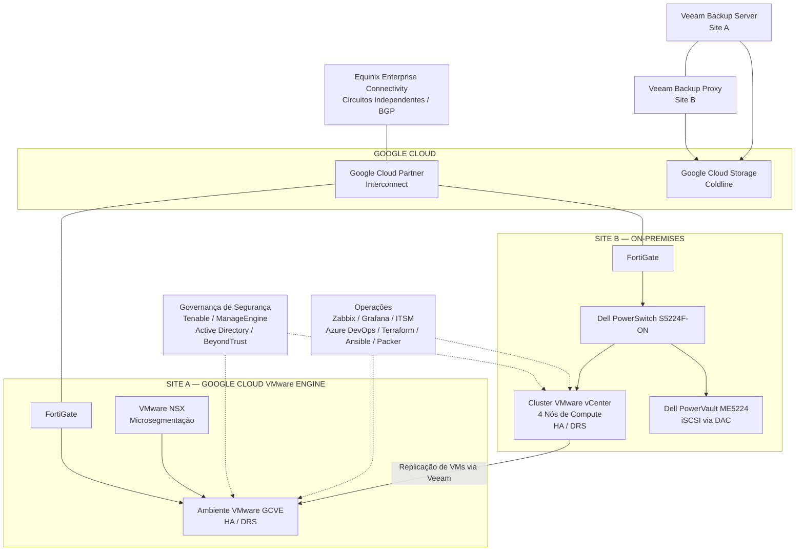

# Modernização dos Datacenters — Desafios, Soluções e Resultados

## 1. Resumo Executivo

Este estudo de caso apresenta uma transformação de infraestrutura corporativa envolvendo dois ambientes de datacenter com objetivos arquiteturais distintos.

A iniciativa integrou modernização de infraestrutura, correção de vulnerabilidades, hardening de segurança, migração de workloads, resiliência de rede, modernização de backup, Disaster Recovery, automação e governança operacional.

A transformação adotou duas estratégias distintas:

- **Site A:** Migração de toda a infraestrutura virtualizada para Google Cloud VMware Engine (GCVE), mantendo a infraestrutura de rede Layer 2 e Layer 3 no site físico original.
- **Site B:** Modernização do ambiente VMware on-premises, incluindo compute, storage, segmentação de rede e integração de Disaster Recovery com GCVE.

O projeto também fortaleceu os processos de segurança e operação por meio de gerenciamento centralizado de identidades, controles de acesso privilegiado, avaliação e remediação de vulnerabilidades, monitoramento da infraestrutura, abertura automatizada de incidentes e governança de mudanças.

Em vez de aplicar uma arquitetura única aos dois ambientes, foram adotadas soluções de acordo com os requisitos técnicos e a função operacional de cada site.

## 2. Contexto de Negócio

A organização precisava de uma estratégia de modernização capaz de atender a diversos objetivos interdependentes:

- Modernizar a infraestrutura existente dos datacenters.
- Tratar vulnerabilidades e aprimorar as configurações de segurança.
- Evoluir a arquitetura mantendo os requisitos de disponibilidade das aplicações de negócio.
- Estabelecer conectividade resiliente entre os ambientes corporativos e o Google Cloud.
- Aprimorar as capacidades de backup e Disaster Recovery.
- Padronizar os processos de provisionamento e configuração da infraestrutura.
- Fortalecer monitoramento, gestão de incidentes e governança operacional.
- Alinhar os objetivos de recuperação à criticidade das aplicações e ao impacto para o negócio.

A transformação foi, portanto, muito além de uma atualização de hardware ou virtualização. Ela envolveu arquitetura, segurança, conectividade, processos operacionais e continuidade de negócio.

## 3. Desafios da Transformação

O projeto exigiu atuação coordenada de engenharia em diferentes domínios da infraestrutura.

### 3.1 Modernização da infraestrutura

Os dois sites precisavam de abordagens diferentes. O Site A seria migrado para GCVE, enquanto o Site B manteria uma arquitetura on-premises, recebendo uma nova estrutura de compute, storage e rede.

### 3.2 Remediação de vulnerabilidades e hardening

A modernização precisava ser acompanhada de atividades de correção de vulnerabilidades e hardening de configurações em ambientes de virtualização, sistemas operacionais, equipamentos de rede, storages, servidores físicos e máquinas virtuais.

### 3.3 Migração de workloads e compatibilidade

A migração do Site A exigiu a transição dos workloads para GCVE, incluindo atividades de migração VMware, práticas de Lift and Shift e modernização de aplicações quando necessária.

### 3.4 Resiliência de rede e conectividade com a nuvem

A arquitetura precisava oferecer conectividade confiável entre os sites corporativos e o Google Cloud, utilizando circuitos físicos independentes, caminhos redundantes e roteamento dinâmico.

### 3.5 Continuidade de negócio e recuperação

As capacidades de backup e Disaster Recovery precisavam atender a diferentes requisitos de recuperação conforme a criticidade dos workloads, incluindo a replicação das máquinas virtuais do Site B para GCVE.

### 3.6 Padronização operacional

A transformação também exigiu processos repetíveis de provisionamento, gerenciamento de configuração, monitoramento, tratamento de incidentes, gestão de mudanças e documentação técnica.

## 4. Estratégia de Segurança e Remediação de Vulnerabilidades

A remediação de segurança foi tratada como uma frente contínua durante o processo de modernização da infraestrutura.

### 4.1 Fluxo de avaliação e remediação de vulnerabilidades

A organização utilizava **Tenable** para avaliação de vulnerabilidades e **ManageEngine** como ferramenta de apoio à distribuição de patches e às atividades de remediação.

O fluxo operacional contemplava:

1. A equipe de Segurança gerava relatórios de vulnerabilidades.
2. Os apontamentos eram classificados por severidade: Critical, High, Medium e Low.
3. Os prazos de correção eram estabelecidos de acordo com a criticidade.
4. As equipes de Infraestrutura realizavam as correções necessárias utilizando ManageEngine ou procedimentos técnicos específicos.
5. Novos scans eram executados no Tenable para validar as remediações.

Esse processo estabeleceu um mecanismo repetível para identificar, priorizar, corrigir e validar vulnerabilidades na infraestrutura.

### 4.2 Hardening da infraestrutura

As atividades de hardening contemplavam:

- VMware ESXi e vCenter.
- Sistemas operacionais Windows Server e Linux.
- Switches, firewalls e roteadores.
- Storages Dell.
- Servidores físicos e máquinas virtuais.

As referências utilizadas para configuração segura incluíam CIS Benchmarks, políticas internas de segurança, recomendações dos fabricantes e procedimentos técnicos estabelecidos.

### 4.3 Gestão de identidades e acessos privilegiados

O gerenciamento centralizado de identidades era realizado pelo Active Directory, com utilização de grupos de segurança e controle de acesso baseado em funções (RBAC).

Os controles de acesso administrativo incluíam:

- Contas nominais para administradores.
- Autenticação multifator (MFA).
- Separação entre contas privilegiadas e contas de uso cotidiano.
- Acesso administrativo por meio de solução de Privileged Access Management (PAM).
- Hierarquia de segurança administrativa dividida em níveis 0, 1 e 2.

A solução **BeyondTrust** apoiava a governança de acessos privilegiados por meio de cofre de senhas, gravação e auditoria de sessões, aprovação de acessos, rotação automática de senhas, acesso remoto controlado e restrições de duração e horário das sessões.

> **Distinção importante:** os níveis administrativos 0, 1 e 2 representam limites de segurança para acessos privilegiados. Eles são diferentes dos níveis de serviço 0, 1, 2 e 3, utilizados para representar a criticidade de negócio e os requisitos de recuperação dos workloads.

### 4.4 Governança de mudanças

As alterações de infraestrutura e segurança seguiam um processo controlado de Change Management, incluindo:

- Abertura de Request for Change (RFC).
- Análise de impacto e riscos.
- Aprovação dos gestores e/ou Change Advisory Board (CAB).
- Definição de janelas de manutenção.
- Planejamento de rollback.
- Validação após a implementação.

## 5. Modernização da Infraestrutura dos Dois Sites

O projeto estabeleceu duas arquiteturas complementares.

| Domínio | Site A | Site B |
|---|---|---|
| Modelo de infraestrutura | Google Cloud VMware Engine | VMware on-premises |
| Estratégia de workloads | Migração para GCVE | Permanência e modernização local |
| Virtualização | VMware no GCVE | Cluster VMware vCenter |
| Segurança de rede | FortiGate e VMware NSX | Segmentação baseada em FortiGate |
| Microsegmentação | VMware NSX | Políticas de segurança FortiGate e segmentação por VLAN |
| Papel no Disaster Recovery | GCVE hospeda os workloads migrados e recebe réplicas do Site B | Ambiente de origem da replicação de VMs para GCVE |

Ambos os ambientes utilizavam VMware High Availability (HA) e Distributed Resource Scheduler (DRS).

## 6. Site A — Migração para Google Cloud VMware Engine

O Site A passou por uma migração integral de sua infraestrutura virtualizada para Google Cloud VMware Engine.

A estratégia de migração contemplou atividades de VMware Export/Import, RackWare e práticas de Lift and Shift, de acordo com os requisitos dos workloads.

Também foi considerada a modernização de aplicações quando necessária, incluindo a correção de vulnerabilidades dos sistemas operacionais e a atualização de aplicações para versões mais recentes.

### 6.1 Arquitetura de destino

A arquitetura resultante transferiu os workloads virtualizados para GCVE, mantendo a infraestrutura de rede Layer 2 e Layer 3 no site físico original.

Os principais componentes incluíam:

- Google Cloud VMware Engine.
- VMware HA e DRS.
- VMware NSX para microsegmentação.
- FortiGate para conectividade com a Internet e com Google Cloud/GCVE.
- Infraestrutura de rede Layer 2 e Layer 3 existente no site físico.

### 6.2 Considerações de engenharia

A migração exigiu coordenação entre a transição dos workloads, conectividade de rede, controles de segurança e requisitos das aplicações.

A abordagem combinou migração de infraestrutura com remediação de segurança e evolução do ciclo de vida das aplicações, evitando tratar a transferência dos workloads como uma atividade isolada.

## 7. Site B — Modernização da Infraestrutura On-Premises

O Site B manteve seu modelo de infraestrutura on-premises, mas recebeu uma arquitetura modernizada de compute, storage e rede.

### 7.1 Compute e virtualização

O ambiente utilizava um cluster VMware gerenciado pelo vCenter, composto por quatro nós de compute e memória, configurados com VMware HA e DRS.

### 7.2 Arquitetura de storage

A estrutura de armazenamento contemplava:

- Storage block Dell PowerVault ME5224.
- Conectividade iSCSI.
- Cabeamento Direct Attach Copper (DAC) entre o storage e a infraestrutura de rede.

### 7.3 Arquitetura de rede e segmentação

O desenho de rede incluía:

- Dell PowerSwitch S5224F-ON.
- Firewalls FortiGate.
- Segmentação baseada em VLANs.
- Roteamento Layer 3 e aplicação de controles de segurança pelo FortiGate.

Diferentemente do Site A, que utilizava VMware NSX para microsegmentação, o Site B utilizava segmentação de rede e controles de segurança Layer 3 baseados em FortiGate.

### 7.4 Integração com Disaster Recovery

As máquinas virtuais do Site B eram replicadas para GCVE por meio do Veeam Backup & Replication, estabelecendo um destino de recuperação externo ao ambiente on-premises.

## 8. Conectividade Resiliente

A conectividade entre a infraestrutura corporativa e o Google Cloud foi projetada com base em caminhos físicos independentes e componentes de rede redundantes.

A arquitetura contemplava:

- Equinix Enterprise Connectivity.
- Google Cloud Partner Interconnect.
- Dois circuitos independentes utilizando localidades físicas distintas.
- Equipamentos e caminhos de rede redundantes.
- BGP para roteamento dinâmico.
- Firewalls FortiGate nos dois sites.

O FortiGate fornecia conectividade com a Internet e com o Google Cloud em ambos os ambientes. No Site A, também suportava a conectividade com GCVE.

Esse desenho estabeleceu uma base de conectividade resiliente, sem dependência de um único circuito físico ou caminho de rede.

## 9. Backup e Disaster Recovery

A arquitetura de backup e recuperação utilizava **Veeam Backup & Replication v12**.

O ambiente combinava infraestrutura local de backup, armazenamento em nuvem por meio de Capacity Tier e replicação de máquinas virtuais.

### 9.1 Arquitetura de backup

A topologia documentada incluía:

- Veeam Backup Server no Site A.
- Backup Proxy no Site B.
- Repositórios locais de backup (hot repositories).
- Scale-Out Backup Repository (SOBR) com Capacity Tier.
- Google Cloud Storage Coldline como camada de armazenamento em nuvem.

O Capacity Tier era utilizado para movimentar os dados de backup para o Google Cloud Storage Coldline como parte da estratégia de armazenamento.

### 9.2 Replicação e recuperação

As máquinas virtuais do Site B eram replicadas para GCVE por meio do Veeam, estabelecendo um destino de recuperação externo ao ambiente de origem.

Os objetivos de recuperação eram definidos conforme a criticidade dos workloads:

- Tier 0.
- Tier 1.
- Tier 2.
- Tier 3.

Esses níveis representavam o impacto para o negócio e os requisitos de recuperação, incluindo aplicações com impacto financeiro.

### 9.3 Validação de recuperação

Os testes de recuperação contemplavam Instant VM Recovery e Full VM Restore.

Durante o procedimento documentado de validação com Instant VM Recovery:

1. A máquina virtual original era desligada.
2. Uma instância separada de recuperação era restaurada ao lado da VM original.
3. Era atribuído um Display Name diferente no cluster VMware.
4. A máquina virtual original era preservada para evitar sobrescrita durante a validação.
5. Eram executadas verificações técnicas e funcionais.

As validações incluíam inicialização e integridade do sistema operacional, conectividade de rede, comunicação entre servidores, serviços das aplicações, conectividade com bancos de dados e testes funcionais realizados pelos usuários ou responsáveis pelas aplicações.

Os testes de restauração eram realizados semestralmente. Uma simulação de indisponibilidade total do Site B era realizada anualmente. No Site A, eram executados testes de restauração de VMs e aplicações individuais, sem simulação de indisponibilidade total do site.

Os resultados eram registrados em planilhas anuais de controle em Excel, acompanhados por evidências técnicas, chamados das equipes de Infraestrutura e Cloud, registros de Change Management e validação formal do negócio.

## 10. Automação e Governança Operacional

A automação e a governança de infraestrutura apoiaram a consistência operacional dos ambientes modernizados.

### 10.1 Infrastructure as Code e automação de configuração

O conjunto de ferramentas de automação incluía:

- **Terraform:** provisionamento de recursos em Google Cloud, VMware e ambientes on-premises.
- **Ansible:** configuração de servidores, instalação de softwares e atividades de configuração.
- **Packer:** geração de imagens de servidores.
- **Azure DevOps:** execução de pipelines automatizados para Terraform, Ansible e Packer.
- **PowerShell:** automação de Windows Server e Active Directory.
- **Bash:** administração e automação de ambientes Linux.
- Automação de rotinas de backup.

### 10.2 Monitoramento e gestão de incidentes

A arquitetura de monitoramento incluía:

- Zabbix.
- Grafana.
- Recursos nativos de monitoramento dos fabricantes de infraestrutura, incluindo Dell, VMware e Fortinet.

O monitoramento contemplava compute, memória, capacidade e latência de storage, hosts e máquinas virtuais VMware, equipamentos e links de rede, serviços, aplicações e bancos de dados.

Os alertas eram integrados à interface do ITSM e ao Microsoft Teams. Os incidentes podiam ser abertos automaticamente e classificados para atendimento pela equipe de Infraestrutura.

O tratamento de incidentes contemplava níveis de severidade e prioridade 0, 1, 2 e 3, escalonamento de acordo com o impacto e SLAs definidos para atendimento e resolução.

### 10.3 Planejamento de capacidade e documentação

O planejamento anual de capacidade considerava crescimento de compute e memória dos clusters VMware, utilização de storage, volumes de backup, necessidades de expansão e tendências da infraestrutura.

A documentação técnica incluía diagramas de arquitetura e topologia, inventário de servidores e VMs, informações de rede, VLANs, endereçamento IP, regras de firewall, procedimentos operacionais, runbooks de recuperação e registros de configuração e mudanças.

## 11. Abordagem de Implementação e Validação

A transformação reuniu frentes de arquitetura, migração, segurança e operação.

A abordagem de implementação e validação contemplou:

1. **Definição de arquitetura:** estabelecimento dos modelos de destino distintos para Site A e Site B.
2. **Avaliação de segurança:** identificação e priorização de vulnerabilidades por meio dos relatórios do Tenable.
3. **Remediação e hardening:** aplicação de patches e alterações de configuração utilizando procedimentos aprovados.
4. **Modernização da infraestrutura:** migração dos workloads do Site A para GCVE e modernização da infraestrutura on-premises do Site B.
5. **Integração de rede:** implementação de conectividade resiliente e segmentação de segurança específica para cada site.
6. **Integração de backup e recuperação:** manutenção das capacidades de backup local, Capacity Tier em nuvem e replicação do Site B para GCVE.
7. **Automação e integração operacional:** aplicação de Infrastructure as Code, automação de configuração, monitoramento e fluxos de incidentes.
8. **Validação e governança:** execução de verificações técnicas e funcionais, documentação de evidências e cumprimento dos procedimentos de Change Management.

A validação era baseada em verificações técnicas, exercícios de recuperação, novos scans de vulnerabilidade, monitoramento operacional e testes das aplicações de negócio, quando aplicáveis.

## 12. Resultados Técnicos e de Negócio Consolidados

A transformação estabeleceu os seguintes resultados arquiteturais e operacionais:

### Infraestrutura e arquitetura

- Migração da infraestrutura virtualizada do Site A para Google Cloud VMware Engine.
- Manutenção e modernização do Site B como ambiente VMware on-premises.
- Estabelecimento de modelos de infraestrutura distintos conforme a função de cada site.
- Manutenção das capacidades de VMware HA e DRS nos dois ambientes.

### Segurança

- Estabelecimento de um fluxo estruturado de remediação de vulnerabilidades utilizando Tenable e ManageEngine.
- Aplicação de hardening em plataformas de virtualização, sistemas operacionais, rede, storage e servidores.
- Fortalecimento da governança de acessos privilegiados por meio de Active Directory, MFA, RBAC e BeyondTrust PAM.
- Reforço dos processos de controle de mudanças e validação de segurança.

### Conectividade e resiliência

- Estabelecimento de conectividade por meio de Equinix Enterprise Connectivity e Google Cloud Partner Interconnect.
- Implementação de circuitos físicos independentes, caminhos redundantes e roteamento BGP.
- Aplicação de segmentação de segurança conforme a arquitetura de cada site.

### Backup e continuidade de negócio

- Implementação da arquitetura Veeam v12 com SOBR Capacity Tier e Google Cloud Storage Coldline.
- Estabelecimento da replicação das máquinas virtuais do Site B para GCVE.
- Formalização de procedimentos de testes de recuperação e validação pelo negócio.
- Alinhamento do planejamento de recuperação aos níveis de serviço dos workloads e ao impacto para o negócio.

### Operações e automação

- Padronização do provisionamento e da automação de configuração utilizando Terraform, Ansible e Packer.
- Integração de pipelines automatizados por meio do Azure DevOps.
- Estabelecimento de monitoramento e fluxos automatizados de abertura de incidentes.
- Fortalecimento do planejamento de capacidade, documentação e governança de mudanças.

De forma consolidada, a iniciativa estabeleceu uma arquitetura modernizada de infraestrutura distribuída em dois sites, apoiada por processos de remediação de segurança, conectividade resiliente, capacidades de recuperação e operações de infraestrutura mais estruturadas.

## 13. Visão Geral da Arquitetura

O diagrama conceitual abaixo resume a arquitetura resultante. Ele representa os principais relacionamentos entre os componentes de infraestrutura, não o cabeamento físico, o roteamento detalhado ou a localização exata dos repositórios.

## 14. Escopo e Limitações das Evidências

Este estudo de caso documenta a arquitetura, as tecnologias, os processos e os resultados confirmados para a transformação.

Os detalhes abaixo não foram quantificados ou especificados porque não foram estabelecidos nas informações utilizadas para este documento:

- Quantidade exata de servidores, máquinas virtuais e workloads.
- Largura de banda dos circuitos, endereços IP, identificadores de VLAN e números de sistemas autônomos BGP.
- Identificadores específicos de vulnerabilidades, CVEs e percentuais de remediação.
- Tempo de indisponibilidade durante migrações ou melhorias mensuradas de performance das aplicações.
- Valores exatos de RPO e RTO para cada workload.
- Períodos de retenção de backup e agendamentos detalhados dos jobs.
- Economia financeira ou melhorias operacionais expressas em percentuais.

O documento, portanto, prioriza mudanças arquiteturais e operacionais verificáveis, sem apresentar alegações quantitativas sem evidências.

---

**Domínios técnicos:** Modernização de Datacenters | Google Cloud VMware Engine | VMware | Arquitetura de Redes | Fortinet | VMware NSX | Dell PowerEdge / PowerVault | Veeam Backup & Replication | Disaster Recovery | Gestão de Vulnerabilidades | Segurança de Infraestrutura | Terraform | Ansible | Packer | Azure DevOps | Zabbix | Grafana | ITSM
