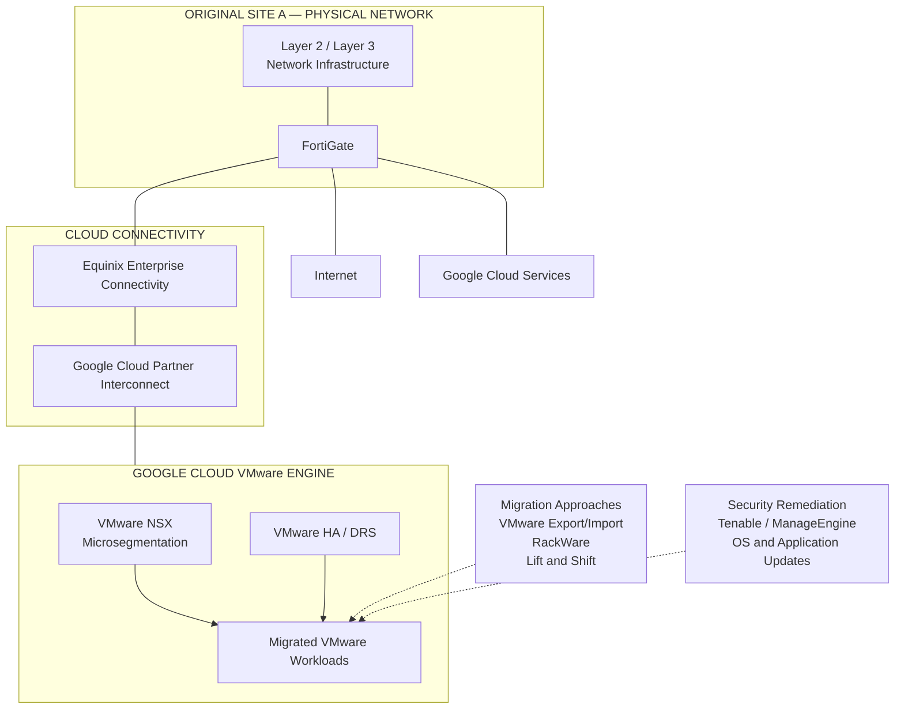

# Site A Migration Challenges — VMware to Google Cloud VMware Engine

## 1. Executive Summary

This case study documents the migration of Site A's virtualized infrastructure to Google Cloud VMware Engine (GCVE).

The initiative involved relocating the virtualized workloads from the original datacenter environment to a VMware-based cloud platform while retaining the existing Layer 2 and Layer 3 network infrastructure at the original physical site.

The migration was part of a broader infrastructure transformation that combined workload relocation, security remediation, application lifecycle improvements, network integration, and operational governance.

The migration strategy incorporated VMware Export/Import activities, RackWare, and Lift and Shift practices according to workload requirements.

The target environment used VMware capabilities such as High Availability (HA) and Distributed Resource Scheduler (DRS), with VMware NSX providing microsegmentation and FortiGate supporting Internet and Google Cloud/GCVE connectivity.

The result was a different infrastructure operating model: virtualized workloads were hosted in GCVE, while the original physical site retained its Layer 2 and Layer 3 network responsibilities.

## 2. Business and Technical Context

Site A was part of a two-site infrastructure transformation.

The architectural objective was to migrate the virtualized infrastructure to GCVE while maintaining the required network connectivity and security controls.

The project needed to address several interconnected requirements:

- Transition existing VMware workloads to GCVE.
- Maintain connectivity between the original physical site, corporate networks, and the cloud environment.
- Preserve appropriate network security and segmentation.
- Address operating system vulnerabilities during the migration process.
- Upgrade applications to newer versions where required.
- Maintain VMware availability and resource-management capabilities.
- Integrate the migrated environment with the broader backup, monitoring, and operational governance strategy.

This required coordination across virtualization, networking, security, operating systems, applications, and cloud infrastructure.

## 3. Migration Challenges

### 3.1 Workload transition to a cloud VMware environment

The migration required the transition of existing virtualized workloads to GCVE.

The process needed to account for the different technical requirements of individual workloads and the migration methods applicable to each scenario.

### 3.2 Network architecture continuity

A key architectural constraint was that the original physical site would retain its Layer 2 and Layer 3 network infrastructure after the virtualized infrastructure had moved to GCVE.

This required the cloud VMware environment to be integrated with the existing network architecture rather than treating the migration as an isolated workload relocation.

### 3.3 Security remediation during migration

The migration was also an opportunity to address operating system vulnerabilities and improve the security posture of the workloads.

Vulnerability remediation and operating system upgrades needed to be considered alongside workload transition activities.

### 3.4 Network segmentation and security

The target environment required security segmentation appropriate to a cloud-hosted VMware environment.

VMware NSX was used for microsegmentation, while FortiGate supported connectivity with the Internet and Google Cloud/GCVE.

### 3.5 Operational continuity

The migration needed to preserve the operational capabilities expected from a VMware environment, including HA and DRS, while aligning the new platform with the organization's monitoring, backup, and change management processes.

## 4. Migration Strategy

The migration strategy combined different approaches according to workload requirements.

The techniques used included:

- VMware Export/Import activities.
- RackWare.
- Lift and Shift migration practices.

These approaches formed the migration toolkit for transitioning workloads from the original environment to GCVE.

The migration was not treated as a single generic operation. Workload requirements and the applicable migration approach were considered as part of the transition.

### 4.1 Migration principles

The migration strategy followed these principles:

1. Transition the virtualized infrastructure to GCVE.
2. Preserve the original site's Layer 2 and Layer 3 network responsibilities.
3. Integrate the target environment with the existing corporate connectivity architecture.
4. Apply the required security controls to the migrated workloads.
5. Address operating system vulnerabilities and application version requirements.
6. Maintain VMware HA and DRS capabilities in the target environment.
7. Validate the migrated environment through the applicable technical and operational procedures.

## 5. Target Architecture

The target architecture moved the virtualized workloads to GCVE while retaining the physical site's Layer 2 and Layer 3 infrastructure.

### 5.1 Google Cloud VMware Engine

GCVE became the hosting platform for the migrated virtualized infrastructure.

The environment retained VMware operational capabilities, including:

- VMware High Availability (HA).
- VMware Distributed Resource Scheduler (DRS).

These capabilities supported the availability and resource-management model of the VMware environment.

### 5.2 Network responsibilities

The original physical site retained Layer 2 and Layer 3 network infrastructure.

This distinction was central to the resulting architecture: workload hosting moved to GCVE, but the original site continued to provide its network-layer responsibilities.

### 5.3 Security architecture

The security architecture included two complementary components:

- **VMware NSX:** microsegmentation within the VMware environment.
- **FortiGate:** Internet and Google Cloud/GCVE connectivity.

This allowed the target environment to combine workload-level segmentation with the existing network security architecture.

## 6. Network Integration and Connectivity

The Site A migration depended on integration with the organization's wider network connectivity design.

The connectivity architecture included:

- FortiGate at Site A.
- Equinix Enterprise Connectivity.
- Google Cloud Partner Interconnect.
- Independent physical circuits.
- Redundant network paths and equipment.
- BGP dynamic routing.

The original site's network infrastructure remained relevant after workload migration because Layer 2 and Layer 3 responsibilities were retained locally.

The FortiGate platform supported Internet and Google Cloud connectivity, including connectivity to GCVE.

This architecture connected the migrated VMware environment with the existing corporate network and cloud connectivity model.

## 7. Security Remediation and Application Modernization

The migration included security and application lifecycle activities.

Operating system vulnerabilities were addressed as part of the broader transformation, and applications were upgraded to newer versions where required.

The vulnerability management process used:

- **Tenable** for vulnerability assessment.
- **ManageEngine** to support patch deployment and remediation activities.
- New Tenable scans to validate remediation.

Security hardening was guided by CIS Benchmarks, internal security policies, vendor recommendations, and established technical procedures.

The approach combined infrastructure migration with security improvements rather than simply relocating existing workloads without reviewing their security requirements.

## 8. VMware Availability and Resource Management

The target VMware environment used:

- VMware High Availability (HA).
- VMware Distributed Resource Scheduler (DRS).

These capabilities were part of the target platform's operational architecture.

Their presence supported the expected VMware availability and resource-management functions after migration.

This case study does not assign specific availability percentages, failover times, or resource utilization improvements because those measurements were not established in the project information.

## 9. Migration Validation and Operational Integration

The migrated environment needed to align with the organization's established operational controls.

The broader operational framework included:

- Infrastructure monitoring through Zabbix and Grafana.
- Native monitoring capabilities from infrastructure vendors.
- Incident integration with the ITSM platform and Microsoft Teams.
- Change Management procedures.
- Backup and recovery processes using Veeam.
- Technical documentation and operational procedures.

Validation activities were governed by applicable technical checks and operational procedures.

The wider backup and recovery strategy included restoration tests for individual Site A virtual machines and applications. Site A did not use a full-site unavailability simulation as part of the documented recovery testing approach.

## 10. Engineering Decisions

The main architectural decisions can be summarized as follows.

| Decision | Rationale |
|---|---|
| Move all virtualized infrastructure to GCVE | Establish GCVE as the hosting platform for Site A workloads |
| Retain Layer 2 and Layer 3 at the original physical site | Preserve the site's existing network-layer responsibilities |
| Use VMware NSX for microsegmentation | Apply workload-level security segmentation in the VMware environment |
| Use FortiGate for Internet and cloud connectivity | Maintain network security and connectivity controls |
| Combine VMware Export/Import, RackWare, and Lift and Shift | Support workload transition using different migration approaches |
| Include vulnerability remediation and application upgrades | Address security and lifecycle requirements during modernization |
| Maintain VMware HA and DRS | Preserve VMware availability and resource-management capabilities |

## 11. High-Level Migration Architecture

The following conceptual diagram illustrates the target architecture and the main network relationships. It does not represent physical cabling, detailed routing, or exact network configuration.

## 12. Technical and Operational Outcomes

The Site A migration established the following outcomes:

### Infrastructure architecture

- Migrated the virtualized infrastructure from the original datacenter to GCVE.
- Established GCVE as the VMware workload hosting platform.
- Retained Layer 2 and Layer 3 network infrastructure at the original physical site.
- Maintained VMware HA and DRS capabilities.

### Network and security

- Integrated the target environment with the corporate connectivity architecture.
- Used Equinix Enterprise Connectivity and Google Cloud Partner Interconnect.
- Maintained FortiGate connectivity and security controls.
- Applied VMware NSX microsegmentation.

### Security and application lifecycle

- Integrated operating system vulnerability remediation into the modernization effort.
- Supported application upgrades to newer versions where required.
- Used Tenable and ManageEngine as part of the vulnerability remediation workflow.

### Operations

- Aligned the migrated environment with existing monitoring and ITSM processes.
- Integrated the target architecture with the organization's backup and recovery strategy.
- Retained technical and operational governance practices.

The migration therefore represented an architectural transformation of Site A, moving its virtualized workloads to GCVE while retaining selected network responsibilities at the original physical location.

## 13. Scope and Evidence Limitations

This case study documents the confirmed Site A migration architecture, migration approaches, security activities, and operational integration.

The following information is intentionally not specified because it was not established in the available project information:

- Exact number of migrated virtual machines or applications.
- Exact migration schedule and workload migration sequence.
- Migration downtime or application outage duration.
- Exact GCVE node count, cluster capacity, and resource utilization.
- Detailed IP addressing, VLAN identifiers, BGP configuration, and bandwidth.
- Detailed VMware NSX policy definitions.
- Measured performance improvements or financial savings.
- Quantified migration success rates.

The document focuses on the confirmed architectural decisions and engineering activities without introducing unsupported migration metrics or operational claims.

---

**Technical domains:** Google Cloud VMware Engine | VMware Migration | VMware Export/Import | RackWare | Lift and Shift | VMware HA | VMware DRS | VMware NSX | Fortinet FortiGate | Equinix Enterprise Connectivity | Google Cloud Partner Interconnect | BGP | Vulnerability Remediation | Infrastructure Modernization
