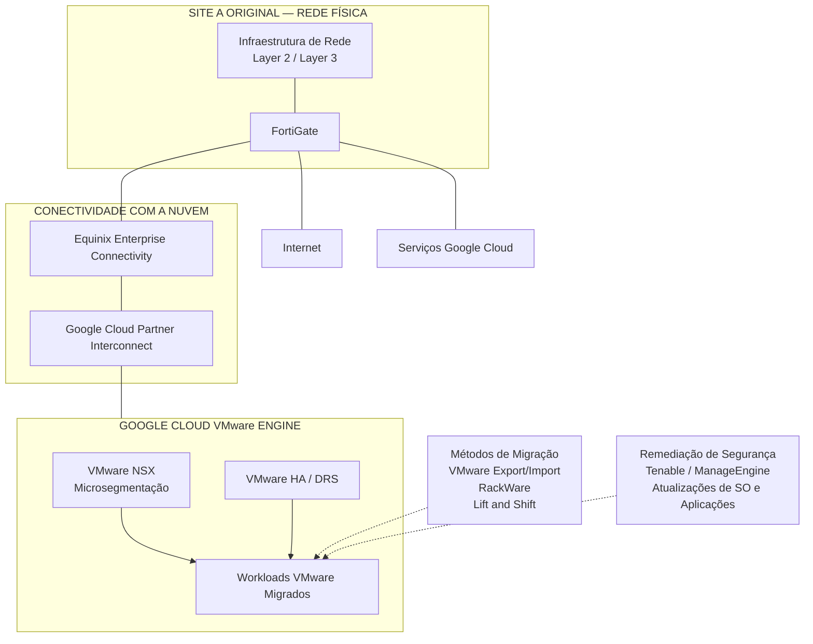

# Desafios da Migração do Site A — VMware para Google Cloud VMware Engine

## 1. Resumo Executivo

Este estudo de caso documenta a migração da infraestrutura virtualizada do Site A para Google Cloud VMware Engine (GCVE).

A iniciativa envolveu a transferência dos workloads virtualizados do datacenter original para uma plataforma VMware em nuvem, mantendo a infraestrutura de rede Layer 2 e Layer 3 no site físico original.

A migração fez parte de uma transformação mais ampla da infraestrutura, combinando transferência de workloads, remediação de segurança, atualização do ciclo de vida das aplicações, integração de rede e governança operacional.

A estratégia de migração contemplou atividades de VMware Export/Import, RackWare e práticas de Lift and Shift, conforme os requisitos dos workloads.

O ambiente de destino utilizou recursos VMware como High Availability (HA) e Distributed Resource Scheduler (DRS), com VMware NSX para microsegmentação e FortiGate para conectividade com a Internet e Google Cloud/GCVE.

O resultado foi um modelo operacional de infraestrutura diferente: os workloads virtualizados passaram a ser hospedados no GCVE, enquanto o site físico original manteve as responsabilidades de rede Layer 2 e Layer 3.

## 2. Contexto de Negócio e Técnico

O Site A fazia parte de uma transformação de infraestrutura envolvendo dois datacenters.

O objetivo arquitetural era migrar a infraestrutura virtualizada para GCVE, mantendo os requisitos necessários de conectividade de rede e controles de segurança.

O projeto precisava atender a diversos requisitos interdependentes:

- Transferir os workloads VMware existentes para GCVE.
- Manter a conectividade entre o site físico original, as redes corporativas e o ambiente em nuvem.
- Preservar os controles adequados de segurança e segmentação de rede.
- Tratar vulnerabilidades dos sistemas operacionais durante o processo de migração.
- Atualizar aplicações para versões mais recentes quando necessário.
- Manter as capacidades de disponibilidade e gerenciamento de recursos VMware.
- Integrar o ambiente migrado à estratégia corporativa de backup, monitoramento e governança operacional.

Isso exigiu coordenação entre virtualização, redes, segurança, sistemas operacionais, aplicações e infraestrutura em nuvem.

## 3. Desafios da Migração

### 3.1 Transição dos workloads para um ambiente VMware em nuvem

A migração exigiu a transferência dos workloads virtualizados existentes para GCVE.

O processo precisava considerar os diferentes requisitos técnicos de cada workload e os métodos de migração aplicáveis a cada cenário.

### 3.2 Continuidade da arquitetura de rede

Uma decisão arquitetural importante foi manter a infraestrutura física de rede Layer 2 e Layer 3 no site original mesmo após a migração da infraestrutura virtualizada.

Isso exigiu integrar o ambiente VMware em nuvem à arquitetura de rede existente, em vez de tratar a migração como uma simples transferência isolada de workloads.

### 3.3 Remediação de segurança durante a migração

A migração também representou uma oportunidade para tratar vulnerabilidades dos sistemas operacionais e aprimorar a postura de segurança dos workloads.

As atividades de remediação de vulnerabilidades e atualização dos sistemas operacionais precisavam ser consideradas em conjunto com a transição dos workloads.

### 3.4 Segmentação e segurança de rede

O ambiente de destino exigia controles de segmentação de segurança adequados a uma infraestrutura VMware hospedada em nuvem.

O VMware NSX foi utilizado para microsegmentação, enquanto o FortiGate suportava a conectividade com a Internet e com Google Cloud/GCVE.

### 3.5 Continuidade operacional

A migração precisava preservar as capacidades operacionais esperadas de um ambiente VMware, incluindo HA e DRS, além de alinhar a nova plataforma aos processos corporativos de monitoramento, backup e gestão de mudanças.

## 4. Estratégia de Migração

A estratégia combinou diferentes abordagens conforme os requisitos dos workloads.

As técnicas utilizadas incluíam:

- Atividades de VMware Export/Import.
- RackWare.
- Práticas de migração Lift and Shift.

Essas abordagens compunham o conjunto de métodos utilizados para transferir os workloads do ambiente original para GCVE.

A migração não foi tratada como uma operação genérica única. Os requisitos dos workloads e a abordagem de migração aplicável eram considerados durante o processo de transição.

### 4.1 Princípios da migração

A estratégia de migração seguiu os seguintes princípios:

1. Transferir a infraestrutura virtualizada para GCVE.
2. Preservar as responsabilidades de rede Layer 2 e Layer 3 do site físico original.
3. Integrar o ambiente de destino à arquitetura corporativa de conectividade existente.
4. Aplicar os controles de segurança necessários aos workloads migrados.
5. Tratar vulnerabilidades dos sistemas operacionais e requisitos de versão das aplicações.
6. Manter as capacidades VMware HA e DRS no ambiente de destino.
7. Validar o ambiente migrado por meio dos procedimentos técnicos e operacionais aplicáveis.

## 5. Arquitetura de Destino

A arquitetura de destino transferiu os workloads virtualizados para GCVE, mantendo a infraestrutura Layer 2 e Layer 3 do site físico original.

### 5.1 Google Cloud VMware Engine

O GCVE passou a ser a plataforma de hospedagem da infraestrutura virtualizada migrada.

O ambiente manteve as capacidades operacionais VMware, incluindo:

- VMware High Availability (HA).
- VMware Distributed Resource Scheduler (DRS).

Esses recursos sustentavam o modelo de disponibilidade e gerenciamento de recursos do ambiente VMware.

### 5.2 Responsabilidades de rede

O site físico original manteve a infraestrutura de rede Layer 2 e Layer 3.

Essa separação foi fundamental para a arquitetura resultante: a hospedagem dos workloads foi transferida para GCVE, mas o site original continuou responsável por suas funções de rede.

### 5.3 Arquitetura de segurança

A arquitetura de segurança incluía dois componentes complementares:

- **VMware NSX:** microsegmentação dentro do ambiente VMware.
- **FortiGate:** conectividade com a Internet e com Google Cloud/GCVE.

Essa abordagem permitiu combinar segmentação no nível dos workloads com a arquitetura de segurança de rede existente.

## 6. Integração e Conectividade de Rede

A migração do Site A dependia da integração com a arquitetura corporativa de conectividade.

A arquitetura incluía:

- FortiGate no Site A.
- Equinix Enterprise Connectivity.
- Google Cloud Partner Interconnect.
- Circuitos físicos independentes.
- Caminhos de rede e equipamentos redundantes.
- Roteamento dinâmico BGP.

A infraestrutura de rede do site original continuou relevante após a migração dos workloads, pois as responsabilidades Layer 2 e Layer 3 foram mantidas localmente.

A plataforma FortiGate suportava a conectividade com a Internet e com o Google Cloud, incluindo o acesso ao GCVE.

Essa arquitetura conectava o ambiente VMware migrado ao modelo de rede corporativa e conectividade em nuvem já estabelecido.

## 7. Remediação de Segurança e Modernização de Aplicações

A migração também contemplou atividades de segurança e evolução do ciclo de vida das aplicações.

As vulnerabilidades dos sistemas operacionais eram tratadas como parte da transformação mais ampla, e as aplicações eram atualizadas para versões mais recentes quando necessário.

O processo de gestão de vulnerabilidades utilizava:

- **Tenable** para avaliação de vulnerabilidades.
- **ManageEngine** para apoiar a distribuição de patches e atividades de remediação.
- Novos scans no Tenable para validar as correções.

O hardening de segurança era orientado por CIS Benchmarks, políticas internas de segurança, recomendações dos fabricantes e procedimentos técnicos estabelecidos.

A abordagem combinou migração de infraestrutura com melhorias de segurança, em vez de simplesmente transferir os workloads existentes sem revisar seus requisitos de proteção.

## 8. Disponibilidade e Gerenciamento de Recursos VMware

O ambiente VMware de destino utilizava:

- VMware High Availability (HA).
- VMware Distributed Resource Scheduler (DRS).

Esses recursos faziam parte da arquitetura operacional da plataforma de destino.

Sua presença sustentava as funções esperadas de disponibilidade e gerenciamento de recursos do ambiente VMware após a migração.

Este estudo de caso não atribui percentuais específicos de disponibilidade, tempos de failover ou melhorias de utilização de recursos, pois essas medições não foram estabelecidas nas informações do projeto.

## 9. Validação da Migração e Integração Operacional

O ambiente migrado precisava estar alinhado aos controles operacionais já estabelecidos pela organização.

A estrutura operacional mais ampla incluía:

- Monitoramento de infraestrutura por meio de Zabbix e Grafana.
- Recursos nativos de monitoramento dos fabricantes.
- Integração de incidentes com a plataforma ITSM e Microsoft Teams.
- Procedimentos de Change Management.
- Processos de backup e recuperação utilizando Veeam.
- Documentação técnica e procedimentos operacionais.

As atividades de validação eram conduzidas conforme as verificações técnicas e os procedimentos operacionais aplicáveis.

A estratégia corporativa de backup e recuperação incluía testes de restauração de máquinas virtuais e aplicações individuais do Site A. O Site A não utilizava simulação de indisponibilidade total do site como parte da abordagem documentada de testes de recuperação.

## 10. Decisões de Engenharia

As principais decisões arquiteturais podem ser resumidas da seguinte forma:

| Decisão | Justificativa |
|---|---|
| Migrar toda a infraestrutura virtualizada para GCVE | Estabelecer GCVE como plataforma de hospedagem dos workloads do Site A |
| Manter Layer 2 e Layer 3 no site físico original | Preservar as responsabilidades de rede existentes no site |
| Utilizar VMware NSX para microsegmentação | Aplicar segmentação de segurança no nível dos workloads VMware |
| Utilizar FortiGate para conectividade com Internet e nuvem | Manter os controles de segurança e conectividade de rede |
| Combinar VMware Export/Import, RackWare e Lift and Shift | Suportar a transição dos workloads utilizando diferentes abordagens de migração |
| Incluir remediação de vulnerabilidades e atualização de aplicações | Atender aos requisitos de segurança e ciclo de vida durante a modernização |
| Manter VMware HA e DRS | Preservar as capacidades VMware de disponibilidade e gerenciamento de recursos |

## 11. Arquitetura de Migração — Alto Nível

O diagrama conceitual abaixo ilustra a arquitetura de destino e os principais relacionamentos de rede. Ele não representa o cabeamento físico, o roteamento detalhado ou as configurações exatas de rede.

## 12. Resultados Técnicos e Operacionais

A migração do Site A estabeleceu os seguintes resultados:

### Arquitetura de infraestrutura

- Migração da infraestrutura virtualizada do datacenter original para GCVE.
- Estabelecimento do GCVE como plataforma de hospedagem dos workloads VMware.
- Manutenção da infraestrutura de rede Layer 2 e Layer 3 no site físico original.
- Preservação das capacidades VMware HA e DRS.

### Rede e segurança

- Integração do ambiente de destino à arquitetura corporativa de conectividade.
- Utilização de Equinix Enterprise Connectivity e Google Cloud Partner Interconnect.
- Manutenção da conectividade e dos controles de segurança FortiGate.
- Aplicação de microsegmentação com VMware NSX.

### Segurança e ciclo de vida das aplicações

- Integração da remediação de vulnerabilidades dos sistemas operacionais ao projeto de modernização.
- Suporte à atualização das aplicações para versões mais recentes quando necessário.
- Utilização de Tenable e ManageEngine como parte do fluxo de remediação de vulnerabilidades.

### Operações

- Alinhamento do ambiente migrado aos processos existentes de monitoramento e ITSM.
- Integração da arquitetura de destino à estratégia corporativa de backup e recuperação.
- Manutenção das práticas de governança técnica e operacional.

A migração representou, portanto, uma transformação arquitetural do Site A, transferindo seus workloads virtualizados para GCVE e mantendo determinadas responsabilidades de rede na localização física original.

## 13. Escopo e Limitações das Evidências

Este estudo de caso documenta a arquitetura de migração do Site A, as abordagens utilizadas, as atividades de segurança e a integração operacional confirmadas.

As informações abaixo não foram especificadas porque não foram estabelecidas nas informações disponíveis do projeto:

- Quantidade exata de máquinas virtuais ou aplicações migradas.
- Cronograma exato e sequência de migração dos workloads.
- Tempo de indisponibilidade durante a migração ou duração de interrupções das aplicações.
- Quantidade exata de nós GCVE, capacidade do cluster e utilização de recursos.
- Endereçamento IP, identificadores de VLAN, configuração BGP e largura de banda detalhados.
- Definições detalhadas das políticas VMware NSX.
- Melhorias mensuradas de performance ou economia financeira.
- Taxas de sucesso da migração expressas quantitativamente.

O documento prioriza as decisões arquiteturais e atividades de engenharia confirmadas, sem introduzir métricas de migração ou alegações operacionais sem evidências.

---

**Domínios técnicos:** Google Cloud VMware Engine | Migração VMware | VMware Export/Import | RackWare | Lift and Shift | VMware HA | VMware DRS | VMware NSX | Fortinet FortiGate | Equinix Enterprise Connectivity | Google Cloud Partner Interconnect | BGP | Remediação de Vulnerabilidades | Modernização de Infraestrutura
