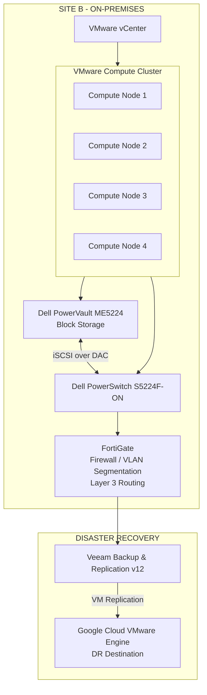

# Site B Infrastructure Modernization — On-Premises VMware, Compute, Storage & Network

## 1. Executive Summary

This case study describes the modernization of Site B's on-premises infrastructure, including its VMware virtualization environment, compute resources, block storage, network connectivity, security segmentation, and disaster recovery integration.

Unlike Site A, whose virtualized infrastructure was migrated to Google Cloud VMware Engine (GCVE), Site B was deliberately retained on-premises. Its architecture was modernized around a four-node VMware cluster, Dell PowerVault ME5224 block storage, Dell PowerSwitch S5224F-ON networking, and FortiGate-based network segmentation and Layer 3 routing.

The design also integrated Site B with the broader business continuity strategy through Veeam Backup & Replication v12, replicating virtual machines to GCVE as a disaster recovery destination.

## 2. Architecture Overview

The modernized Site B environment consists of the following components:

| Layer | Technology | Role |
|---|---|---|
| Virtualization management | VMware vCenter | Centralized management of the VMware environment |
| Compute | Four-node VMware cluster | Virtual machine execution and compute resources |
| Virtualization availability | VMware HA and DRS | Workload availability and resource balancing |
| Block storage | Dell PowerVault ME5224 | Shared block storage for the virtualization environment |
| Storage connectivity | iSCSI over DAC cabling | Connectivity between storage and network infrastructure |
| Network switching | Dell PowerSwitch S5224F-ON | Network connectivity for the infrastructure |
| Network security | FortiGate | Firewall policies, VLAN segmentation, and Layer 3 routing |
| Backup and replication | Veeam Backup & Replication v12 | Backup operations and replication to GCVE |
| Disaster recovery destination | Google Cloud VMware Engine | Recovery environment for replicated Site B workloads |

## 3. Conceptual Architecture Diagram

The following diagram represents the logical architecture based on the confirmed project information. It does not attempt to represent undocumented physical port assignments, VLAN IDs, IP addressing, or redundant-path configurations.

**Diagram note:** This is a conceptual representation of the infrastructure and its logical relationships. It should not be interpreted as a detailed physical network or storage connectivity diagram.

## 4. VMware Compute and Virtualization Layer

Site B retained an on-premises VMware virtualization architecture managed through VMware vCenter.

The compute environment was organized into a four-node cluster, providing the resources required to run the site's virtual machines.

The VMware platform used:

- **VMware vCenter:** Centralized administration and management.
- **VMware HA:** Virtual machine availability and recovery in the event of supported host failures.
- **VMware DRS:** Resource distribution and workload balancing across the cluster.

This architecture provided a centralized operational model for compute resource management and virtualization administration.

The four-node design was part of the infrastructure modernization strategy, maintaining the virtualization platform on-premises while aligning its operations with the broader infrastructure governance model.

## 5. Storage Architecture

The storage layer was based on the **Dell PowerVault ME5224**, operating as block storage for the VMware environment.

Connectivity between the storage infrastructure and the network switching layer used **iSCSI over DAC cabling**.

Key architectural elements:

- Dell PowerVault ME5224 block storage.
- iSCSI-based storage connectivity.
- DAC cabling for the confirmed storage connection.
- Integration with the VMware compute environment.

The available project information does not specify storage capacity, RAID configuration, datastore layout, multipathing policies, or detailed physical port assignments. These implementation details are therefore intentionally excluded.

## 6. Network Architecture and Segmentation

The Site B network architecture used the **Dell PowerSwitch S5224F-ON** as part of its switching infrastructure and **FortiGate** for network security and segmentation.

Unlike Site A, which used VMware NSX for microsegmentation, Site B implemented network segmentation through FortiGate.

The FortiGate responsibilities included:

- VLAN-based network segmentation.
- Layer 3 routing.
- Firewall policy enforcement.
- Network traffic control between defined network segments.

This approach provided network-level security controls and centralized routing and policy enforcement.

The distinction between the two sites was intentional:

| Architecture aspect | Site A | Site B |
|---|---|---|
| Infrastructure model | Migrated to GCVE | On-premises |
| Virtualization | GCVE VMware environment | VMware cluster managed by vCenter |
| Network segmentation | VMware NSX | FortiGate |
| Network security | FortiGate | FortiGate |
| Disaster recovery relationship | Part of the broader environment | Replication to GCVE |

## 7. Backup and Disaster Recovery Integration

Site B was integrated into the business continuity strategy through **Veeam Backup & Replication v12**.

Virtual machines running in Site B were replicated to Google Cloud VMware Engine, establishing GCVE as the disaster recovery destination for the workloads covered by the replication strategy.

The broader backup architecture included:

- Centralized Veeam Backup & Replication management.
- Veeam Backup Proxy participation in data processing and transport.
- Scale-out Backup Repository (SOBR) with Capacity Tier.
- Google Cloud Storage Coldline as the Capacity Tier storage target.
- Replication of Site B virtual machines to GCVE.

Backup and replication served complementary purposes: backup supported data protection and restore operations, while VM replication supported disaster recovery readiness.

Recovery objectives were defined according to workload criticality, using service tiers 0, 1, 2, and 3. Specific RPO and RTO values are not included in this case study because they varied by application and were not provided as fixed project-wide values.

## 8. Operational Governance and Automation

The Site B environment was operated within the broader infrastructure governance framework.

Relevant operational practices included:

- VMware infrastructure monitoring using Zabbix, Grafana, and native vendor monitoring capabilities.
- Incident creation and classification through integration with the ITSM platform and Microsoft Teams.
- Incident escalation according to impact and responsibility.
- Service-level agreements for incident response and resolution.
- Change Management with impact and risk analysis, approvals, maintenance windows, rollback planning, and post-change validation.
- Annual capacity planning covering compute, storage, and backup growth.
- Infrastructure configuration and provisioning automation using Terraform, Ansible, Packer, PowerShell, and Bash, according to the applicable platform and workload.

Security and access controls were also part of the operating model, including Active Directory, role-based access controls, MFA, BeyondTrust privileged access management, hardening practices, and vulnerability remediation workflows.

## 9. Key Technical Decisions

### Decision 1 — Retain Site B On-Premises

**Decision:** Maintain Site B's virtualization infrastructure on-premises rather than following Site A's migration path to GCVE.

**Rationale:** The project adopted different infrastructure models for the two sites. Site B retained its local compute and storage environment while integrating with GCVE for disaster recovery.

### Decision 2 — Use a Four-Node VMware Cluster

**Decision:** Organize the compute environment into a four-node VMware cluster managed by vCenter.

**Rationale:** Provide a centralized virtualization platform with VMware HA and DRS capabilities.

### Decision 3 — Deploy Dell PowerVault ME5224 Block Storage

**Decision:** Use Dell PowerVault ME5224 as the block storage platform.

**Rationale:** Provide the storage layer for the VMware environment, using iSCSI connectivity over DAC cabling.

### Decision 4 — Implement FortiGate-Based Network Segmentation

**Decision:** Use FortiGate for VLAN segmentation and Layer 3 routing instead of VMware NSX microsegmentation.

**Rationale:** Apply network-level segmentation and firewall policy enforcement through the existing FortiGate architecture.

### Decision 5 — Replicate Site B Workloads to GCVE

**Decision:** Use Veeam Backup & Replication v12 to replicate Site B virtual machines to GCVE.

**Rationale:** Integrate the on-premises environment with the organization's disaster recovery strategy.

## 10. Outcomes and Operational Value

The modernization established a structured on-premises infrastructure for Site B and integrated it with the broader enterprise infrastructure architecture.

Key outcomes included:

- A four-node VMware compute cluster managed through vCenter.
- VMware HA and DRS capabilities within the virtualization environment.
- Dell PowerVault ME5224 block storage integrated through iSCSI.
- Dell PowerSwitch S5224F-ON switching infrastructure.
- FortiGate-based VLAN segmentation and Layer 3 routing.
- Integration with Veeam Backup & Replication v12.
- Replication of Site B virtual machines to GCVE for disaster recovery.
- Alignment with enterprise monitoring, security, automation, and Change Management practices.

The resulting architecture maintained Site B's on-premises operational model while providing an integration path to the cloud-based disaster recovery environment.

## 11. Architecture Considerations and Documentation Boundaries

This case study intentionally documents only confirmed architectural decisions and technologies.

The following details require additional implementation evidence before they can be documented:

- Compute server manufacturer and model.
- Storage capacity and RAID configuration.
- Datastore design and storage allocation.
- iSCSI multipathing and detailed path topology.
- Switch port assignments and physical cabling layout.
- VLAN IDs, IP addressing, and routing details.
- Firewall rules and traffic-flow specifications.
- Measured recovery times and replication performance.

These boundaries preserve the technical accuracy and credibility of the architecture documentation.

## 12. Conclusion

Site B's modernization established a four-node VMware environment supported by Dell block storage and network infrastructure, with FortiGate providing network segmentation and Layer 3 routing.

Rather than replicating Site A's cloud migration approach, Site B retained its on-premises infrastructure and adopted a complementary disaster recovery model through Veeam replication to Google Cloud VMware Engine.

The result was a differentiated two-site architecture in which each site followed an infrastructure model aligned with its role in the overall environment.
