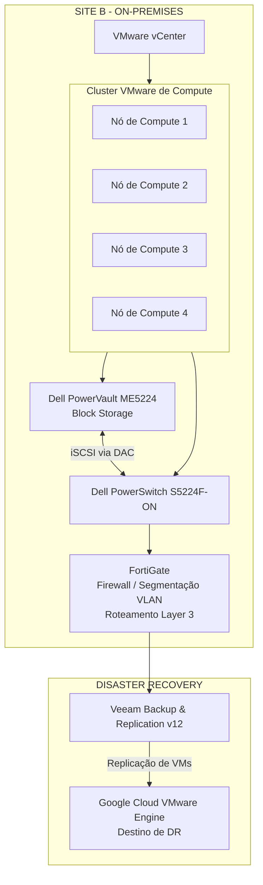

# Modernização da Infraestrutura do Site B — VMware On-Premises, Compute, Storage e Rede

## 1. Resumo Executivo

Este estudo de caso apresenta a modernização da infraestrutura on-premises do Site B, abrangendo seu ambiente de virtualização VMware, recursos computacionais, armazenamento em bloco, conectividade de rede, segmentação de segurança e integração com a estratégia de Disaster Recovery.

Diferentemente do Site A, cuja infraestrutura virtualizada foi migrada para o Google Cloud VMware Engine (GCVE), o Site B foi mantido deliberadamente em ambiente on-premises. Sua arquitetura foi modernizada com base em um cluster VMware de quatro nós, storage Dell PowerVault ME5224, switches Dell PowerSwitch S5224F-ON e segmentação de rede e roteamento Layer 3 realizados por meio de FortiGate.

A arquitetura também foi integrada à estratégia corporativa de continuidade de negócios por meio do Veeam Backup & Replication v12, replicando máquinas virtuais para o GCVE como destino de Disaster Recovery.

## 2. Visão Geral da Arquitetura

O ambiente modernizado do Site B é composto pelos seguintes elementos:

| Camada | Tecnologia | Responsabilidade |
|---|---|---|
| Gerenciamento de virtualização | VMware vCenter | Gerenciamento centralizado do ambiente VMware |
| Compute | Cluster VMware de quatro nós | Execução das máquinas virtuais e disponibilização de recursos computacionais |
| Alta disponibilidade e balanceamento | VMware HA e DRS | Disponibilidade das VMs e balanceamento de recursos |
| Storage em bloco | Dell PowerVault ME5224 | Armazenamento em bloco para o ambiente de virtualização |
| Conectividade de storage | iSCSI via cabos DAC | Conectividade entre o storage e a infraestrutura de rede |
| Switching | Dell PowerSwitch S5224F-ON | Conectividade de rede da infraestrutura |
| Segurança de rede | FortiGate | Políticas de firewall, segmentação por VLAN e roteamento Layer 3 |
| Backup e replicação | Veeam Backup & Replication v12 | Operações de backup e replicação para o GCVE |
| Destino de Disaster Recovery | Google Cloud VMware Engine | Ambiente de recuperação das cargas replicadas do Site B |

## 3. Diagrama Conceitual da Arquitetura

O diagrama abaixo representa a arquitetura lógica com base nas informações confirmadas do projeto. Ele não pretende representar atribuições físicas de portas, identificadores de VLAN, endereçamento IP ou configurações de caminhos redundantes que não foram documentadas.

**Observação sobre o diagrama:** trata-se de uma representação conceitual da infraestrutura e de seus relacionamentos lógicos. Não deve ser interpretado como um diagrama físico detalhado de rede ou conectividade de storage.

## 4. Camada de Compute e Virtualização VMware

O Site B manteve uma arquitetura de virtualização VMware on-premises, gerenciada centralmente por meio do VMware vCenter.

O ambiente computacional foi organizado em um cluster de quatro nós, disponibilizando os recursos necessários para a execução das máquinas virtuais do site.

A plataforma VMware utilizava:

- **VMware vCenter:** administração e gerenciamento centralizado.
- **VMware HA:** disponibilidade das máquinas virtuais e recuperação diante de falhas de hosts suportadas pela plataforma.
- **VMware DRS:** distribuição de recursos e balanceamento de workloads entre os nós do cluster.

Essa arquitetura proporcionou um modelo operacional centralizado para administração da virtualização e gerenciamento dos recursos computacionais.

O desenho de quatro nós fez parte da estratégia de modernização da infraestrutura, mantendo a plataforma de virtualização on-premises e alinhando sua operação ao modelo corporativo de governança de infraestrutura.

## 5. Arquitetura de Storage

A camada de armazenamento foi baseada no **Dell PowerVault ME5224**, utilizado como storage em bloco para o ambiente VMware.

A conectividade entre a infraestrutura de storage e a camada de switching utilizava **iSCSI por meio de cabeamento DAC**.

Principais elementos da arquitetura:

- Storage em bloco Dell PowerVault ME5224.
- Conectividade de armazenamento baseada em iSCSI.
- Cabeamento DAC para a conexão de storage confirmada.
- Integração com o ambiente de compute VMware.

As informações disponíveis do projeto não especificam capacidade de armazenamento, configuração de RAID, organização dos datastores, políticas de multipathing ou atribuições físicas detalhadas de portas. Esses detalhes foram intencionalmente excluídos.

## 6. Arquitetura de Rede e Segmentação

A arquitetura de rede do Site B utilizava o **Dell PowerSwitch S5224F-ON** como parte da infraestrutura de switching e o **FortiGate** para segurança, segmentação e roteamento de rede.

Diferentemente do Site A, que utilizava VMware NSX para microsegmentação, o Site B implementava a segmentação de rede por meio do FortiGate.

As responsabilidades do FortiGate incluíam:

- Segmentação de rede baseada em VLANs.
- Roteamento Layer 3.
- Aplicação de políticas de firewall.
- Controle do tráfego entre os segmentos de rede definidos.

Essa abordagem disponibilizou controles de segurança em nível de rede, com centralização das políticas e do roteamento.

A distinção entre os dois sites foi intencional:

| Aspecto da arquitetura | Site A | Site B |
|---|---|---|
| Modelo de infraestrutura | Migrado para GCVE | On-premises |
| Virtualização | Ambiente VMware no GCVE | Cluster VMware gerenciado pelo vCenter |
| Segmentação de rede | VMware NSX | FortiGate |
| Segurança de rede | FortiGate | FortiGate |
| Relação com Disaster Recovery | Parte do ambiente corporativo | Replicação para o GCVE |

## 7. Integração com Backup e Disaster Recovery

O Site B foi integrado à estratégia de continuidade de negócios por meio do **Veeam Backup & Replication v12**.

As máquinas virtuais executadas no Site B eram replicadas para o Google Cloud VMware Engine, estabelecendo o GCVE como destino de Disaster Recovery para as cargas de trabalho contempladas pela estratégia de replicação.

A arquitetura corporativa de backup incluía:

- Gerenciamento centralizado pelo Veeam Backup & Replication.
- Participação do Veeam Backup Proxy no processamento e transporte dos dados.
- Scale-out Backup Repository (SOBR) com Capacity Tier.
- Google Cloud Storage Coldline como destino do Capacity Tier.
- Replicação das máquinas virtuais do Site B para o GCVE.

Backup e replicação atendiam a objetivos complementares: o backup apoiava a proteção de dados e as operações de restauração, enquanto a replicação de VMs contribuía para a preparação do ambiente de Disaster Recovery.

Os objetivos de recuperação eram definidos conforme a criticidade das cargas de trabalho, utilizando os níveis de serviço 0, 1, 2 e 3. Valores específicos de RPO e RTO não são apresentados neste estudo porque variavam conforme a aplicação e não foram informados como valores fixos para todo o projeto.

## 8. Governança Operacional e Automação

O ambiente do Site B era operado dentro do modelo corporativo de governança de infraestrutura.

Entre as práticas operacionais relevantes estavam:

- Monitoramento da infraestrutura VMware com Zabbix, Grafana e recursos nativos dos fabricantes.
- Abertura e classificação de incidentes por meio da integração com a plataforma ITSM e o Microsoft Teams.
- Escalonamento de incidentes conforme impacto e responsabilidade.
- SLAs para atendimento e resolução de incidentes.
- Change Management com análise de impacto e risco, aprovações, janelas de manutenção, planejamento de rollback e validação pós-mudança.
- Planejamento anual de capacidade, contemplando crescimento de compute, storage e volumes de backup.
- Automação de provisionamento e configuração de infraestrutura com Terraform, Ansible, Packer, PowerShell e Bash, conforme a plataforma e a carga de trabalho.

Os controles de segurança e acesso também faziam parte do modelo operacional, incluindo Active Directory, controles de acesso baseados em funções, MFA, gerenciamento de acessos privilegiados com BeyondTrust, práticas de hardening e processos de remediação de vulnerabilidades.

## 9. Principais Decisões Técnicas

### Decisão 1 — Manter o Site B On-Premises

**Decisão:** manter a infraestrutura de virtualização do Site B on-premises, em vez de seguir o mesmo caminho de migração do Site A para o GCVE.

**Justificativa:** o projeto adotou modelos de infraestrutura diferentes para os dois sites. O Site B manteve seu ambiente local de compute e storage, enquanto foi integrado ao GCVE para Disaster Recovery.

### Decisão 2 — Utilizar um Cluster VMware de Quatro Nós

**Decisão:** organizar o ambiente computacional em um cluster VMware de quatro nós, gerenciado pelo vCenter.

**Justificativa:** disponibilizar uma plataforma centralizada de virtualização com os recursos de VMware HA e DRS.

### Decisão 3 — Implementar o Storage em Bloco Dell PowerVault ME5224

**Decisão:** utilizar o Dell PowerVault ME5224 como plataforma de armazenamento em bloco.

**Justificativa:** fornecer a camada de armazenamento para o ambiente VMware, utilizando conectividade iSCSI por meio de cabos DAC.

### Decisão 4 — Implementar Segmentação de Rede com FortiGate

**Decisão:** utilizar o FortiGate para segmentação por VLAN e roteamento Layer 3, em vez da microsegmentação VMware NSX.

**Justificativa:** aplicar segmentação em nível de rede e políticas de firewall por meio da arquitetura FortiGate existente.

### Decisão 5 — Replicar as Cargas do Site B para o GCVE

**Decisão:** utilizar o Veeam Backup & Replication v12 para replicar as máquinas virtuais do Site B para o GCVE.

**Justificativa:** integrar o ambiente on-premises à estratégia corporativa de Disaster Recovery.

## 10. Resultados e Benefícios Operacionais

A modernização estabeleceu uma infraestrutura on-premises estruturada para o Site B e integrou o ambiente à arquitetura corporativa de infraestrutura.

Os principais resultados incluíram:

- Cluster VMware de quatro nós gerenciado pelo vCenter.
- Recursos de VMware HA e DRS no ambiente de virtualização.
- Storage em bloco Dell PowerVault ME5224 integrado por iSCSI.
- Infraestrutura de switching Dell PowerSwitch S5224F-ON.
- Segmentação por VLAN e roteamento Layer 3 com FortiGate.
- Integração com Veeam Backup & Replication v12.
- Replicação das máquinas virtuais do Site B para o GCVE como destino de Disaster Recovery.
- Alinhamento com as práticas corporativas de monitoramento, segurança, automação e Change Management.

A arquitetura resultante manteve o modelo operacional on-premises do Site B, ao mesmo tempo que estabeleceu sua integração com o ambiente de Disaster Recovery baseado em nuvem.

## 11. Considerações de Arquitetura e Limites da Documentação

Este estudo documenta intencionalmente apenas as tecnologias e decisões arquiteturais confirmadas.

Os seguintes detalhes exigem evidências adicionais de implementação antes de serem documentados:

- Fabricante e modelo dos servidores de compute.
- Capacidade do storage e configuração de RAID.
- Desenho dos datastores e alocação de armazenamento.
- Multipathing iSCSI e topologia detalhada dos caminhos.
- Atribuições de portas dos switches e layout físico do cabeamento.
- Identificadores de VLAN, endereçamento IP e detalhes de roteamento.
- Regras de firewall e especificações dos fluxos de tráfego.
- Tempos de recuperação medidos e desempenho da replicação.

Esses limites preservam a precisão técnica e a credibilidade da documentação arquitetural.

## 12. Conclusão

A modernização do Site B estabeleceu um ambiente VMware de quatro nós, sustentado por storage em bloco Dell e infraestrutura de rede, com o FortiGate responsável pela segmentação e pelo roteamento Layer 3.

Em vez de replicar a estratégia de migração para nuvem utilizada no Site A, o Site B manteve sua infraestrutura on-premises e adotou um modelo complementar de Disaster Recovery por meio da replicação com Veeam para o Google Cloud VMware Engine.

O resultado foi uma arquitetura diferenciada entre os dois sites, na qual cada ambiente seguiu um modelo de infraestrutura alinhado à sua função no cenário corporativo.
