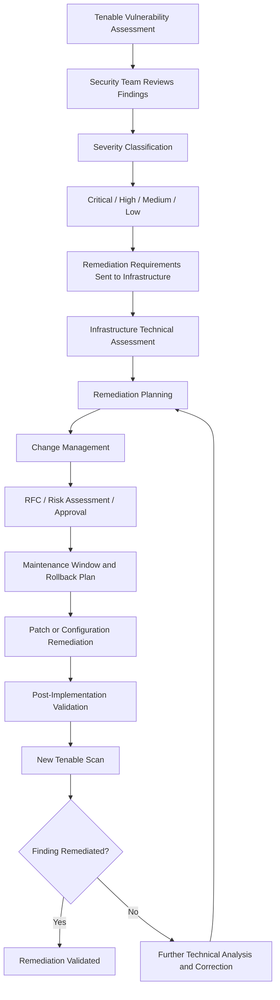

# Vulnerability Remediation — Security Assessment, Hardening & Validation

## 1. Executive Summary

This case study describes the vulnerability management and infrastructure security practices implemented as part of a broader corporate datacenter modernization initiative.

The objective was to establish a structured approach to identifying, prioritizing, remediating, and validating security findings across a heterogeneous infrastructure environment.

The process covered virtualization platforms, operating systems, network devices, storage systems, physical servers, and virtual machines. It combined vulnerability assessment, patch management, configuration hardening, privileged access governance, and controlled change management.

The main technologies and frameworks involved included:

- **Tenable:** infrastructure vulnerability assessment and validation.
- **ManageEngine:** support for patch deployment and remediation activities.
- **CIS Benchmarks:** security configuration reference.
- **Active Directory:** centralized identity management and security groups.
- **BeyondTrust:** Privileged Access Management (PAM).
- **MFA and RBAC:** additional identity and access security controls.
- **Change Management:** governance of infrastructure and security changes.

The resulting approach established a repeatable remediation workflow supported by severity classification, remediation deadlines, technical procedures, and subsequent vulnerability scans.

## 2. Business and Security Context

The datacenter modernization initiative involved significant changes to infrastructure architecture, workload placement, virtualization, network connectivity, and operational processes.

These changes also required security controls to be reviewed and reinforced across the infrastructure lifecycle.

The security workstream addressed several objectives:

- Identify infrastructure vulnerabilities through structured assessments.
- Prioritize findings according to severity.
- Coordinate remediation activities between Security and Infrastructure teams.
- Apply operating system patches and security configuration changes.
- Strengthen administrative identity and privileged access controls.
- Validate remediation through subsequent vulnerability scans.
- Govern changes through formal approval and implementation procedures.

Security remediation was therefore integrated into infrastructure modernization rather than treated as an isolated activity.

## 3. Infrastructure Scope

Vulnerability assessment and hardening activities covered multiple infrastructure layers.

| Infrastructure domain | Scope |
|---|---|
| Virtualization | VMware ESXi and vCenter |
| Operating systems | Windows Server and Linux |
| Network infrastructure | Switches, firewalls, and routers |
| Storage | Dell storage systems |
| Compute | Physical servers |
| Workloads | Virtual machines and hosted services |

The scope required coordination across different technology platforms, administrative teams, and maintenance procedures.

## 4. Vulnerability Assessment and Prioritization

**Tenable** was used to assess infrastructure vulnerabilities and generate findings for remediation.

The Security team provided vulnerability reports to the Infrastructure team. Findings were classified into four severity levels:

- Critical
- High
- Medium
- Low

Remediation deadlines were established according to the severity classification.

This approach supported prioritization and coordination between the teams responsible for identifying security findings and implementing the corresponding corrections.

### 4.1 Operational responsibilities

The workflow involved two primary operational responsibilities:

**Security team**
- Perform vulnerability assessment activities.
- Review and classify findings.
- Generate vulnerability reports.
- Communicate remediation requirements to Infrastructure.
- Execute or coordinate subsequent vulnerability scans to validate corrections.

**Infrastructure team**
- Review assigned findings.
- Evaluate the affected infrastructure components.
- Plan remediation activities.
- Apply patches or configuration corrections.
- Follow change procedures where applicable.
- Support technical validation and remediation evidence collection.

## 5. Vulnerability Remediation Workflow

The remediation process followed a structured lifecycle.

### 5.1 Identification

Vulnerability findings were identified through Tenable assessments.

The resulting reports provided the basis for determining which infrastructure components required remediation.

### 5.2 Classification and prioritization

Findings were classified as Critical, High, Medium, or Low.

The severity classification guided remediation prioritization and the corresponding correction deadlines.

### 5.3 Remediation planning

The Infrastructure team evaluated the affected components and determined the appropriate technical remediation procedure.

Depending on the finding, remediation could involve:

- Operating system patch installation.
- Software updates.
- Security configuration adjustments.
- Platform-specific technical corrections.
- Manufacturer-recommended procedures.

ManageEngine supported patch deployment and remediation activities where applicable. Other corrections could be performed through specific technical procedures.

### 5.4 Change implementation

Infrastructure changes followed the applicable Change Management process.

The process included:

1. Request for Change (RFC).
2. Impact and risk assessment.
3. Manager and/or Change Advisory Board (CAB) approval.
4. Maintenance window definition.
5. Rollback planning.
6. Implementation.
7. Post-implementation validation.

### 5.5 Remediation validation

After corrective actions were implemented, new Tenable scans were performed to validate remediation.

This verification step provided a feedback mechanism to assess whether the reported findings had been addressed.

### 5.6 Continuous improvement

The assessment and remediation cycle supported ongoing infrastructure security management by connecting vulnerability identification, prioritization, corrective action, and subsequent validation.

## 6. Infrastructure Hardening Strategy

In addition to vulnerability remediation, hardening activities were applied across infrastructure platforms.

The objective was to improve security configurations using recognized benchmarks, internal requirements, vendor recommendations, and established technical procedures.

### 6.1 Hardening references

Security configuration activities were based on:

- CIS Benchmarks.
- Internal security policies.
- Infrastructure vendor recommendations.
- Established technical procedures.

These references provided guidance for reviewing and improving configuration settings across the infrastructure environment.

### 6.2 Hardening scope

| Platform | Hardening scope |
|---|---|
| VMware ESXi | Hypervisor security configuration |
| VMware vCenter | Virtualization management security |
| Windows Server | Operating system security configuration |
| Linux | Operating system security configuration |
| Network devices | Switch, firewall, and router configuration |
| Dell storage | Storage platform security configuration |
| Physical servers | Server configuration and security controls |
| Virtual machines | Guest operating system and workload security |

Hardening was treated as a cross-platform activity, not limited to operating systems.

## 7. Identity and Access Management

Centralized identity management was provided through **Active Directory**.

The access model used security groups and Role-Based Access Control (RBAC) to support controlled access to infrastructure resources.

Administrative access controls included:

- Named administrator accounts.
- Multi-factor authentication (MFA).
- Separation of privileged and everyday user accounts.
- Controlled administrative access through PAM.
- Administrative security tiers 0, 1, and 2.

### 7.1 Administrative security tiers

The administrative hierarchy used three security levels:

- **Tier 0:** highest-level administrative security boundary.
- **Tier 1:** administrative access for infrastructure and server environments.
- **Tier 2:** administrative access for user and workstation-related environments.

These tiers represent administrative access boundaries and must not be confused with the workload service tiers used for business criticality and recovery objectives.

The separation helped organize privileged access according to the administrative scope and sensitivity of the managed environment.

## 8. Privileged Access Management — BeyondTrust

**BeyondTrust** was used as the Privileged Access Management solution.

The platform supported centralized control and auditing of privileged administrative activities.

Implemented capabilities included:

- Password Vault.
- Administrative session recording.
- Session auditing.
- Privileged access approval.
- Automatic password rotation.
- Controlled remote access to servers and infrastructure devices.
- Session duration restrictions.
- Access schedule restrictions.

Administrative access to infrastructure was performed through the PAM solution, supporting a more controlled and auditable access model.

These controls complemented Active Directory, MFA, and RBAC by adding governance over privileged credentials and administrative sessions.

## 9. Security Governance and Change Management

Vulnerability remediation and infrastructure hardening required controlled implementation procedures.

Change Management provided the governance framework for planned infrastructure and security modifications.

The process included:

| Control | Purpose |
|---|---|
| Request for Change (RFC) | Formally document the proposed change |
| Impact and risk assessment | Evaluate potential operational and technical effects |
| Manager and/or CAB approval | Establish authorization before implementation |
| Maintenance window | Define the approved implementation period |
| Rollback plan | Prepare a recovery path if the change fails |
| Post-implementation validation | Confirm the expected technical behavior |

This process supported coordination between security requirements and infrastructure operational constraints.

## 10. Roles and Operational Responsibilities

The vulnerability management workflow required cooperation between Security and Infrastructure teams.

| Activity | Security | Infrastructure |
|---|---|---|
| Vulnerability assessment | Responsible | Supports as required |
| Finding classification | Responsible | Reviews assigned findings |
| Vulnerability reporting | Responsible | Receives reports |
| Remediation planning | Coordinates requirements | Responsible for technical planning |
| Patch and configuration changes | Provides security requirements | Responsible for implementation |
| Change governance | Participates as applicable | Follows approved procedures |
| Validation scans | Responsible for scan execution or coordination | Supports remediation verification |
| Technical evidence | Reviews findings | Supports evidence collection |

This division of responsibilities connected security assessment with practical infrastructure remediation.

## 11. End-to-End Remediation Workflow

The following diagram represents the operational lifecycle.

## 12. Technical and Operational Outcomes

The vulnerability remediation and hardening practices established several security and operational improvements.

### Vulnerability management

- Structured vulnerability assessment using Tenable.
- Severity-based classification of findings.
- Remediation deadlines aligned with severity.
- Coordination between Security and Infrastructure teams.
- Patch and correction activities supported by ManageEngine and technical procedures.
- Subsequent vulnerability scans to validate remediation.

### Infrastructure hardening

- Security configuration activities across virtualization, operating systems, network, storage, physical servers, and virtual machines.
- Use of CIS Benchmarks, internal policies, vendor recommendations, and technical procedures as configuration references.
- Integration of hardening activities with infrastructure modernization.

### Identity and privileged access

- Centralized identity management through Active Directory.
- Security groups and RBAC.
- MFA for administrative access.
- Separation of privileged and everyday accounts.
- Administrative security tiers 0, 1, and 2.
- BeyondTrust-based privileged access control and auditing.

### Operational governance

- Formal RFC-based change procedures.
- Impact and risk assessment.
- Approval processes involving managers and/or CAB.
- Maintenance windows and rollback planning.
- Post-implementation validation.

Overall, these practices established a more structured approach to infrastructure security management, connecting vulnerability assessment, remediation, access governance, and change control.

## 13. Evidence and Scope Limitations

This case study documents the security processes, technologies, and controls confirmed for the infrastructure transformation.

The following details are intentionally not specified because they were not established in the available project information:

- Specific CVE identifiers or vulnerability names.
- Exact numbers of findings or affected infrastructure assets.
- Vulnerability remediation percentages.
- Exact remediation deadlines for each severity.
- Specific patch deployment schedules.
- Detailed BeyondTrust policy configurations.
- Exact Active Directory organizational unit or group structures.
- Security incident counts or breach history.
- Quantified risk reduction or compliance scores.

The document therefore focuses on the confirmed remediation workflow, security controls, and operational governance without making unsupported claims about vulnerability elimination or measured security outcomes.

---

**Technical domains:** Vulnerability Management | Tenable | ManageEngine | Infrastructure Hardening | CIS Benchmarks | Active Directory | RBAC | MFA | BeyondTrust PAM | Privileged Access Management | Change Management | VMware | Windows Server | Linux | Network Security | Storage Security
