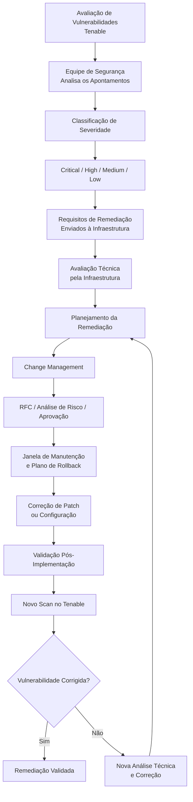

# Remediação de Vulnerabilidades — Avaliação de Segurança, Hardening e Validação

## 1. Resumo Executivo

Este estudo de caso apresenta as práticas de gestão de vulnerabilidades e segurança de infraestrutura implementadas como parte de uma iniciativa mais ampla de modernização dos datacenters corporativos.

O objetivo era estabelecer uma abordagem estruturada para identificar, priorizar, corrigir e validar apontamentos de segurança em um ambiente de infraestrutura heterogêneo.

O processo abrangia plataformas de virtualização, sistemas operacionais, equipamentos de rede, storages, servidores físicos e máquinas virtuais. A estratégia combinava avaliação de vulnerabilidades, gerenciamento de patches, hardening de configurações, governança de acessos privilegiados e gestão controlada de mudanças.

As principais tecnologias e referências utilizadas incluíam:

- **Tenable:** avaliação e validação de vulnerabilidades da infraestrutura.
- **ManageEngine:** apoio à distribuição de patches e às atividades de remediação.
- **CIS Benchmarks:** referência para configurações seguras.
- **Active Directory:** gerenciamento centralizado de identidades e grupos de segurança.
- **BeyondTrust:** solução de Privileged Access Management (PAM).
- **MFA e RBAC:** controles adicionais de segurança de identidade e acesso.
- **Change Management:** governança das alterações de infraestrutura e segurança.

A abordagem estabeleceu um fluxo de remediação repetível, sustentado por classificação de severidade, prazos de correção, procedimentos técnicos e novos scans de vulnerabilidade.

## 2. Contexto de Negócio e Segurança

A iniciativa de modernização dos datacenters envolveu mudanças significativas na arquitetura de infraestrutura, posicionamento de workloads, virtualização, conectividade de rede e processos operacionais.

Essas mudanças também exigiram revisão e fortalecimento dos controles de segurança durante todo o ciclo de vida da infraestrutura.

A frente de segurança contemplava os seguintes objetivos:

- Identificar vulnerabilidades de infraestrutura por meio de avaliações estruturadas.
- Priorizar os apontamentos conforme sua severidade.
- Coordenar as atividades de remediação entre as equipes de Segurança e Infraestrutura.
- Aplicar patches de sistemas operacionais e correções de configurações de segurança.
- Fortalecer os controles de identidade administrativa e acesso privilegiado.
- Validar as correções por meio de novos scans de vulnerabilidade.
- Governar as mudanças utilizando procedimentos formais de aprovação e implementação.

A remediação de segurança foi, portanto, integrada à modernização da infraestrutura, em vez de ser tratada como uma atividade isolada.

## 3. Escopo da Infraestrutura

As atividades de avaliação de vulnerabilidades e hardening abrangiam diferentes camadas da infraestrutura.

| Domínio de infraestrutura | Escopo |
|---|---|
| Virtualização | VMware ESXi e vCenter |
| Sistemas operacionais | Windows Server e Linux |
| Infraestrutura de rede | Switches, firewalls e roteadores |
| Storage | Sistemas de armazenamento Dell |
| Compute | Servidores físicos |
| Workloads | Máquinas virtuais e serviços hospedados |

O escopo exigia coordenação entre diferentes plataformas tecnológicas, equipes administrativas e procedimentos de manutenção.

## 4. Avaliação e Priorização de Vulnerabilidades

O **Tenable** era utilizado para avaliar vulnerabilidades da infraestrutura e gerar os apontamentos que precisavam ser tratados.

A equipe de Segurança encaminhava os relatórios de vulnerabilidades para a equipe de Infraestrutura. Os apontamentos eram classificados em quatro níveis de severidade:

- Critical
- High
- Medium
- Low

Os prazos de remediação eram estabelecidos de acordo com a classificação de severidade.

Essa abordagem permitia priorizar as correções e coordenar o trabalho entre as equipes responsáveis por identificar os apontamentos de segurança e implementar as respectivas soluções.

### 4.1 Responsabilidades operacionais

O fluxo envolvia duas responsabilidades operacionais principais:

**Equipe de Segurança**
- Realizar as atividades de avaliação de vulnerabilidades.
- Analisar e classificar os apontamentos.
- Gerar relatórios de vulnerabilidades.
- Comunicar os requisitos de remediação à Infraestrutura.
- Executar ou coordenar novos scans para validar as correções.

**Equipe de Infraestrutura**
- Analisar os apontamentos recebidos.
- Avaliar os componentes de infraestrutura afetados.
- Planejar as atividades de remediação.
- Aplicar patches ou correções de configuração.
- Seguir os procedimentos de mudança aplicáveis.
- Apoiar a validação técnica e a coleta de evidências de remediação.

## 5. Fluxo de Remediação de Vulnerabilidades

O processo de remediação seguia um ciclo estruturado.

### 5.1 Identificação

Os apontamentos de vulnerabilidades eram identificados por meio das avaliações realizadas pelo Tenable.

Os relatórios gerados forneciam a base para determinar quais componentes da infraestrutura precisavam de correção.

### 5.2 Classificação e priorização

Os apontamentos eram classificados como Critical, High, Medium ou Low.

A classificação de severidade orientava a priorização das atividades de remediação e os respectivos prazos de correção.

### 5.3 Planejamento da remediação

A equipe de Infraestrutura avaliava os componentes afetados e determinava o procedimento técnico mais adequado para a correção.

Dependendo do apontamento, a remediação poderia envolver:

- Instalação de patches de sistemas operacionais.
- Atualização de softwares.
- Ajustes de configurações de segurança.
- Correções técnicas específicas de cada plataforma.
- Procedimentos recomendados pelos fabricantes.

O ManageEngine apoiava a distribuição de patches e as atividades de remediação quando aplicável. Outras correções poderiam ser executadas por meio de procedimentos técnicos específicos.

### 5.4 Implementação das mudanças

As alterações de infraestrutura seguiam o processo aplicável de Change Management.

O processo incluía:

1. Abertura de Request for Change (RFC).
2. Análise de impacto e riscos.
3. Aprovação dos gestores e/ou Change Advisory Board (CAB).
4. Definição da janela de manutenção.
5. Planejamento de rollback.
6. Implementação.
7. Validação após a implementação.

### 5.5 Validação da remediação

Após a implementação das ações corretivas, novos scans eram realizados no Tenable para validar as remediações.

Essa etapa de verificação permitia avaliar se os apontamentos identificados anteriormente haviam sido tratados.

### 5.6 Melhoria contínua

O ciclo de avaliação e remediação apoiava a gestão contínua de segurança da infraestrutura, conectando identificação de vulnerabilidades, priorização, ações corretivas e validação posterior.

## 6. Estratégia de Hardening da Infraestrutura

Além da remediação de vulnerabilidades, eram realizadas atividades de hardening nas plataformas de infraestrutura.

O objetivo era aprimorar as configurações de segurança utilizando benchmarks reconhecidos, requisitos internos, recomendações dos fabricantes e procedimentos técnicos estabelecidos.

### 6.1 Referências de hardening

As atividades de configuração segura eram baseadas em:

- CIS Benchmarks.
- Políticas internas de segurança.
- Recomendações dos fabricantes de infraestrutura.
- Procedimentos técnicos estabelecidos.

Essas referências forneciam orientações para revisar e aprimorar as configurações do ambiente de infraestrutura.

### 6.2 Escopo de hardening

| Plataforma | Escopo de hardening |
|---|---|
| VMware ESXi | Configurações de segurança do hypervisor |
| VMware vCenter | Segurança da plataforma de gerenciamento de virtualização |
| Windows Server | Configurações de segurança do sistema operacional |
| Linux | Configurações de segurança do sistema operacional |
| Equipamentos de rede | Configurações de switches, firewalls e roteadores |
| Storage Dell | Configurações de segurança das plataformas de armazenamento |
| Servidores físicos | Configurações e controles de segurança dos servidores |
| Máquinas virtuais | Segurança dos sistemas operacionais convidados e workloads |

O hardening era tratado como uma atividade transversal, não limitada aos sistemas operacionais.

## 7. Gestão de Identidade e Acesso

O gerenciamento centralizado de identidades era realizado por meio do **Active Directory**.

O modelo de acesso utilizava grupos de segurança e Role-Based Access Control (RBAC) para permitir o controle de acesso aos recursos de infraestrutura.

Os controles de acesso administrativo incluíam:

- Contas nominais para administradores.
- Autenticação multifator (MFA).
- Separação entre contas privilegiadas e contas de uso cotidiano.
- Acesso administrativo controlado por meio de PAM.
- Níveis administrativos de segurança 0, 1 e 2.

### 7.1 Níveis administrativos de segurança

A hierarquia administrativa utilizava três níveis de segurança:

- **Tier 0:** nível mais elevado de segurança administrativa.
- **Tier 1:** acessos administrativos aos ambientes de infraestrutura e servidores.
- **Tier 2:** acessos administrativos relacionados aos ambientes de usuários e estações de trabalho.

Esses níveis representam limites de acesso administrativo e não devem ser confundidos com os níveis de serviço dos workloads, utilizados para definir criticidade de negócio e objetivos de recuperação.

Essa separação ajudava a organizar os acessos privilegiados de acordo com o escopo administrativo e a sensibilidade do ambiente gerenciado.

## 8. Privileged Access Management — BeyondTrust

A solução **BeyondTrust** era utilizada como plataforma de Privileged Access Management.

A ferramenta apoiava o controle centralizado e a auditoria das atividades administrativas privilegiadas.

As funcionalidades implementadas incluíam:

- Password Vault.
- Gravação de sessões administrativas.
- Auditoria de sessões.
- Aprovação de acessos privilegiados.
- Rotação automática de senhas.
- Acesso remoto controlado a servidores e equipamentos de infraestrutura.
- Restrições de duração das sessões.
- Restrições de horários de acesso.

O acesso administrativo à infraestrutura era realizado por meio da solução PAM, contribuindo para um modelo de acesso mais controlado e auditável.

Esses controles complementavam o Active Directory, o MFA e o RBAC, adicionando governança sobre credenciais privilegiadas e sessões administrativas.

## 9. Governança de Segurança e Change Management

As atividades de remediação de vulnerabilidades e hardening exigiam procedimentos controlados de implementação.

O Change Management fornecia a estrutura de governança para as alterações planejadas de infraestrutura e segurança.

O processo incluía:

| Controle | Objetivo |
|---|---|
| Request for Change (RFC) | Documentar formalmente a alteração proposta |
| Análise de impacto e riscos | Avaliar possíveis efeitos operacionais e técnicos |
| Aprovação dos gestores e/ou CAB | Estabelecer autorização antes da implementação |
| Janela de manutenção | Definir o período aprovado para implementação |
| Plano de rollback | Preparar um caminho de recuperação caso a alteração falhe |
| Validação pós-implementação | Confirmar o comportamento técnico esperado |

Esse processo apoiava a coordenação entre os requisitos de segurança e as restrições operacionais da infraestrutura.

## 10. Papéis e Responsabilidades Operacionais

O fluxo de gestão de vulnerabilidades exigia colaboração entre as equipes de Segurança e Infraestrutura.

| Atividade | Segurança | Infraestrutura |
|---|---|---|
| Avaliação de vulnerabilidades | Responsável | Apoio quando necessário |
| Classificação dos apontamentos | Responsável | Analisa os apontamentos recebidos |
| Relatórios de vulnerabilidades | Responsável | Recebe os relatórios |
| Planejamento da remediação | Coordena os requisitos | Responsável pelo planejamento técnico |
| Correções de patches e configurações | Fornece requisitos de segurança | Responsável pela implementação |
| Governança de mudanças | Participa quando aplicável | Segue os procedimentos aprovados |
| Scans de validação | Responsável pela execução ou coordenação | Apoia a verificação das correções |
| Evidências técnicas | Analisa os apontamentos | Apoia a coleta de evidências |

Essa divisão de responsabilidades conectava a avaliação de segurança à remediação prática da infraestrutura.

## 11. Fluxo Completo de Remediação

O diagrama abaixo representa o ciclo operacional de gestão de vulnerabilidades.

## 12. Resultados Técnicos e Operacionais

As práticas de remediação e hardening estabeleceram melhorias nos processos de segurança e operação da infraestrutura.

### Gestão de vulnerabilidades

- Avaliação estruturada de vulnerabilidades utilizando Tenable.
- Classificação dos apontamentos por severidade.
- Prazos de remediação alinhados à criticidade.
- Coordenação entre as equipes de Segurança e Infraestrutura.
- Atividades de correção e aplicação de patches apoiadas pelo ManageEngine e por procedimentos técnicos.
- Novos scans de vulnerabilidade para validação das remediações.

### Hardening da infraestrutura

- Atividades de configuração segura em virtualização, sistemas operacionais, rede, storage, servidores físicos e máquinas virtuais.
- Utilização de CIS Benchmarks, políticas internas, recomendações dos fabricantes e procedimentos técnicos como referências de configuração.
- Integração das atividades de hardening ao processo de modernização da infraestrutura.

### Identidade e acessos privilegiados

- Gerenciamento centralizado de identidades por meio do Active Directory.
- Grupos de segurança e RBAC.
- MFA para acessos administrativos.
- Separação entre contas privilegiadas e contas de uso cotidiano.
- Níveis administrativos de segurança 0, 1 e 2.
- Controle e auditoria de acessos privilegiados por meio do BeyondTrust.

### Governança operacional

- Procedimentos formais de mudanças baseados em RFC.
- Análise de impacto e riscos.
- Processos de aprovação envolvendo gestores e/ou CAB.
- Janelas de manutenção e planejamento de rollback.
- Validação pós-implementação.

De forma consolidada, essas práticas estabeleceram uma abordagem mais estruturada para a gestão de segurança da infraestrutura, conectando avaliação de vulnerabilidades, remediação, governança de acessos e controle de mudanças.

## 13. Evidências e Limitações do Escopo

Este estudo de caso documenta os processos de segurança, tecnologias e controles confirmados para a transformação da infraestrutura.

Os detalhes abaixo não foram especificados porque não foram estabelecidos nas informações disponíveis do projeto:

- Identificadores CVE ou nomes específicos de vulnerabilidades.
- Quantidade exata de apontamentos ou ativos afetados.
- Percentuais de remediação de vulnerabilidades.
- Prazos exatos de correção para cada severidade.
- Agendamentos detalhados de distribuição de patches.
- Configurações específicas das políticas do BeyondTrust.
- Estrutura detalhada de OUs ou grupos do Active Directory.
- Quantidade de incidentes de segurança ou histórico de violações.
- Redução de risco ou índices de conformidade quantificados.

O documento prioriza, portanto, o fluxo de remediação confirmado, os controles de segurança e a governança operacional, sem apresentar alegações não comprovadas sobre eliminação de vulnerabilidades ou resultados quantitativos de segurança.

---

**Domínios técnicos:** Gestão de Vulnerabilidades | Tenable | ManageEngine | Hardening de Infraestrutura | CIS Benchmarks | Active Directory | RBAC | MFA | BeyondTrust PAM | Privileged Access Management | Change Management | VMware | Windows Server | Linux | Segurança de Redes | Segurança de Storage
